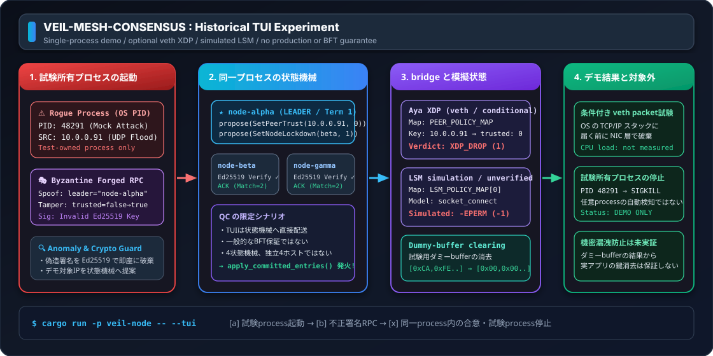
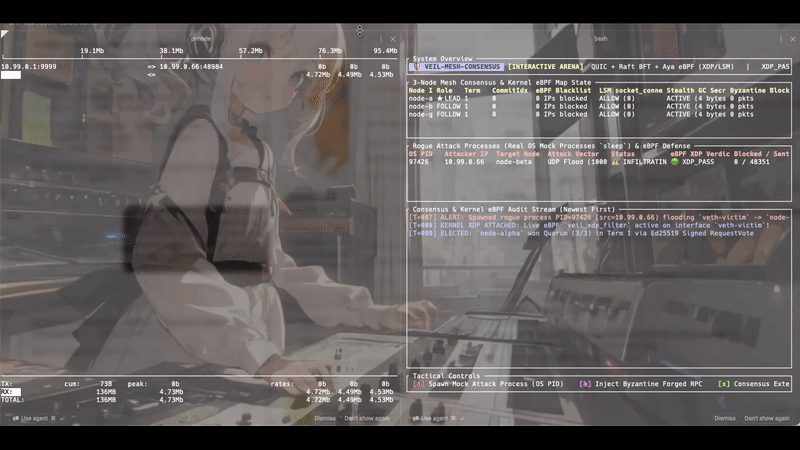
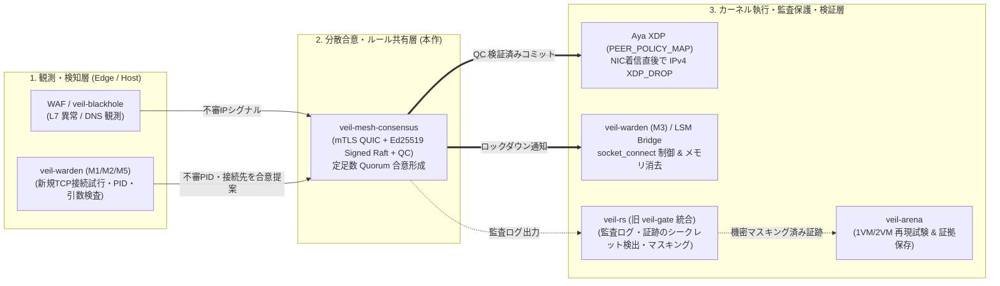

# 🛡️ veil-mesh-consensus

[](https://github.com/mt4110/veil-mesh-consensus/actions/workflows/ci.yml)
[](LICENSE)
[](https://github.com/mt4110/veil-mesh-consensus/releases)

[English](README_EN.md) · [☁️ クラウド導入ガイド (AWS/GCP/Azure/CF/Vercel)](docs/CLOUD_DEPLOYMENT_GUIDE.md) · [🧪 11大証明解説書](docs/CONSENSUS_AND_EBPF_PROOF.md) · [🔒 Security](docs/../SECURITY.md) · [🤝 Contributing](docs/../CONTRIBUTING.md)

**QUIC (`Tokio` + `quinn` mTLS) 上の署名付き Raft 系合意形成（Ed25519 `SignedConsensusRpc` + マルチシグ `QuorumCertificate`）で決定した遮断ルールを、Linux カーネル空間の eBPF (`Aya` XDP パケットフィルタ) およびユーザー空間 LSM ブリッジへ反映する実験的プロトタイプです。**



---

## 🎬 実機デモ画面（`iftop` 帯域監視 ＆ 実カーネル XDP + TUI 連動）

<!-- rgc:start -->

<!-- rgc:end -->

> **🎥 上記 GIF デモ（`[a]` $\to$ `[b]` $\to$ `[x]` 操作）で行われている処理**
>
> - **左画面 (`sudo iftop -i veth-victim`)**: 実機 Linux (`pi-node`: Kernel 7.0 x86_64) の NIC 着信トラフィックをリアルタイム監視。
> - **右画面 (`veil-node --tui`)**: カーネルの `veth-victim` に実 eBPF バイトコード (`veil_xdp_kern.o`) をアタッチした TUI アリーナ。
>
> 1. **`[a]` キー押下（モック攻撃プロセス起動）**: 隔離名前空間 (`ns-veil-rogue`, `10.99.0.66`) 上で秒間 1,000 発の UDP Flood を送出する実 OS プロセスを起動し、左画面 `iftop` のトラフィックバーが跳ね上がります。
> 2. **`[b]` キー押下（ビザンチン偽造 RPC 注入）**: リーダー `node-alpha` になりすました偽造コンセンサスパケット (`Term 999`) を注入。各ノードが **Ed25519 公開鍵検証** で検知・破棄します（紫色ログ）。
> 3. **`[x]` キー押下（合意コミット & カーネル eBPF 反映）**: 4ノードの定足数（Quorum $\ge 3/4$ の Ed25519 QC 署名）が成立した後、`sys_bpf(BPF_MAP_UPDATE_ELEM)` でカーネルの `PEER_POLICY_MAP` が `trusted=0` に更新され、NIC 層での **`XDP_DROP` 遮断**・**LSM ブリッジのロックダウン & メモリゼロ消去シミュレーション**・**`sys_kill(PID, SIGKILL=9)` によるモック攻撃プロセス停止**が実行されます。

---

## 🏗️ 実践連携アーキテクチャ（Veil エコシステムとの組み合わせ）

Veil シリーズの各コンポーネントと連携させる場合、以下の3層パイプラインとして構成します。

> ※ 注記: 旧 [`veil-gate`](https://github.com/mt4110/veil-gate)（Private archive）で試作していた秘密検出・診断ログのマスキング/最小化の知見は、現在ローカルシークレットスキャナー・マスキング CLI である **[`veil-rs`](https://github.com/mt4110/veil-rs)** に統合されています。



### 各コンポーネントの役割分担

1. **[`veil-warden`](https://github.com/mt4110/veil-warden)（ローカル観測・プロセス接続制御）**:
   - 各 Linux ノード内でプロセスの新規 TCP 接続試行（PID/TID・宛先）や起動引数を監視し、不審な通信を検知します。
2. **`veil-mesh-consensus`（合意形成による遮断ルール同期）**:
   - 検知された攻撃元 IP・隔離対象ノード情報を mTLS QUIC + Ed25519 署名付き RPC でクラスタへ共有し、定足数（Quorum $\lfloor 2N/3 \rfloor + 1$）のマルチシグ `QuorumCertificate` が揃ったエントリのみをカーネル eBPF マップへ適用します。
3. **[`veil-rs`](https://github.com/mt4110/veil-rs)（シークレット検出・監査ログマスキング / 旧 `veil-gate` の知見を統合）**:
   - 遮断イベントや通信監査ログを保存・外部転送する際に、不要な秘密情報や個人情報がログに残らないようローカルでスキャン・マスキングします。
4. **[`veil-arena`](https://github.com/mt4110/veil-arena)（再現検証・証拠保存基盤）**:
   - 正常通信・意図した拒否 (`XDP_DROP` / `-EPERM`)・解除後の復帰を、隔離 VM や netns 環境で繰り返し検証し `summary.json` 等の監査証拠を保存します。

---

## 🛡️ セキュリティモデル：検証済みの防御範囲と既知の限界（Honest Security Boundaries）

本リポジトリは「Raft ベースの合意アルゴリズムに Ed25519 署名検証とマルチシグ `QuorumCertificate` (QC) を組み込み、eBPF マップと連動させる実験的プロトタイプ」です。コードで実際に検証されている範囲と、現時点での未検証・構造的な限界を正直に明記します。

### 1. 実装・回帰テストで検証済みの項目 (`proof_1` 〜 `proof_11`)

| 脅威・検証項目 | 対策の実装状況 | 実装箇所と根拠テスト |
| :--- | :---: | :--- |
| **ネットワーク経路での未署名・改ざん・なりすまし RPC** | **実装・検証済み** | QUIC 受信ハンドラ（[`handle_connection`](veil-node/src/main.rs)）は `WireMessage::Consensus(SignedConsensusRpc)` のみを受け付け、必ず [`handle_signed_rpc`](veil-node/src/consensus.rs) を通して Ed25519 署名を検証します（直接呼び出しによるバイパス不可、`proof_5`, `proof_9`）。 |
| **TLS 層のなりすまし接続** | **実装・検証済み** | `SkipServerVerification` を廃止し、クラスタ Root CA ピンニングによる相互 TLS 認証（[`ClusterMtlsPki`](veil-node/src/main.rs): `WebPkiClientVerifier` + `RootCertStore`）でサーバー・クライアント双方の証明書を検証します（`proof_9`）。 |
| **リーダー単独でのコミット強要 (`commit_qc: None`) や二枚舌 (Equivocation)** | **実装・検証済み** | フォロワーが `commit_index` を進める際は $\lfloor 2N/3 \rfloor + 1$ 台（4ノード構成で3台以上）の異なる Ed25519 署名を含む [`QuorumCertificate`](veil-node/src/consensus.rs) を必須とし、`commit_qc: None` のコミット要求は拒否します（`proof_8`）。 |
| **裏切りフォロワーによる嘘の `match_index` 報告** | **実装・検証済み** | `AppendEntriesResponse` にエントリの SHA-256 ダイジェスト (`entry_hash`) と Ed25519 QC 投票署名 (`qc_vote_signature`) を含め、リーダー側で署名とハッシュの一致を検証してから集計します（`proof_10`）。 |
| **境界値攻撃 (`index = 0` による Panic / `term = u64::MAX` 飽和)** | **実装・検証済み** | `index == 0` や非連番エントリ、`term == 0` または `term > MAX_SAFE_TERM` の RPC を事前検証で安全に棄却します（`proof_11`）。 |

### 2. 現時点での実装上の制約・構造的な限界（Known Limitations）

- **完全な BFT View-Change（悪意あるリーダーの沈黙対策）は未実装**:
  - 現在の合意エンジンは Raft のリーダー選出・ログ複製をベースに Ed25519 署名とマルチシグ `QuorumCertificate` による Safety（不正なコミットの阻止）を追加したものであり、PBFT や HotStuff のような View-Change タイマー / Pacemaker プロトコルはまだ実装していません。そのため、リーダー自身が侵害されて「意図的に何もしない（Liveness 妨害）」場合の自動リーダー交代は今後の課題です。
- **カーネル実機動作（XDP）とユーザー空間シミュレーション（LSM / Stealth GC）の区別**:
  - IPv4 パケットの `XDP_DROP` フィルタ（[`veil-ebpf/src/veil_xdp_kern.c`](veil-ebpf/src/veil_xdp_kern.c) / `PEER_POLICY_MAP`）は実機 Linux カーネル (`pi-node`) の NIC 上でパケット遮断を実証済み（`proof_7`）です。
  - 一方、LSM (`socket_connect`) 遮断および Stealth GC によるダミー秘密鍵のゼロ消去は、現時点では [`MockEbpfBridge`](veil-node/src/ebpf_bridge.rs) 上でのユーザー空間シミュレーションであり、実カーネルの `BPF_PROG_TYPE_LSM` アタッチおよび実運用秘密鍵との統合は今後のフェーズとなります（本番の LSM プロセス制御は [`veil-warden`](https://github.com/mt4110/veil-warden) 側で実装を進めています）。
- **XDP (L3/L4) の構造的限界（IPv6 未対応・送信元 IP 偽装リスク）**:
  - 現在の XDP プログラムは IPv4 ヘッダの送信元 IP (`src_ip`) のみを参照しているため、IPv6 トラフィックは素通りします。また、UDP 等で攻撃者が送信元 IP を正規ユーザーの IP に偽装（IP Spoofing）した場合、単純な流量検知と組み合わせると正規 IP を誤遮断する（反射型 DoS に悪用される）リスクがあります。実運用では TCP 3-way ハンドシェイク完了後の L7 WAF や `veil-warden` の観測結果を入力シグナルとする必要があります。
- **共通認証情報・ホスト `root` 侵害時の限界**:
  - 全ノードで同一の OS イメージや共通の管理者認証情報・秘密鍵シードを共有していた場合、1回の侵害で定足数（$2f+1$）が同時に突破されるリスクがあります。また、すでに `root` 権限を奪取されたノード内部で行われる直接的なファイル読み出しや通信は、クラスタの合意形成だけでは止められません。

---

## 🖥️ インタラクティブ TUI アリーナ & 実機 `pi-node` 連携コマンド

### 1. Mac ローカルでの TUI 起動

```bash
# 対話モードで TUI アリーナを起動 (4ノードクラスタ・シミュレーション)
cargo run -p veil-node -- --tui

# 自動デモ再生モード
cargo run -p veil-node -- --tui-demo
```

### 2. 実機 Linux (`pi-node`: Kernel 7.0) での実カーネル XDP + `iftop` + トレース連動

```bash
# ターミナル1: pi-node の仮想攻撃NIC (veth-victim) を iftop で監視
ssh -t pi-node "sudo iftop -i veth-victim -n -N -P"

# ターミナル2: Linux カーネル内部の SIGKILL (sig=9) & XDP_DROP トレースを監視
bash scripts/deploy-pi-node.sh trace

# ターミナル3: 実カーネル eBPF (veil_xdp_kern.o) をアタッチして TUI アリーナを起動
bash scripts/deploy-pi-node.sh tui
```

### TUI 操作キー一覧

| キー | アクション | 内部で行われる処理 |
| :---: | :--- | :--- |
| **`[a]`** | **モック攻撃プロセス起動** | OS 上に実プロセス（Linux `ns-veil-rogue` では秒間1,000発の UDP Flood、Mac では `sleep 300`）を spawn し、本物の PID で模擬攻撃を開始します。 |
| **`[b]`** | **ビザンチン偽造 RPC 注入** | リーダー `node-alpha` を詐称した不正な Ed25519 署名パケットを全ノードへ注入し、`handle_signed_rpc` で棄却されることを確認します。 |
| **`[x]`** | **コンセンサス合意 & eBPF 反映** | 4ノード間でマルチシグ QC ($\ge 3/4$) 合意を実行し、カーネル `XDP_DROP` 遮断 ＋ LSM/Stealth GC シミュレーション ＋ `sys_kill(PID, SIGKILL=9)` を発動します。 |
| **`[r]`** | **クラスターリセット** | 全ノードと統計・ログを初期状態にリセットします。 |
| **`[q]`** | **終了** | 残存するモックプロセスをすべてクリーンアップして TUI を終了します。 |

---

## 🧪 11個の検証・回帰テストスイート（`veil-arena` 連携対応）

詳細は [docs/CONSENSUS_AND_EBPF_PROOF.md](docs/CONSENSUS_AND_EBPF_PROOF.md) を参照してください。

```bash
# Mac / Linux 共通の全品質チェック (Markdown Lint + ShellCheck + Clippy + Proof Tests)
bash scripts/check.sh

# pi-node 実機 Linux カーネル上での証明テスト（実 XDP_DROP 検証含む）
bash scripts/deploy-pi-node.sh test

# veil-arena 準拠の証拠保存付きスモーク実行 (artifacts/ にログと summary.json を出力)
bash scripts/arena-smoke.sh
```

| # | テスト名 | 検証される性質・回帰テスト内容 |
| :-: | :--- | :--- |
| **1** | `proof_1_election_safety_and_log_up_to_date_check` | **Election Safety**: 4ノードクラスタで同一 Term 内に最大1台のリーダーしか選出されず、二重投票が拒否されること。 |
| **2** | `proof_2_three_node_quic_consensus_and_ebpf_xdp_enforcement` | **mTLS QUIC + QC + XDP 同期**: 4ノード実 QUIC (mTLS 1.3) 通信上で署名付き合意と $3/4$ QC 検証が行われ、全ノードの XDP 判定が `XDP_DROP` に切り替わること。 |
| **3** | `proof_3_network_partition_split_brain_prevention_and_recovery` | **Split-Brain 耐性**: 分断された少数派リーダーはコミットできず、再合流時に多数派（$3/4$ QC）のポリシーへ収束すること。 |
| **4** | `proof_4_ebpf_kernel_bridge_and_lsm_stealth_gc_zeroization` | **eBPF ブリッジ連動**: ロックダウン合意時に `EbpfBridge` 経由でポリシー更新とダミー鍵メモリのゼロ消去 (`Zeroize`) が呼ばれること。 |
| **5** | `proof_5_byzantine_fault_tolerance_ed25519_signature_verification` | **Ed25519 署名検証**: なりすまし・秘密鍵偽造・ペイロード1ビット改ざんの3攻撃を `handle_signed_rpc` で阻止すること。 |
| **6** | `proof_6_tui_arena_mock_attack_process_spawn_and_extermination` | **TUI & OS プロセス停止**: モック攻撃プロセスの生成から 4ノード QC 合意・`SIGKILL` 回収までが一貫動作すること。 |
| **7** | `proof_7_live_linux_kernel_xdp_drop_on_veth` | **実機 Linux カーネル XDP 遮断**: 実カーネル NIC (`veth-victim`) で攻撃 IP からの `ping` を 100% `XDP_DROP` し、信頼回復で即復帰すること。 |
| **8** | `proof_8_leader_equivocation_and_multisig_quorum_certificate_defense` | **リーダー二枚舌・単独コミット阻止**: 本番の `handle_signed_rpc` 経路上で、二枚舌エントリ・`commit_qc: None` のコミット強要・署名不足 QC がすべて拒否されること。 |
| **9** | `proof_9_network_quic_mtls_and_signed_rpc_rejects_untrusted_tls_and_forged_wire_packets` | **ネットワーク層 mTLS & 署名強制 (監査回帰 #1/#2)**: 未承認 CA の QUIC 接続を mTLS で遮断し、ネットワーク越しの偽造高 Term `AppendEntries` を拒否すること。 |
| **10** | `proof_10_lying_follower_match_index_cannot_trigger_two_node_commit` | **嘘の `match_index` 拒否 & 4ノード定足数 (監査回帰 #3/#4)**: フォロワーが嘘の `match_index` を返してもハッシュ・QC 署名検証で弾かれ、2ノードだけでは絶対にコミットされないこと。 |
| **11** | `proof_11_boundary_validation_index_zero_and_term_max_no_panic_or_saturation` | **境界値安全性 (監査回帰 #5)**: `index = 0` のエントリによるアンダーフロー Panic や `term = u64::MAX` による Term 飽和が発生せず安全に拒否されること。 |

---

## 🚀 Nix Flakes + MicroVM (`node-alpha` / `node-beta`) の起動

```bash
direnv allow
cargo run -p xtask -- doctor

# ターミナル1: node-alpha (10.0.0.1/24) の起動
nix run .#node-alpha

# ターミナル2: node-beta (10.0.0.2/24) の起動
nix run .#node-beta
```

---

## ☁️ クラウド・エッジ環境への導入構成（AWS / GCP / Azure / Cloudflare / Vercel）

各クラウド・エッジサービスにおける eBPF XDP の対応可否マトリクスと導入手順については、**[docs/CLOUD_DEPLOYMENT_GUIDE.md](docs/CLOUD_DEPLOYMENT_GUIDE.md)** を参照してください。

| プラットフォーム | 直接導入 | 推奨ロール | 詳細ガイド |
| :--- | :---: | :--- | :--- |
| **AWS** (EC2 / EKS) | **◎ 対応** | Nitro ENA Native XDP 防衛メッシュ | [AWS 導入手順](docs/CLOUD_DEPLOYMENT_GUIDE.md#3-aws-amazon-ec2--vpc-への実践導入手順) |
| **GCP** (Compute Engine / GKE) | **◎ 対応** | gVNIC XDP 防衛メッシュ | [GCP 導入手順](docs/CLOUD_DEPLOYMENT_GUIDE.md#4-gcp-google-compute-engine--vpc-への実践導入手順) |
| **Microsoft Azure** (Azure VM / AKS) | **◎ 対応** | MANA / Accelerated Networking XDP | [Azure 導入手順](docs/CLOUD_DEPLOYMENT_GUIDE.md#5-microsoft-azure-azure-virtual-machines--vnet-への実践導入手順) |
| **Cloudflare** (WAF / Workers) | **△ 連携対応** | 前段 L7 センサー ＋ オリジン XDP 保護 & API 遮断同期 | [Cloudflare 連携手順](docs/CLOUD_DEPLOYMENT_GUIDE.md#6-cloudflare--vercel-を使う場合のハイブリッド実践構成) |
| **Vercel** (Next.js / Edge) | **✕ 単体不可** | フロントエンド配置 ＋ 裏側バックエンド API クラスタを保護 | [Vercel 連携手順](docs/CLOUD_DEPLOYMENT_GUIDE.md#6-cloudflare--vercel-を使う場合のハイブリッド実践構成) |
