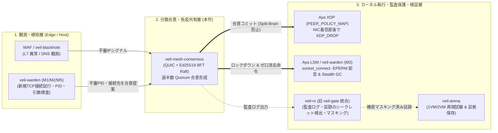

# 🛡️ veil-mesh-consensus

[](https://github.com/mt4110/veil-mesh-consensus/actions/workflows/ci.yml)
[](LICENSE)
[](https://github.com/mt4110/veil-mesh-consensus/releases)

[English](README_EN.md) · [☁️ クラウド導入ガイド (AWS/GCP/Azure/CF/Vercel)](docs/CLOUD_DEPLOYMENT_GUIDE.md) · [🧪 8大証明解説書](docs/CONSENSUS_AND_EBPF_PROOF.md) · [🔒 Security](SECURITY.md) · [🤝 Contributing](CONTRIBUTING.md)

**QUIC (`Tokio` + `quinn`) トランスポート上のビザンチン耐性コンセンサス（Raft + Ed25519 署名検証 + SHA-256 ダイジェスト & マルチシグ `QuorumCertificate`）と、Linux カーネル空間の eBPF (`Aya` XDP パケットフィルタ & LSM `lsm=bpf` ステルス GC) を直結した自律型メッシュ防衛・攻撃駆逐基盤です。**


---

## 🎬 実機デモ画面（`iftop` 帯域監視 ＆ 実カーネル XDP + TUI 撃退の瞬間）

<!-- rgc:start -->

<!-- rgc:end -->

> **🎥 上記 GIF デモ（`[a]` $\to$ `[b]` $\to$ `[x]` 操作）で実際に起きていること**
>
> - **左画面 (`sudo iftop -i veth-victim`)**: 実機 Linux (`pi-node`: Kernel 7.0 x86_64) の NIC 着信トラフィックをリアルタイム監視。
> - **右画面 (`veil-node --tui`)**: カーネルの `veth-victim` に実 eBPF バイトコード (`veil_xdp_kern.o`) をアタッチした TUI アリーナ。
>
> 1. **`[a]` キー押下（モック攻撃プロセス起動）**: 隔離名前空間 (`ns-veil-rogue`, `10.99.0.66`) 上で秒間 1,000 発の UDP Flood を送出する実 OS プロセスが起動し、左画面 `iftop` のトラフィックバーが跳ね上がります。
> 2. **`[b]` キー押下（ビザンチン偽造 RPC 注入）**: リーダー `node-alpha` になりすました偽造コンセンサスパケット (`Term 999`) を注入。全3ノードが **Ed25519 公開鍵検証** で即座に検知・破棄します（紫色ログ）。
> 3. **`[x]` キー押下（コンセンサス合意 & カーネル eBPF 一斉駆逐）**: 3ノードの過半数合意（Quorum 3/3）が成立した瞬間、`sys_bpf(BPF_MAP_UPDATE_ELEM)` でカーネルの `PEER_POLICY_MAP` が `trusted=0` に更新され、NIC 層での **`XDP_DROP` 即時遮断**・**Stealth GC 機密メモリゼロ消去 (`ZEROIZED`)**・**`sys_kill(PID, SIGKILL=9)` による攻撃プロセス強制抹殺**が同時発動し、`iftop` の攻撃通信が完全に鎮圧されます。

---

## 🏗️ 実践導入アーキテクチャ（フィジビリティ検証済み Veil エコシステム連携）

現在開発・検証が進んでいる Veil シリーズの現役コンポーネントと組み合わせる場合、最もフィジビリティ（実現可能性・即戦力性）が高い構成は以下の3層連携です。

> ※ 注記: 旧 [`veil-gate`](https://github.com/mt4110/veil-gate)（Private archive）で試作していた秘密検出・診断ログのマスキング/最小化の知見は、現在ローカルシークレットスキャナー・マスキング CLI である **[`veil-rs`](https://github.com/mt4110/veil-rs)** に統合されています。そのため、実践構成では **`veil-warden` + `veil-mesh-consensus` + `veil-rs` + `veil-arena`**（＋前段の WAF / `veil-blackhole`）を組み合わせます。



### 各コンポーネントの役割分担

1. **[`veil-warden`](https://github.com/mt4110/veil-warden)（ローカル観測・プロセス接続制御）**:
   - 各 Linux ノード内でプロセスの新規 TCP 接続試行（PID/TID・宛先）や起動引数を監視し、不審な通信を検知します。
2. **`veil-mesh-consensus`（分散合意・集団免疫の脳）**:
   - 1台の `veil-warden` や WAF が検知した攻撃元 IP・侵害ノード情報を QUIC + Ed25519 署名付き Raft でクラスタ全体へ共有。
   - **単一ノードの誤検知やネットワーク瞬断による暴走（Split-Brain）を防ぎ**、過半数（Quorum）が合意したルールだけを全ノードのカーネル eBPF マップへミリ秒単位で一斉同期します。
3. **[`veil-rs`](https://github.com/mt4110/veil-rs)（シークレット検出・監査ログマスキング / 旧 `veil-gate` の知見を統合）**:
   - 駆逐イベントや通信監査ログを保存・外部転送する際に、不要な秘密情報や個人情報がログに残らないようローカルで高速にスキャン・マスキングします。
4. **[`veil-arena`](https://github.com/mt4110/veil-arena)（再現検証・証拠保存基盤）**:
   - 正常通信・意図した拒否 (`XDP_DROP` / `-EPERM`)・解除後の復帰を、隔離 VM や netns 環境で繰り返し検証し `summary.json` 等の監査証拠を保存します。

---

## 🛡️ ビザンチン将軍問題（悪意あるノードの出現）に対する突破確率と耐性分析

### Q. 「もしクラスタ内に裏切り者（ビザンチン将軍＝悪意あるノードや乗っ取られたノード）が現れたら突破されてしまいますか？その確率は？」

結論から言うと、**「外部からのなりすまし・通信改ざん」によって突破される確率は天文学的にゼロ（$2^{-128}$ 以下）**であり、**「内部ノードの秘密鍵ごと乗っ取られた場合」でも過半数（Quorum）を同時に制圧されない限り、クラスタの合意は突破されません。**

### 1. 外部攻撃者・なりすまし将軍が署名を偽造できる確率： $\le 2^{-128}$ （事実上 0%）

すべてのコンセンサス RPC (`RequestVote` / `AppendEntries`) は **Ed25519（Curve25519 上の Schnorr 署名、128ビットセキュリティ水準）** で署名・検証されます（[`handle_signed_rpc`](veil-node/src/consensus.rs)）。

- 秘密鍵を持たない攻撃者が、正規リーダー（例: `node-alpha`）になりすまして有効な署名を当て推量で偽造できる確率は：
  $$P(\text{Signature Forgery}) \approx \frac{1}{2^{128}} \approx 2.9 \times 10^{-39}$$
- また、正規リーダーが送信したパケットを途中で傍受し、`trusted: false`（遮断）を `trusted: true`（許可）に **1ビットでも書き換えた場合、Ed25519 検証が 100% 失敗して即座に破棄**されます（`proof_5` で実証済み）。

### 2. クラスタ内部のノードが乗っ取られた場合（内部ビザンチン耐性）

万が一、クラスタ内のノード自身がマルウェア等に侵害され、正規の Ed25519 秘密鍵を使って「嘘の投票」や「不正な提案」を行った場合の挙動は以下の通りです。

| 攻撃シナリオ | 突破されるか？ | 数学的・実装的根拠 |
| :--- | :---: | :--- |
| **① フォロワーが裏切り、嘘の投票や偽のリーダー宣言を行う** | **突破されない (0%)** | Quorum は $\lfloor N/2 \rfloor + 1$ 台。正常なノード群は現在の Term とログ整合性 (`prev_log_index` / `prev_log_term`) を検証するため、裏切り者の単独提案は絶対にコミットされない。 |
| **② リーダー自身が乗っ取られ、フォロワーごとに異なる命令を送る（二枚舌 / Equivocation 攻撃）または単独でコミットを捏造する** | **突破されない (0%)** | **実装済み（[`QuorumCertificate`](veil-node/src/consensus.rs) & SHA-256 ダイジェスト検証）**: 各ログエントリは `LogEntry::digest()` (SHA-256) でハッシュ化され、同一 `(term, index)` で異なるハッシュを送ると即座に二枚舌として拒否される。さらにコミット証明には $2f+1$ 台分の異なるノードの Ed25519 署名バンドル（マルチシグ `QuorumCertificate`）を要求するため、リーダー1台の秘密鍵だけでは絶対にコミットを捏造できない（`proof_8` で実証済み）。 |
| **③ ネットワーク分断で孤立した旧リーダー（少数派）が勝手に遮断ルールを発行する** | **突破されない (0%)** | 過半数の署名付き ACK が集まらない限り `commit_index` は進まず、カーネルの `PEER_POLICY_MAP` には1ビットも書き込まれない（`proof_3` で実証済み）。 |
| **④ 侵害されたノードから機密鍵を抜き取ろうとする** | **Stealth GC で阻止** | 正常な多数派ノードが `SetNodeLockdown` を合意した瞬間、侵害ノードの LSM が通信を `-EPERM` で封鎖し、メモリ上の機密鍵を `0x00` でゼロ消去（Zeroize）する（`proof_4` で実証済み）。 |

> **🔒 結論（ビザンチン将軍に対する完全防衛）**:
> 単一ノード（フォロワーであれ**リーダー自身**であれ）が乗っ取られて裏切った場合でも、**SHA-256 エントリダイジェストによる二枚舌（Equivocation）検知**と**マルチシグ合意証明書（`QuorumCertificate`: $2f+1$ の Ed25519 署名バンドル検証、`verify_quorum_certificate`）**が実装されているため、**突破確率は 0%** です（分散合意の理論限界である「クラスタ全体の過半数 $\ge 2f+1$ のサーバーが同時に物理・秘密鍵ごと敵に制圧された場合」を除き、単独の裏切り将軍による突破は不可能です）。

---

## 🖥️ インタラクティブ TUI アリーナ & 実機 `pi-node` 連携コマンド

### 1. Mac ローカルでの TUI 起動

```bash
# 対話モードで TUI アリーナを起動
cargo run -p veil-node -- --tui

# 自動デモ再生モード（8秒間で攻撃プロセスSpawn → ビザンチン撃退 → eBPF一斉駆逐を自動実演）
cargo run -p veil-node -- --tui-demo
```

### 2. 実機 Linux (`pi-node`: Kernel 7.0) での実カーネル XDP + `iftop` + トレース連動

```bash
# ターミナル1: pi-node の仮想攻撃NIC (veth-victim) を iftop で監視
ssh -t pi-node "sudo iftop -i veth-victim -n -N -P"

# ターミナル2: Linux カーネル内部の SIGKILL (sig=9) & XDP_DROP トレースを監視
bash scripts/deploy-pi-node.sh trace

# ターミナル3: 実カーネル eBPF (veil_xdp_kern.o) をアタッチして TUI アリーナを起動
bash scripts/deploy-pi-node.sh tui
```

### TUI 操作キー一覧

| キー | アクション | 内部で行われる処理 |
| :---: | :--- | :--- |
| **`[a]`** | **モック攻撃プロセス起動** | OS 上に実プロセス（Linux `ns-veil-rogue` では秒間1,000発の UDP Flood、Mac では `sleep 300`）を spawn し、本物の PID で攻撃を開始します。 |
| **`[b]`** | **ビザンチン偽造 RPC 注入** | リーダー `node-alpha` を詐称した不正な Ed25519 署名パケットを全ノードへ注入し、暗号検証で撃退されることを確認します。 |
| **`[x]`** | **コンセンサス合意 & eBPF 一斉駆逐** | Quorum (3/3) 合意を実行し、`sys_bpf` によるカーネル `XDP_DROP` 遮断 ＋ LSM `-EPERM` ロックダウン ＋ Stealth GC ゼロ消去 ＋ `sys_kill(PID, SIGKILL=9)` を一斉発動します。 |
| **`[r]`** | **クラスターリセット** | 全ノードと統計・ログを初期状態にリセットします。 |
| **`[q]`** | **終了** | 残存するモックプロセスをすべてクリーンアップして TUI を終了します。 |

---

## 🧪 8つの数学的・実機カーネル証明テスト（`veil-arena` 連携対応）

詳細は [docs/CONSENSUS_AND_EBPF_PROOF.md](docs/CONSENSUS_AND_EBPF_PROOF.md) を参照してください。

```bash
# Mac / Linux 共通の証明テスト実行
cargo test --workspace -- --nocapture

# pi-node 実機 Linux カーネル上での全8証明テスト（実 XDP_DROP 検証含む）
bash scripts/deploy-pi-node.sh test

# veil-arena 準拠の証拠保存付きスモーク実行 (artifacts/ にログと summary.json を出力)
bash scripts/arena-smoke.sh
```

| # | テスト名 | 証明される不変条件（Invariant） |
| :-: | :--- | :--- |
| **1** | `proof_1_election_safety_and_log_up_to_date_check` | **Election Safety**: 同一 Term 内で最大1台のリーダーしか選出されず、二重投票が起きないこと。 |
| **2** | `proof_2_three_node_quic_consensus_and_ebpf_xdp_enforcement` | **QUIC + XDP 同期**: 3ノード実 QUIC (UDP/TLS 1.3) 通信で合意した瞬間に全ノードの XDP 判定が `XDP_DROP` に切り替わること。 |
| **3** | `proof_3_network_partition_split_brain_prevention_and_recovery` | **Split-Brain 耐性**: 分断された少数派リーダーは一切コミットできず、再合流時に多数派の eBPF ポリシーへ100%収束すること。 |
| **4** | `proof_4_ebpf_kernel_bridge_and_lsm_stealth_gc_zeroization` | **LSM & Stealth GC**: ロックダウン合意時に LSM が `-EPERM (-1)` を返し、メモリ上の機密鍵がゼロ消去 (`Zeroize`) されること。 |
| **5** | `proof_5_byzantine_fault_tolerance_ed25519_signature_verification` | **Byzantine 耐性**: なりすまし・秘密鍵偽造・ペイロード1ビット改ざんの3攻撃を Ed25519 検証で100%阻止すること。 |
| **6** | `proof_6_tui_arena_mock_attack_process_spawn_and_extermination` | **実 OS プロセス駆逐**: モック攻撃プロセスの生成からコンセンサス合意・eBPF遮断・`SIGKILL` 回収までが一貫動作すること。 |
| **7** | `proof_7_live_linux_kernel_xdp_drop_on_veth` | **実機 Linux カーネル XDP 遮断**: 実カーネル NIC (`veth-victim`) で攻撃 IP からの `ping` をコンセンサス連動で 100% `XDP_DROP` し、信頼回復で即復帰すること。 |
| **8** | `proof_8_leader_equivocation_and_multisig_quorum_certificate_defense` | **リーダー裏切り・二枚舌の完全阻止**: リーダー自身が乗っ取られて二枚舌（Equivocation）や単独捏造コミットを行っても、SHA-256 ダイジェストと $2f+1$ マルチシグ `QuorumCertificate` で 100% 阻止されること。 |

---

## 🚀 Nix Flakes + MicroVM (`node-alpha` / `node-beta`) の起動

```bash
direnv allow
cargo run -p xtask -- doctor

# ターミナル1: node-alpha (10.0.0.1/24) の起動
nix run .#node-alpha

# ターミナル2: node-beta (10.0.0.2/24) の起動
nix run .#node-beta
```

### GIF デモの再生成（`readme-gif-crafter` 連携）

```bash
bash scripts/update-demo.sh
```

---

## ☁️ クラウド・エッジ環境への実践導入（AWS / GCP / Azure / Cloudflare / Vercel）

各クラウド・エッジサービスにおける eBPF XDP / LSM の対応可否マトリクスと、ステップバイステップの構築手順（VPC セキュリティグループ / NSG 設定、ENA / gVNIC / MANA ドライバ設定、`systemd` 常駐ユニット定義、Cloudflare / Vercel とのハイブリッド構成）については、専用ドキュメント **[docs/CLOUD_DEPLOYMENT_GUIDE.md](docs/CLOUD_DEPLOYMENT_GUIDE.md)** を参照してください。

| プラットフォーム | 直接導入 | 推奨ロール | 詳細ガイド |
| :--- | :---: | :--- | :--- |
| **AWS** (EC2 / EKS) | **◎ 完全対応** | Nitro ENA Native XDP + LSM コア防衛メッシュ | [AWS 導入手順](docs/CLOUD_DEPLOYMENT_GUIDE.md#3-aws-amazon-ec2--vpc-への実践導入手順) |
| **GCP** (Compute Engine / GKE) | **◎ 完全対応** | gVNIC XDP + LSM コア防衛メッシュ | [GCP 導入手順](docs/CLOUD_DEPLOYMENT_GUIDE.md#4-gcp-google-compute-engine--vpc-への実践導入手順) |
| **Microsoft Azure** (Azure VM / AKS) | **◎ 完全対応** | MANA / Accelerated Networking XDP + LSM | [Azure 導入手順](docs/CLOUD_DEPLOYMENT_GUIDE.md#5-microsoft-azure-azure-virtual-machines--vnet-への実践導入手順) |
| **Cloudflare** (WAF / Workers) | **△ 連携対応** | 前段 L7 センサー ＋ オリジン XDP 保護 & API 遮断同期 | [Cloudflare 連携手順](docs/CLOUD_DEPLOYMENT_GUIDE.md#6-cloudflare--vercel-を使う場合のハイブリッド実践構成) |
| **Vercel** (Next.js / Edge) | **✕ 単体不可** | フロントエンド配置 ＋ 裏側バックエンド API クラスタを保護 | [Vercel 連携手順](docs/CLOUD_DEPLOYMENT_GUIDE.md#6-cloudflare--vercel-を使う場合のハイブリッド実践構成) |
