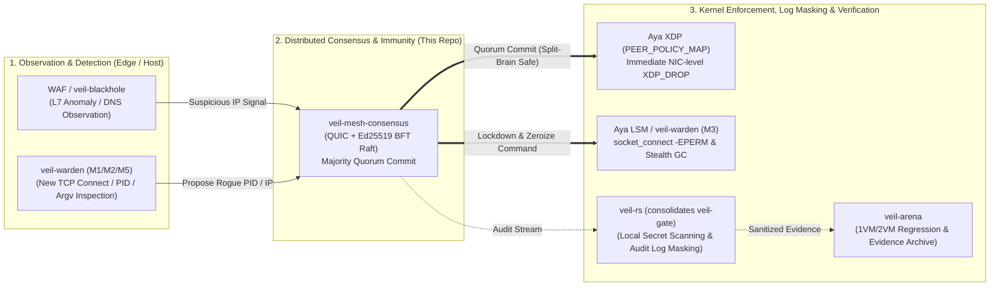

# 🛡️ veil-mesh-consensus

[](https://github.com/mt4110/veil-mesh-consensus/actions/workflows/ci.yml)
[](LICENSE)
[](https://github.com/mt4110/veil-mesh-consensus/releases)

[日本語 (Main)](README.md) · [☁️ Cloud Deployment Guide (AWS/GCP/Azure/CF/Vercel)](docs/CLOUD_DEPLOYMENT_GUIDE.md) · [🧪 Proof Documentation](docs/CONSENSUS_AND_EBPF_PROOF.md) · [🔒 Security](SECURITY.md) · [🤝 Contributing](CONTRIBUTING.md)

**An autonomous mesh defense and attack extermination foundation that directly bridges Byzantine-resilient consensus (Raft + Ed25519 signature verification + SHA-256 Digest & Multi-Sig `QuorumCertificate`) over QUIC (`Tokio` + `quinn`) with Linux kernel eBPF (`Aya` XDP packet filtering & LSM `lsm=bpf` Stealth GC).**


---

## 🎬 Live Hardware Demo (`iftop` Bandwidth Monitor & Real Kernel XDP + TUI Extermination)

<!-- rgc:start -->

<!-- rgc:end -->

> **🎥 What You Are Seeing in the Demo GIF (`[a]` $\to$ `[b]` $\to$ `[x]` Key Sequence)**
>
> - **Left Terminal (`sudo iftop -i veth-victim`)**: Real-time network bandwidth monitor on a physical Linux host (`pi-node`: Kernel 7.0 x86_64).
> - **Right Terminal (`veil-node --tui`)**: TUI Arena with live eBPF bytecode (`veil_xdp_kern.o`) attached directly to the kernel `veth-victim` interface.
>
> 1. **Press `[a]` (Spawn Rogue Attack Process)**: Spawns a real OS process inside `ns-veil-rogue` (`10.99.0.66`) firing a 1,000 pkt/s UDP flood at `10.99.0.1:9999`. The bandwidth bar in `iftop` spikes immediately.
> 2. **Press `[b]` (Inject Byzantine Forged RPC)**: Broadcasts a forged `AppendEntries` RPC spoofing `node-alpha` (`Term 999`). All 3 nodes cryptographically verify and reject the packet via **Ed25519 public key verification** (purple audit log).
> 3. **Press `[x]` (Consensus Exterminate)**: Once Quorum (3/3) commits the block policy, `sys_bpf(BPF_MAP_UPDATE_ELEM)` writes `trusted=0` into the kernel `PEER_POLICY_MAP`, simultaneously triggering **NIC-level `XDP_DROP`**, **Stealth GC memory zeroization (`ZEROIZED`)**, and **`sys_kill(PID, SIGKILL=9)`** to terminate the rogue OS process.

---

## 🏗️ Practical Integration Architecture (High-Feasibility Veil Ecosystem)

When combining `veil-mesh-consensus` with active repositories in the Veil ecosystem, the highest-feasibility production architecture is the 3-tier pipeline below:

> *Note*: The secret-detection and diagnostic log-minimization capabilities prototyped in [`veil-gate`](https://github.com/mt4110/veil-gate) (now a private archive) have been consolidated into **[`veil-rs`](https://github.com/mt4110/veil-rs)** (local secret scanner & log masking CLI). Therefore, the practical defense stack combines **`veil-warden` + `veil-mesh-consensus` + `veil-rs` + `veil-arena`** (alongside edge WAF / `veil-blackhole` sensors).



---

## 🛡️ Byzantine Generals Problem: Breach Probability & Security Analysis

### Q. "What happens if a Byzantine General (a malicious or compromised node) appears? Can the cluster be breached, and what is the probability?"

### 1. External Spoofing or Packet Tampering: Breach Probability $\le 2^{-128}$ (~0%)

Every consensus RPC (`RequestVote`, `AppendEntries`) is signed and verified using **Ed25519 (128-bit security level)**.

- The probability of an external attacker forging a valid signature without the private key is:
  $$P(\text{Signature Forgery}) \approx \frac{1}{2^{128}} \approx 2.9 \times 10^{-39}$$
- Modifying even a single bit of a legitimate leader's payload (e.g., flipping `trusted: false` to `trusted: true`) causes Ed25519 verification to fail 100% of the time (`proof_5`).

### 2. Compromised Internal Node (Insider Byzantine Faults)

| Threat Scenario | Breached? | Mathematical & Implementation Guarantee |
| :--- | :---: | :--- |
| **1. A follower turns traitor and sends fake votes/proposals** | **No (0%)** | Quorum requires $\lfloor N/2 \rfloor + 1$ nodes. Honest nodes verify term and log matching invariants, rejecting unilateral rogue proposals. |
| **2. The Leader itself is compromised and attempts Equivocation (sending conflicting logs) or unilateral commit forgery** | **No (0%)** | **Implemented ([`QuorumCertificate`](veil-node/src/consensus.rs) & SHA-256 Digest Verification)**: Every log entry is hashed via `LogEntry::digest()` (SHA-256). Conflicting entries for the same `(term, index)` are immediately rejected. Furthermore, `verify_quorum_certificate()` requires a $2f+1$ multi-signature Ed25519 bundle (`QuorumCertificate`), making it cryptographically impossible for a compromised leader to unilaterally forge a commit (`proof_8`). |
| **3. An isolated former leader in a minority partition issues block rules** | **No (0%)** | Without majority ACKs, `commit_index` never advances and `PEER_POLICY_MAP` is never modified (`proof_3`). |
| **4. Attacker attempts to dump secret keys from a compromised node** | **Blocked by Stealth GC** | As soon as the honest majority commits `SetNodeLockdown`, the compromised node's LSM blocks sockets (`-EPERM`) and overwrites in-memory secret keys with `0x00` (`proof_4`). |

---

## 🧪 8 Mathematical & Live-Kernel Proof Tests

```bash
# Run unit & QUIC proof tests locally
cargo test --workspace -- --nocapture

# Run all 8 proof tests including live Linux kernel XDP_DROP on pi-node
bash scripts/deploy-pi-node.sh test

# Save verification evidence in veil-arena format
bash scripts/arena-smoke.sh
```

---

## ☁️ Cloud & Edge Deployment Matrix (AWS / GCP / Azure / Cloudflare / Vercel)

See **[docs/CLOUD_DEPLOYMENT_GUIDE.md](docs/CLOUD_DEPLOYMENT_GUIDE.md)** for full step-by-step instructions.

| Platform | Direct Kernel Support | Recommended Role | Guide Link |
| :--- | :---: | :--- | :--- |
| **AWS** (EC2 / EKS) | **Yes (Full)** | Nitro ENA Native XDP + LSM Core Defense Mesh | [AWS Guide](docs/CLOUD_DEPLOYMENT_GUIDE.md#3-aws-amazon-ec2--vpc-への実践導入手順) |
| **GCP** (Compute Engine / GKE) | **Yes (Full)** | gVNIC XDP + LSM Core Defense Mesh | [GCP Guide](docs/CLOUD_DEPLOYMENT_GUIDE.md#4-gcp-google-compute-engine--vpc-への実践導入手順) |
| **Microsoft Azure** (Azure VM / AKS) | **Yes (Full)** | MANA / Accelerated Networking XDP + LSM | [Azure Guide](docs/CLOUD_DEPLOYMENT_GUIDE.md#5-microsoft-azure-azure-virtual-machines--vnet-への実践導入手順) |
| **Cloudflare** (WAF / Workers) | **Hybrid** | Edge L7 Sensor + Origin XDP Protection & API Sync | [Cloudflare Guide](docs/CLOUD_DEPLOYMENT_GUIDE.md#6-cloudflare--vercel-を使う場合のハイブリッド実践構成) |
| **Vercel** (Next.js / Edge) | **Hybrid Only** | Frontend Hosting + Backend Linux Mesh Protection | [Vercel Guide](docs/CLOUD_DEPLOYMENT_GUIDE.md#6-cloudflare--vercel-を使う場合のハイブリッド実践構成) |
