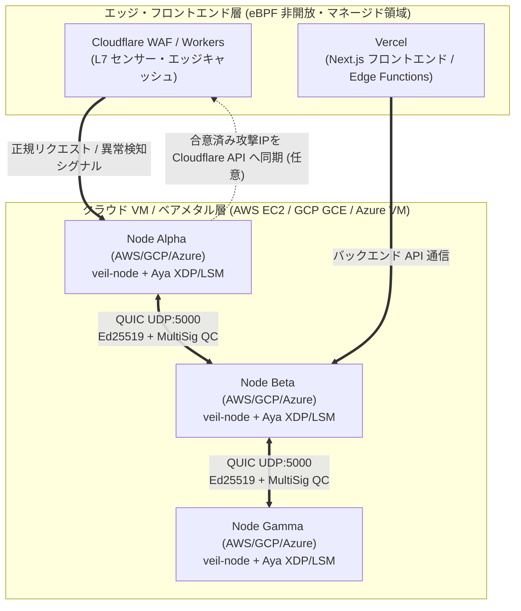

# ☁️ クラウド・エッジ環境別 実践導入ガイド（AWS / GCP / Azure / Cloudflare / Vercel）

[README（日本語）](../README.md) · [English README](../README_EN.md) · [証明解説書](CONSENSUS_AND_EBPF_PROOF.md)

本書では、`veil-mesh-consensus`（mTLS QUIC 署名付き合意形成 ＋ Linux カーネル eBPF `XDP` / LSM ブリッジ）をパブリッククラウドやエッジプラットフォームへ導入する際の **対応可否マトリクス** と、**各プラットフォーム別のステップバイステップ構築手順** を解説します。

---

## 1. プラットフォーム別の導入可否マトリクス（結論）

`veil-mesh-consensus` は **Linux カーネル空間の eBPF (`BPF_PROG_TYPE_XDP`)** と **UDP 5000 番ポート上の mTLS QUIC 双方向通信** を使用します（LSM 制御は現時点ではユーザー空間ブリッジでシミュレートしており、実カーネルの BPF LSM は `veil-warden` と連携します）。そのため、「利用者自身が Linux カーネル（VM / ベアメタル / 専用ノード）の特権 (`CAP_BPF`, `CAP_NET_ADMIN`) を持てるか」によって導入方式が分かれます。

| プラットフォーム | 直接導入（eBPF + QUIC） | 推奨アーキテクチャ・役割 | 理由・技術的根拠 |
| :--- | :---: | :--- | :--- |
| **AWS** (EC2 / EKS) | **◎ 対応** | **コア防衛メッシュ層** (Nitro ENA XDP) | 専用 Linux カーネル（Amazon Linux 2023 / Ubuntu 24.04+ / NixOS）上で ENA ドライバの XDP が動作するため。 |
| **GCP** (Compute Engine / GKE) | **◎ 対応** | **コア防衛メッシュ層** (gVNIC XDP) | `gVNIC` (Google Virtual NIC) が XDP をサポートしており、Ubuntu 等でパケット遮断が可能なため。 |
| **Microsoft Azure** (Azure VM / AKS) | **◎ 対応** | **コア防衛メッシュ層** (MANA / Accelerated Networking XDP) | Azure Linux / Ubuntu 24.04+ において、高速ネットワーク上の XDP が動作するため。 |
| **Cloudflare** (WAF / Workers / Magic Transit) | **△ 連携対応（センサー＆エッジ遮断層）** | **前段 L7/L3 エッジセンサー ＋ Webhook 連携** | Cloudflare のサーバー上に顧客の Linux eBPF はロードできないが、**Cloudflare を前段センサー、バックエンド VM クラスタを `veil-mesh-consensus` で守る構成（または合意結果を Cloudflare Firewall API へ自動反映する構成）** が極めて有効なため。 |
| **Vercel** (Functions / Edge Network) | **✕ 単体導入は不可（バックエンド保護で連携）** | **フロントエンド層（裏側の API クラスタを保護）** | Vercel はマネージドなサーバーレス実行環境（V8 Isolates / Firecracker 抽象化層）であり、利用者に `CAP_BPF` や NIC への XDP アタッチ権限が開放されていないため。Vercel から呼ばれるバックエンド API サーバー群（AWS/GCP/Azure 等）側に本ツールを導入します。 |



---

## 2. 共通の事前準備（Linux カーネル要件と `lsm=bpf` の有効化）

AWS / GCP / Azure いずれの Linux VM（Ubuntu 24.04 LTS 推奨、Kernel 6.8 以降）でも、XDP パケットフィルタはデフォルトでそのまま動作します。さらに **LSM ステルス GC (`lsm=bpf`)** も有効化する場合は、以下の手順を1回だけ実行します。

```bash
# 1. 現在のカーネルで BTF と LSM がどう設定されているか確認
ls -lh /sys/kernel/btf/vmlinux
cat /sys/kernel/security/lsm

# 2. もし出力に `bpf` が含まれていない場合は GRUB パラメータに `,bpf` を追加
sudo sed -i 's/GRUB_CMDLINE_LINUX="/GRUB_CMDLINE_LINUX="lsm=lockdown,capability,landlock,yama,apparmor,bpf /' /etc/default/grub
sudo update-grub
sudo reboot
```

---

## 3. AWS (Amazon EC2 / VPC) への実践導入手順

AWS の Nitro インスタンス（`t4g`, `c7g`, `m7i` 等）に搭載されている **ENA (Elastic Network Adapter)** は XDP をサポートしており、セキュリティグループでノード間の `UDP 5000` を許可するだけで即座にメッシュを構築できます。

### Step 3.1: セキュリティグループ（VPC ファイアウォール）の設定

同一 VPC 内の3台の EC2 インスタンス（例: `10.0.1.11`, `10.0.1.12`, `10.0.1.13`）が属するセキュリティグループ `sg-veil-mesh` に、以下のインバウンドルールを追加します。

```bash
# AWS CLI でメッシュ内ノード間の QUIC (UDP 5000) 通信を許可
aws ec2 authorize-security-group-ingress \
  --group-id sg-xxxxxxxx \
  --protocol udp \
  --port 5000 \
  --source-group sg-xxxxxxxx
```

### Step 3.2: ENA ドライバのプライマリ NIC 名の確認と起動

Amazon Linux 2023 や Ubuntu on EC2 では、プライマリ NIC 名は通常 `ens5` です。

```bash
# 1. プライマリ NIC 名を確認 (例: ens5)
ip -br addr show

# 2. リポジトリの取得とビルド
git clone https://github.com/mt4110/veil-mesh-consensus.git
cd veil-mesh-consensus
cargo build --release -p veil-node

# 3. eBPF XDP バイトコードのコンパイル（または同梱の assets/veil_xdp_kern.o を使用）
clang -O2 -g -target bpf -c veil-ebpf/src/veil_xdp_kern.c -o assets/veil_xdp_kern.o

# 4. Node 1 (node-alpha: 10.0.1.11) で起動
sudo ./target/release/veil-node \
  --node-id node-alpha \
  --listen 0.0.0.0:5000 \
  --peer 10.0.1.12:5000 \
  --iface ens5 \
  --ebpf-obj ./assets/veil_xdp_kern.o
```

> **💡 AWS ENA での注意点**: ENA ドライバで Native XDP を動かす際、MTU がジャンボフレーム（`9001`）になっていると XDP アタッチが拒否される場合があります。その場合は `sudo ip link set dev ens5 mtu 1500`（または `3498` 以下）に設定してください。

---

## 4. GCP (Google Compute Engine / VPC) への実践導入手順

GCP では **gVNIC (`ens4`)** を有効にした Ubuntu 24.04 LTS インスタンス（`e2-standard-2`, `c3-standard-4`, `t2a-standard-2` 等）を使用します。

### Step 4.1: VPC ファイアウォールルールの作成

`veil-mesh-node` ネットワークタグを持つ VM 同士の `UDP 5000` 通信を許可します。

```bash
gcloud compute firewall-rules create allow-veil-mesh-quic \
  --network=default \
  --allow=udp:5000 \
  --source-tags=veil-mesh-node \
  --target-tags=veil-mesh-node \
  --description="Allow QUIC BFT consensus traffic (UDP 5000) between veil-mesh nodes"
```

### Step 4.2: GCE インスタンス (`ens4`) でのデーモン起動

```bash
# GCP gVNIC のインターフェース名（通常 ens4）を指定して起動
sudo ./target/release/veil-node \
  --node-id node-alpha \
  --listen 0.0.0.0:5000 \
  --peer 10.128.0.12:5000 \
  --iface ens4 \
  --ebpf-obj ./assets/veil_xdp_kern.o
```

---

## 5. Microsoft Azure (Azure Virtual Machines / VNet) への実践導入手順

Azure では Ubuntu 24.04 LTS または Azure Linux において、プライマリ NIC が **`eth0`** として認識されます。

### Step 5.1: NSG (Network Security Group) で UDP 5000 を許可

```bash
az network nsg rule create \
  --resource-group veil-rg \
  --nsg-name veil-mesh-nsg \
  --name AllowVeilQuicConsensus \
  --priority 100 \
  --source-address-prefixes VirtualNetwork \
  --destination-address-prefixes VirtualNetwork \
  --destination-port-ranges 5000 \
  --protocol Udp \
  --access Allow
```

### Step 5.2: Azure VM (`eth0`) での systemd 常駐サービス化

Azure / AWS / GCP 共通で本番運用する際は、以下の `systemd` ユニットファイル (`/etc/systemd/system/veil-node.service`) を配置して自動起動・常駐させます。

```ini
[Unit]
Description=veil-mesh-consensus QUIC BFT & eBPF XDP/LSM Daemon
After=network-online.target
Wants=network-online.target

[Service]
Type=simple
User=root
WorkingDirectory=/opt/veil-mesh-consensus
ExecStart=/opt/veil-mesh-consensus/target/release/veil-node \
  --node-id node-alpha \
  --listen 0.0.0.0:5000 \
  --peer 10.0.0.12:5000 \
  --iface eth0 \
  --ebpf-obj /opt/veil-mesh-consensus/assets/veil_xdp_kern.o
Restart=always
RestartSec=2
LimitMEMLOCK=infinity

[Install]
WantedBy=multi-user.target
```

```bash
sudo systemctl daemon-reload
sudo systemctl enable --now veil-node
sudo journalctl -u veil-node -f
```

---

## 6. Cloudflare / Vercel を使う場合のハイブリッド実践構成

### 6.1 なぜ Vercel や Cloudflare Workers の「内部」には直接入れられないのか？

- **Vercel** や **Cloudflare Workers** は、ユーザーコードをマルチテナントの V8 Isolate や軽量コンテナ上で実行するサーバーレス基盤です。
- これらの環境ではホスト OS の Linux カーネルやネットワークカード（NIC）がクラウド事業者に管理されており、ユーザーに `bpf()` システムコール（`CAP_BPF` / `CAP_NET_ADMIN`）や UDP 5000 の常時待受ソケットが開放されていません。

### 6.2 どう組み合わせるのが正解か？（ハイブリッド水際防衛）

1. **Vercel を使う場合（フロントエンド Next.js ＋ バックエンド API 保護）**:
   - フロントエンド（Next.js）は Vercel に置き、そこから通信する **バックエンド API / DB クラスタ（AWS EC2, GCP GCE, Azure VM, さくら VPS, オンプレ Linux 等）** に `veil-mesh-consensus` を導入します。
   - 万が一バックエンドの1台に脆弱性（PHP / Node.js / Python 等の RCE）があっても、`veil-mesh-consensus` が裏側のサーバー群で合意を取り、攻撃通信を `XDP_DROP`・不審プロセスを `SIGKILL` で水際封鎖します。
2. **Cloudflare を使う場合（Real Client IP 連携 ＆ エッジ API 遮断）**:
   - Cloudflare プロキシ配下のオリジンサーバーでは、L3/L4 の送信元 IP が Cloudflare のエッジ IP になります。
   - そのため、オリジン側では **① Cloudflare 以外の IP から直接オリジンへ飛んでくるバイパス攻撃パケットを XDP で即座に `XDP_DROP`** しつつ、**② L7 (`CF-Connecting-IP` ヘッダ) で検知し `veil-mesh-consensus` で過半数合意（Quorum Commit）した攻撃者 IP を、Cloudflare Rulesets API (IP Access Rules) へ Webhook 同期してエッジ側でブロック** する2段構えが最も強力です。
