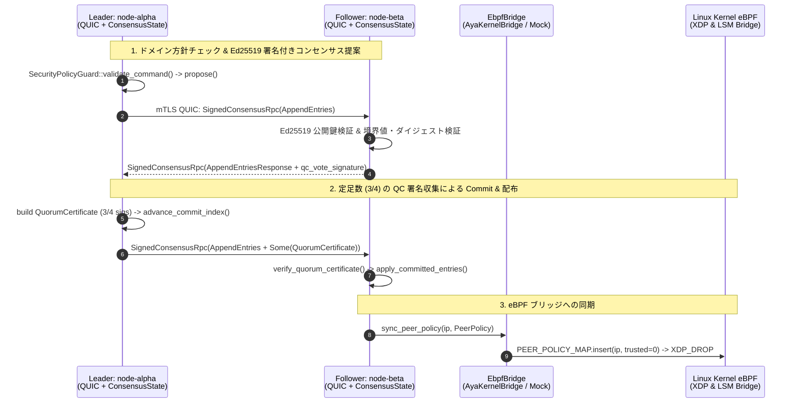

# `veil-mesh-consensus` コンセンサス & eBPF ブリッジ 検証テスト解説書

本書は、`veil-mesh-consensus` において **mTLS QUIC (`Tokio` + `quinn`) トランスポート上の署名付き合意形成（Raft ベース + Ed25519 `SignedConsensusRpc` + マルチシグ `QuorumCertificate`）** と **Linux カーネル空間の eBPF (`Aya` XDP パケットフィルタ) / ユーザー空間 LSM ブリッジ** がどのように連携し、11 個の検証・回帰テスト (`proof_1` 〜 `proof_11`) で何を確かめているかを解説する技術ドキュメントです。

---

## 1. クリーンアーキテクチャ構成とデータフロー

コードベースは以下の 4 層（Clean Architecture）に分離されています：

1. **Domain 層 (`veil-node/src/domain/`)**: `MeshCommand`, `LogEntry`, `QuorumCertificate` 等のコア型と、保護対象 IP（ループバック等）の誤遮断防止や `index`/`term` の境界値を検査する [`SecurityPolicyGuard`](../veil-node/src/domain/policy.rs)。
2. **UseCase 層 (`veil-node/src/usecase/`)**: [`ConsensusState`](../veil-node/src/usecase/consensus_engine.rs) ステートマシンと [`EbpfBridge`](../veil-node/src/usecase/ports.rs) 出力ポート。
3. **Adapter 層 (`veil-node/src/adapter/`)**: OS 乱数 (`SystemRandom`) による Ed25519 鍵生成・ファイル保存を行う [`NodeCryptoIdentity`](../veil-node/src/adapter/crypto_ring.rs) と [`WireMessage`](../veil-node/src/adapter/wire_protocol.rs)。
4. **Infra 層 (`veil-node/src/infra/`, `ebpf_bridge.rs`, `tui.rs`)**: `quinn` mTLS 通信、Linux `Aya` eBPF ローダー、Ratatui TUI。



---

## 2. 11 個の検証・回帰テスト（`cargo test`）の解説

[`veil-node/src/proof_tests.rs`](../veil-node/src/proof_tests.rs) に実装された 11 個のテストケースは、以下の性質と過去のセキュリティ監査で指摘された回帰項目を検証しています。

### 証明 1: Election Safety（単一リーダー選出の安全性）

- **テスト関数**: `proof_1_election_safety_and_log_up_to_date_check`
- **検証内容**: 4ノードクラスタにおいて同一の `Term` で複数の候補者（`node-alpha`, `node-gamma`）が立候補した場合でも、各ノードは1つの候補者にしか投票せず、定足数（3/4）を獲得した1台のみが `Role::Leader` になることを確認します。

### 証明 2: 実 mTLS QUIC メッシュ（4ノード）での合意形成と XDP 遮断同期

- **テスト関数**: `proof_2_three_node_quic_consensus_and_ebpf_xdp_enforcement`
- **検証内容**: 実際の UDP ソケット上の mTLS 1.3 QUIC 双方向ストリーム通信を介して4ノード間でリーダー選出・QC 構築・コミット伝搬が行われ、全ノードの XDP フィルタ状態が `XDP_DROP`（および解除後の `XDP_PASS`）へ切り替わることを確認します。

### 証明 3: ネットワーク分断（Split-Brain）時の少数派コミット抑止と再合流時の収束

- **テスト関数**: `proof_3_network_partition_split_brain_prevention_and_recovery`
- **検証内容**: 4ノードが `[alpha]` (1台) と `[beta, gamma, delta]` (3台) に分断された際、孤立した旧リーダー `alpha` の提案はコミットされず、多数派側で確定したポリシーへ分断復旧後にロールバック・収束することを確認します。

### 証明 4: `EbpfBridge` ポート連動と LSM / 鍵ゼロ消去シミュレーション

- **テスト関数**: `proof_4_ebpf_kernel_bridge_and_lsm_stealth_gc_zeroization`
- **検証内容**: `SetNodeLockdown` がコミットされた際、[`MockEbpfBridge`](../veil-node/src/ebpf_bridge.rs) を通じて `LSM_POLICY_MAP` の更新とメモリ上のダミー秘密鍵データのゼロ消去が呼び出されることを確認します。

### 証明 5: Ed25519 署名によるなりすまし・偽造・改ざん RPC の棄却

- **テスト関数**: `proof_5_byzantine_fault_tolerance_ed25519_signature_verification`
- **検証内容**: 送信者 ID の詐称（Identity Spoofing）、未知の秘密鍵による署名偽造、および正規リーダーが署名したペイロードの1ビット改ざんの3パターンが `handle_signed_rpc` で棄却されることを確認します。

### 証明 6: TUI アリーナにおけるモック攻撃プロセス起動と停止

- **テスト関数**: `proof_6_tui_arena_mock_attack_process_spawn_and_extermination`
- **検証内容**: TUI アリーナが4ノードの `ConsensusState` 上で QC 合意を行い、OS 上に起動したモック攻撃プロセスを `SIGKILL` で停止・回収できることを確認します。

### 証明 7: 実機 Linux カーネル (`veth-victim`) 上での `XDP_DROP` 遮断確認

- **テスト関数**: `proof_7_live_linux_kernel_xdp_drop_on_veth`
- **検証内容**: Linux 実機環境（`veth-victim` と `ns-veil-rogue` が存在する環境）において、実際の eBPF プログラム (`veil_xdp_kern.o`) が `ping` パケットを NIC 層で `XDP_DROP` し、`trusted=true` で復帰することを確認します。

### 証明 8: リーダー二枚舌（Equivocation）および `commit_qc: None` 単独コミットの拒否

- **テスト関数**: `proof_8_leader_equivocation_and_multisig_quorum_certificate_defense`
- **検証内容**: `handle_signed_rpc` の本番経路上で、リーダーが同一 `(term, index)` に異なるハッシュのエントリを送る二枚舌攻撃、`commit_qc: None` のまま `leader_commit` を進める要求、および署名数が定足数（3/4）に満たない QC がすべてフォロワーに拒否されることを確認します。

### 証明 9: ネットワーク経路での mTLS 証明書検証と署名付き RPC 強制（監査回帰 #1/#2）

- **テスト関数**: `proof_9_network_quic_mtls_and_signed_rpc_rejects_untrusted_tls_and_forged_wire_packets`
- **検証内容**: クラスタ CA 以外が署名した自己署名 QUIC クライアントが mTLS で拒絶されること、および QUIC ネットワーク受信ハンドラ (`handle_connection`) に偽造された高 Term のロックダウン RPC を送っても適用されないことを確認します。

### 証明 10: フォロワーの嘘の `match_index` 報告の棄却と 4ノード定足数（監査回帰 #3/#4）

- **テスト関数**: `proof_10_lying_follower_match_index_cannot_trigger_two_node_commit`
- **検証内容**: フォロワーが偽の `entry_hash` や不正な `qc_vote_signature` を伴う `match_index` を返してもリーダーに棄却されること、またリーダー＋フォロワー1台の計2台（2/4）ではコミットが成立せず、3台（3/4）の検証済み QC 署名が必要であることを確認します。

### 証明 11: `index = 0` / `term >= MAX_SAFE_TERM` / CSPRNG 鍵推測耐性 / 保護 IP ガード（監査回帰 #5/N1）

- **テスト関数**: `proof_11_boundary_validation_index_zero_and_term_max_no_panic_or_saturation`
- **検証内容**:
  1. `index = 0` のエントリを受信してもアンダーフロー Panic せず拒否すること。
  2. `term = u64::MAX` および `term = MAX_SAFE_TERM` ちょうどの RPC を受信しても `current_term` が上限に張り付かず拒否すること。
  3. ノード名（`"node-alpha"`）のハッシュから秘密鍵を推測して署名しても、`SystemRandom` (CSPRNG) 鍵であるため拒否されること。
  4. 保護対象 IP (`127.0.0.1`) を遮断しようとする提案が `SecurityPolicyGuard` で拒否されること。

---

## 3. 検証コマンドの実行方法

```bash
bash scripts/check.sh
```
