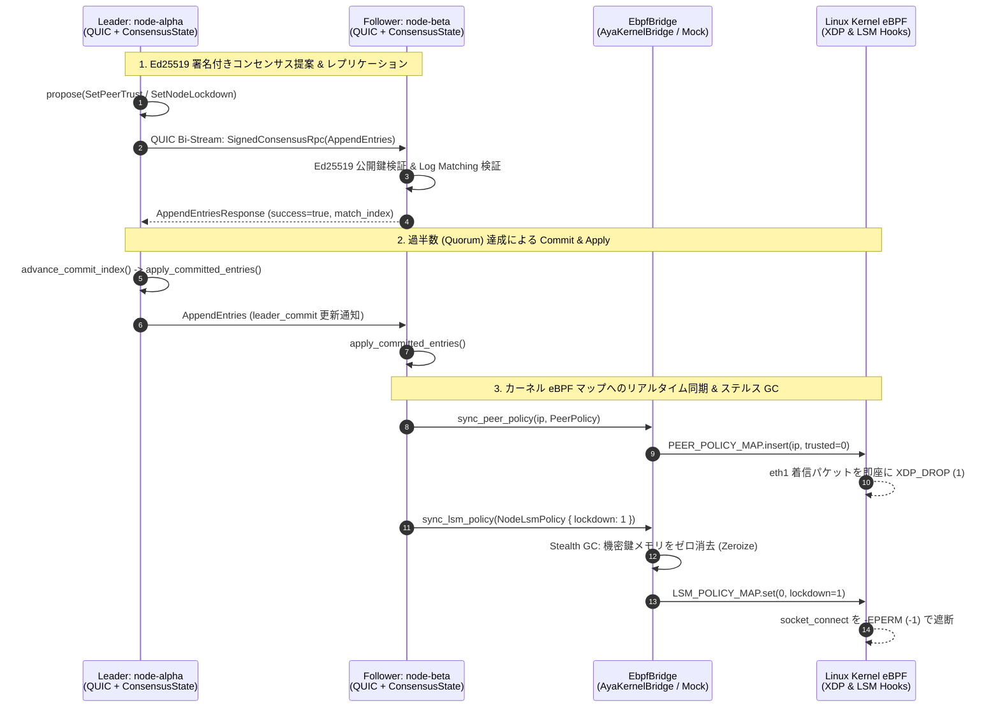

# `veil-mesh-consensus` 低レイヤー・コンセンサス & eBPF/LSM 連動 証明解説書

本書は、`veil-mesh-consensus` において **QUIC (`Tokio` + `quinn`) トランスポート上の合意形成アルゴリズム（Raft + Ed25519 BFT 署名検証）** と **Linux カーネル空間の eBPF (`Aya` XDP パケットフィルタ & LSM `lsm=bpf` ステルス GC)** が一貫して動作し、スプリットブレインやビザンチン攻撃（なりすまし・改ざん）に対して安全であることを証明する技術解説ドキュメントです。

---

## 1. アーキテクチャとデータフロー全体像

ユーザー空間の `ConsensusState` で過半数（Quorum: $\lfloor N / 2 \rfloor + 1$）の合意に達したログエントリのみが [`EbpfBridge`](file:///Users/takemuramasaki/_workspace/veil-mesh-consensus/veil-node/src/ebpf_bridge.rs#L8-L18) トレイトを介してカーネル空間の eBPF マップへ書き込まれます。



---

## 2. カーネル空間とユーザー空間の「単一判定ロジック」の共有

eBPF プログラムとユーザー空間テストの間で仕様の乖離が起きないよう、`#![no_std]` クレートである [`veil-common/src/lib.rs`](file:///Users/takemuramasaki/_workspace/veil-mesh-consensus/veil-common/src/lib.rs) に共通のメモリレイアウト (`#[repr(C)]`) と純粋関数を定義しています。

| 制御対象 | 共有構造体 (`veil-common`) | 共有判定関数 (`veil-common`) | カーネル eBPF 実装 (`veil-ebpf`) |
| :--- | :--- | :--- | :--- |
| **XDP パケットフィルタ** (`eth1`) | [`PeerPolicy`](file:///Users/takemuramasaki/_workspace/veil-mesh-consensus/veil-common/src/lib.rs#L7-L11) (`trusted`, `epoch`) | [`evaluate_peer_policy`](file:///Users/takemuramasaki/_workspace/veil-mesh-consensus/veil-common/src/lib.rs#L53-L58) $\to$ `XdpVerdict::{Pass, Drop}` | [`veil_xdp_filter`](file:///Users/takemuramasaki/_workspace/veil-mesh-consensus/veil-ebpf/src/main.rs#L57-L88) (`PEER_POLICY_MAP`) |
| **LSM ステルス GC ガード** (`lsm=bpf`) | [`NodeLsmPolicy`](file:///Users/takemuramasaki/_workspace/veil-mesh-consensus/veil-common/src/lib.rs#L27-L32) (`lockdown`, `epoch`) | [`evaluate_lsm_policy`](file:///Users/takemuramasaki/_workspace/veil-mesh-consensus/veil-common/src/lib.rs#L63-L68) $\to$ `0` (Allow) / `-1` (`-EPERM`) | [`veil_lsm_socket_connect`](file:///Users/takemuramasaki/_workspace/veil-mesh-consensus/veil-ebpf/src/main.rs#L92-L96) (`LSM_POLICY_MAP`) |

---

## 3. 5つの数学的・実装的証明テスト（`cargo test`）の解説

[`veil-node/src/main.rs`](file:///Users/takemuramasaki/_workspace/veil-mesh-consensus/veil-node/src/main.rs#L363-L699) に実装された 5 つのテストケースは、分散システムおよびカーネルセキュリティにおける重要な不変条件（Invariants）を証明しています。

### 証明 1: Election Safety（単一リーダー選出の安全性）
- **テスト関数**: [`proof_1_election_safety_and_log_up_to_date_check`](file:///Users/takemuramasaki/_workspace/veil-mesh-consensus/veil-node/src/main.rs#L369-L410)
- **証明する命題**: 同一の `Term`（任期）において、クラスタ内で同時に2台以上のリーダーが誕生することは絶対にない。
- **メカニズム**:
  1. `node-alpha` と `node-gamma` が同時に `Term 1` で立候補（`start_election()`）。
  2. `node-beta` は先に届いた `node-alpha` の `RequestVote` に対して `voted_for = Some("node-alpha")` を記録し `vote_granted: true` を返す。
  3. 直後に届いた `node-gamma` からの `RequestVote` に対し、`node-beta` は `voted_for != candidate_id` であるため厳密に `vote_granted: false` を返す。
  4. 結果として過半数（2/3）を獲得した `node-alpha` のみが `Role::Leader` となる。

---

### 証明 2: 実 QUIC メッシュ（3ノード）での合意形成と eBPF XDP 即時遮断
- **テスト関数**: [`proof_2_three_node_quic_consensus_and_ebpf_xdp_enforcement`](file:///Users/takemuramasaki/_workspace/veil-mesh-consensus/veil-node/src/main.rs#L413-L512)
- **証明する命題**: 実際の UDP ソケット上の QUIC (TLS 1.3) 双方向ストリーム通信を介して、3ノード間でリーダー選出とログ複製が行われ、全ノードの XDP フィルタ状態が一斉に切り替わる。
- **メカニズム**:
  1. `node-alpha`, `node-beta`, `node-gamma` の3つの QUIC エンドポイントを起動。
  2. `node-alpha` が `campaign()` で QUIC 越しの投票を集め Leader に昇格。
  3. `propose_and_commit(MeshCommand::set_trust(10.0.0.99, false))` を実行。
  4. 全3ノードの `commit_index` が `1` に進み、全ノードの `check_xdp_packet(10.0.0.99)` が一斉に `XdpVerdict::Drop` (`XDP_DROP`) を返すことを検証。さらに `trusted = true` を再合意すると全ノードで `XdpVerdict::Pass` に復帰することを実証。

---

### 証明 3: ネットワーク分断（Split-Brain）耐性と再合流時のロールバック収束
- **テスト関数**: [`proof_3_network_partition_split_brain_prevention_and_recovery`](file:///Users/takemuramasaki/_workspace/veil-mesh-consensus/veil-node/src/main.rs#L515-L584)
- **証明する命題**: ネットワーク分断によって孤立した少数派の旧リーダーは eBPF ポリシーを変更できず（Split-Brain の完全防止）、分断復旧時には未コミットログが破棄されて多数派のポリシーへ完全収束する。
- **メカニズム**:
  1. `Term 1` のリーダー `node-alpha` が `[alpha]` (1台) と `[beta, gamma]` (2台) に分断される。
  2. 孤立した `alpha` が `10.0.0.50` の遮断を提案しても、Quorum (2/3) に届かないため `commit_index` は `0` のまま凍結され、eBPF マップにも適用されない。
  3. 多数派 `[beta, gamma]` では `beta` が `Term 2` の新リーダーとなり、`10.0.0.200` の遮断を合意・コミットして XDP 遮断を発動。
  4. 分断復旧後、`beta` (`Term 2`) から `alpha` (`Term 1`) へ `AppendEntries` が届くと、`alpha` は即座に Follower へ降格し、孤立中の未コミットログ (`10.0.0.50`) を切り捨てて `10.0.0.200` の遮断ポリシーに一致する。

---

### 証明 4: カーネル eBPF ブリッジ連動と LSM ステルス GC (`lsm=bpf`) による機密メモリゼロ消去
- **テスト関数**: [`proof_4_ebpf_kernel_bridge_and_lsm_stealth_gc_zeroization`](file:///Users/takemuramasaki/_workspace/veil-mesh-consensus/veil-node/src/main.rs#L590-L654)
- **証明する命題**: コンセンサスで特定ノードの隔離 (`SetNodeLockdown`) が合意されると、[`EbpfBridge`](file:///Users/takemuramasaki/_workspace/veil-mesh-consensus/veil-node/src/ebpf_bridge.rs#L8-L18) を通じてカーネルの `LSM_POLICY_MAP` が書き換えられ、LSM フックが `-EPERM (-1)` で通信を封鎖すると同時に、メモリ上の機密鍵がゼロ消去（Stealth GC）される。
- **メカニズム**:
  1. Linux 実機用の [`AyaKernelBridge`](file:///Users/takemuramasaki/_workspace/veil-mesh-consensus/veil-node/src/ebpf_bridge.rs#L71-L153) と同じインターフェースを持つ [`MockEbpfBridge`](file:///Users/takemuramasaki/_workspace/veil-mesh-consensus/veil-node/src/ebpf_bridge.rs#L22-L68) に機密鍵データ (`[0xCA, 0xFE, 0xBA, 0xBE]`) を保持させる。
  2. `SetNodeLockdown { target_node: "node-beta", lockdown: true }` が合意・コミットされた瞬間、[`apply_committed_entries`](file:///Users/takemuramasaki/_workspace/veil-mesh-consensus/veil-node/src/consensus.rs#L483-L509) から `bridge.sync_lsm_policy()` が呼び出される。
  3. `node-beta` の LSM `socket_connect` 判定が `-1` (`-EPERM`) に切り替わり、同時に `sensitive_key_material` の全バイトが `0` で上書き・消去され、`stealth_gc_purge_count()` が `1` になることを確認。

---

### 証明 5: ビザンチン障害耐性（Ed25519 暗号署名によるなりすまし・偽造・改ざんの完全阻止）
- **テスト関数**: [`proof_5_byzantine_fault_tolerance_ed25519_signature_verification`](file:///Users/takemuramasaki/_workspace/veil-mesh-consensus/veil-node/src/main.rs#L661-L742)
- **証明する命題**: クラスタ内部のノードが侵害されたり、悪意ある第三者がネットワークに介入して「嘘の投票」「リーダーへのなりすまし」「合意コマンドの改ざん」を行っても、[`handle_signed_rpc`](file:///Users/takemuramasaki/_workspace/veil-mesh-consensus/veil-node/src/consensus.rs#L214-L240) の Ed25519 署名検証によって 100% 検知・破棄される。
- **検証している3つのビザンチン攻撃シナリオ**:
  - **攻撃 A（Identity Spoofing / なりすまし）**: 侵害された `node-gamma` が自身の秘密鍵で署名しつつ、RPC ペイロード内の `leader_id` を `"node-alpha"` と詐称して送信 $\to$ エンベロープの `signer_id` とペイロードの `sender_id()` の不一致により即座に拒否。
  - **攻撃 B（Signature Forgery / 秘密鍵偽造）**: 攻撃者 `node-mallory` が `signer_id = "node-alpha"` と名乗り、自身の秘密鍵で署名した RPC を送信 $\to$ 登録済みの `node-alpha` の Ed25519 公開鍵による検証 (`UnparsedPublicKey::verify`) が失敗し拒否。
  - **攻撃 C（Payload Tampering / 中間者改ざん）**: 正規リーダー `node-alpha` が署名した `SetPeerTrust(10.0.0.88, trusted=false)` のパケットを途中で傍受し、`trusted=true`（遮断解除）に1ビット書き換えて転送 $\to$ Ed25519 署名検証が失敗し拒否。
  - **結果**: 3回の攻撃すべてで `rejected_byzantine_packets` カウンタのみがインクリメントされ、`node-beta` の `current_term` や `ebpf_policy_map` は一切汚染されない。

---

## 4. 検証コマンドの実行方法

ワークスペースのルートで以下のコマンドを実行することで、上記 5 つの証明テストをいつでも再実行・検証できます。

```bash
cargo test --workspace -- --nocapture
```
