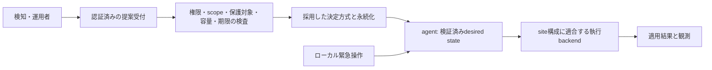

# 実践投入に向けたレビューと改訂設計案

評価日: 2026-10-23（Asia/Tokyo）  
対象: `c8d3f7f` の設計書、指定された5実装ファイル、および実行経路・eBPF・関連テスト・CI・導入手順  
状態: **レビューと設計提案。実装変更・本番導入の承認ではない。**

## 1. 判断

**現行実装は、本番で自動遮断を担う状態には達していない。** これは「さらにテストを増やせば安心」という程度の不足ではない。正常な署名と3/4の定足数があっても、誠実なノードが異なる遮断状態を確定する反例を再現した。通常デーモンの独立プロセス間通信、Linuxテストのビルド、成功応答と実際の執行にも具体的な問題がある。

一方、隔離されたLinuxのvethでは、配布済みeBPFオブジェクトによる `PASS → DROP → PASS` を確認できた。署名検証、境界検査、テスト可能な状態機械、執行ポートは今後の材料になる。ただし、その部品の動作から分散システム全体の保証へ飛躍してはならない。

目指すべき成果は「200行のBFT」や「11個の証明」ではなく、**対象サイトで正常利用者への影響を抑え、必要な遮断を実行し、失敗を見える形で扱い、運用者が復旧できること**である。

| ゴール | 今回の扱い |
| --- | --- |
| 最終ゴール | 小規模サイトから実践投入できる、維持可能な防御手段にする |
| 現在のマイルストーン | 現行の保証と限界を確定し、必要な実装・検証と採用判断を絞る |
| 今回のタスク | 根拠付きレビュー、反例、改訂設計、実装順序を引き渡す |
| 導入先 | **未決定**。ユーザーの回答に従い構成別の条件を示す |
| 未決定事項 | 本番でBFTが必須か、対象サイト、許容誤遮断、運用時間・費用の上限 |

原設計書は保存する。本書を採用する場合も、未合意の信頼モデル変更や追加機能を自動的に実装しない。

## 2. 今回確認したことと証拠の限界

### 2.1 検証環境と結果

| 検証 | 結果 | その結果が示さないこと |
| --- | --- | --- |
| macOS arm64、Rust 1.98.1、`cargo test --workspace --locked --offline` | 既存10件成功。Linux専用 `proof_7` は対象外 | Linux動作、独立OSプロセスのクラスタ、本番安全性 |
| macOSのformat、Clippy（workspace/all-targets、警告をエラー扱い） | 成功 | Linux限定部分のコンパイルやセキュリティ保証 |
| pi-node、Linux 7.0.0-38-generic x86_64、Rust 1.98.1、現HEADのテストビルド | **失敗**。`proof_tests.rs:424` のモジュール参照でE0433 | Linux CI成功とは扱えない |
| Linux検証コピーで上記参照だけ `crate::ebpf_bridge` に補正し `proof_7` を実行 | 既存の隔離vethで疎通・遮断・解除を実測 | 無変更HEADの合格、BFT、多ホスト、IPv6、TTL、耐負荷 |
| コピーに追加したmacOS反例8件 | 欠陥の存在をassertして成功 | 修正後の回帰試験の合格とは逆の意味 |
| Linuxの `BPF_PROG_TEST_RUN`、配布object、interfaceへのattachなし | 通常source portはDROP、22/10023はPASS。257件目map更新は拒否 | 実TCP接続の成立や耐負荷。合成frameへのkernel判定を確認したもの |
| 現mainから起動した独立2プロセス | 双方mTLSで `BadSignature`、成功Pingなし | TLSライブラリが壊れているという意味ではない |

依存は既存のロックファイルとキャッシュ／pi-nodeの既存vendorを使用した。依存追加、既知脆弱性DBの網羅照合、クラウド・本番検証は行っていない。ワークスペースのCargo版番号は `0.1.0` であり、文書の「v0.2.0」と版管理上のずれがある。

証拠はローカルの `artifacts/review-20261023-kvbx7g1s/` に保存した。再現テストは [review/2026-10-23-reproduction-cases.rs](review/2026-10-23-reproduction-cases.rs)、手順は [review/2026-10-23-REPRODUCTION.md](review/2026-10-23-REPRODUCTION.md) を参照する。これらは原本のテストや安全条件を弱める変更ではない。

### 2.2 「証明」と呼ぶ範囲

`proof_1`〜`proof_11` は特定シナリオの検証・回帰テストである。任意のメッセージ順序、再起動、侵害ノードの振る舞いを尽くした数学的証明ではない。`proof_2` は同一OSプロセス内の4状態機械と実UDP/mTLS通信を使い、公開鍵を手動登録する。`proof_7` は現在、オブジェクト/NIC欠落やattach失敗でも `Ok(())` を返す。CIの「成功件数」から実カーネル試験の実行を推定してはならない。

## 3. 実装の主要所見

P1は本番投入を止める問題、P2は採用設計・運用条件として解消する問題とする。優先度はテスト数ではなく、保証への影響で決める。以下の行番号は対象コミットのもの。

### R1 / P1: 末尾QCが、その前のログの一致を証明していない

根拠: `domain/entities.rs:43–50`、`usecase/consensus_engine.rs:512–546,656–679`。

`LogEntry::digest()` が結び付けるのは `(term,index,command)` だけで、直前のログやprefixのハッシュを含まない。一方、末尾のQCを検証すると、その位置までの全エントリを適用する。`prev_log_term` の一致は、悪意ある送信者の下ではprefixの内容の一致を意味しない。

4メンバーA/B/C/D、必要署名3、Aだけが不正という条件で、次を実コードの署名付きRPC入口から再現した。

1. AがBへ `[index1: IPを遮断, index2: NoOp]` を送り、Cへ `[index1: 同じIPを許可, index2: 同じNoOp]` を送る。
2. BとCは同じindex2のハッシュに署名する。Aの署名と合わせれば有効な3署名QCになる。
3. そのQCを双方へ配ると、ともに `commit_index=2` になり、BはDROP、CはPASSになる。

暗号の破壊、誠実なノードの秘密鍵の入手、再起動は不要だった。対策にはprefixを認証するblock/parent hashまたは全エントリの適切な証明が必要。ただし、それだけではR2のviewを跨ぐ安全性は解決しない。

### R2 / P1: commitの隠蔽と別termの提案で、競合する値が確定する

根拠: `consensus_engine.rs:528–530,537–546`。未commitログは別termのエントリで置換でき、投票済みの値を守る永続lockがない。

A/B/Cの署名で値XのQCを作りBだけへ配送した後、Aがterm2の値YをC/Dへ提案すると、A/C/DのQCでYも確定できる。BとC/Dでindex1の結果が分かれた。また、未確定ログをterm1→term2→term1と置換することで、誠実なBが同一 `(term,index)` の異なるhashへ署名することも再現した。最後のRPC自体のtermは2なので、低いRPC termの拒否では防げない。

同じtermの現在のログだけを比較する対策では、過去の投票制約を守れない。既知BFT方式に従うlock、投票状態、view変更の正当化、安定記憶が必要である。

### R3 / P1: 通常デーモンの独立プロセス間クラスタが成立しない

根拠: `infra/quic_mtls.rs:91–98`、`main.rs:100–110,130–145`。

各プロセスの `OnceLock` が別々のCAを生成し、そのCAだけを信頼する。共有trust bundleを読み込む経路がない。さらに `--peer` から実ノードIDと対応しないIDを作り、相手の署名公開鍵を登録せず、通常送信ループはPingのみである。選挙、提案受付、複製を駆動する運用runtimeがない。

共有CAを作るだけでは完了しない。静的メンバー定義、証明書とnode IDの対応、公開鍵配布、駆動ループ、管理入力を一体で検証する必要がある。現在のCloud導入ガイドは、予定された機能を実行可能な手順のように読めるため訂正対象となる。

### R4 / P1: 未commit・未執行を成功として扱う

根拠: `infra/quic_mtls.rs:172–200`、`consensus_engine.rs:656–676`、`ebpf_bridge.rs:112–139`。

`propose_and_commit()` は複製を2回呼ぶだけでcommit確認をせずindexを返す。全peer無応答でも `Ok(1)`、`commit_index=0`、`last_applied=0` を再現した。

別に、執行処理は `last_applied` とメモリ上のmapを先に更新し、bridgeのエラーを捨てる。失敗するbridgeを注入すると、カーネルへの反映に失敗しても適用済みになった。ユーザーへの成功応答は `Accepted`、`Committed`、`Applied` を区別しなければならない。

### R5 / P1: Linux専用テストがコンパイルできず、実行できてもskipを成功に数える

根拠: `proof_tests.rs:3,413–429`、`.github/workflows/ci.yml:42–43`。

Linuxビルドでは `ebpf_bridge::AyaKernelBridge` の名前解決に失敗した。macOSではこのコードがコンパイル対象にならない。参照を補正した場合でも、実機試験の前提不成立やattach失敗を成功として返す問題は残る。実機ジョブを分け、前提不足を明示skipまたはジョブ失敗にする。requiredの実機ジョブではskipを合格に数えない。

### R6 / P1: eBPF map容量の枯渇を回収できず、執行状態を誤報する

根拠: `veil-ebpf/src/veil_xdp_kern.c:53–58`、`veil-ebpf/src/main.rs:17`、`usecase/ports.rs:5–18`。

実mapは最大256件。解除は `trusted=true` の値を挿入するだけで、エントリを削除するポートがない。異なるIPが蓄積すると追加不能になる。R4の失敗無視と組み合わさると、画面上は遮断済みでも実際の保護は増えない。容量を増やすだけでなく、期限切れ・解除済みの回収と入場制限が必要。

### R7 / P1: C版のSSH例外がWeb向けの遮断にも穴を作る

根拠: `veil-ebpf/src/veil_xdp_kern.c:110–117`。

送信元または宛先portが22/10023なら、IPの拒否mapより先にPASSする。この条件では、遮断IPからWebの443番へ送るパケットも、送信元portが22なら通過する。管理通信の保護には、管理元CIDR、管理先、方向、宛先portを含む明示した例外を用いる。Rust版には同じ例外がなく、C/Rust/配布objectの挙動が一致しない。

pi-nodeの実カーネルで、配布objectへ合成Ethernet/IPv4/TCP frameを与える試験を行い、通常source port 40000は `XDP_DROP=1`、source port 22/10023は `XDP_PASS=2` になることを確認した。実ネットワークへこのframeを送信した試験ではない。同じ試験でmapの257件目更新拒否も確認した。object SHA-256は `90ba0784f0c2ffacac1bcdf5c50903db5627acaaa7772777f7bd095b21c450dc`。

### R8 / P1（条件付き）: 0600鍵ファイルという約束を守れない

根拠: `adapter/crypto_ring.rs:44–75`。

既存0644鍵をそのまま受け入れることを再現した。新規生成はwrite後にchmodするため、umask022ならchmod前に広い読み取り権限で存在する。`exists → read/write` は排他的生成でなく、symlinkや並行起動への対処もない。安全な所有ディレクトリ、作成時0600、排他的作成、symlink拒否、既存所有者/mode検査、必要なfsyncを設計する。レース時間の実測や他ユーザーからの秘密読取は行っていない。

### R9 / P1: 受信上限を超える遅延ノードが追随できない

根拠: `consensus_engine.rs:275–280`、`domain/policy.rs:59–60`、`quic_mtls.rs:211`。

未送信ログを全件送る一方、受信には1024エントリ・64KiBの上限がある。1025件のNoOpをまとめて送る再現では、受信側が拒否してログが空のままになった。送信側で件数とwire byte数の両方を上限内に区切り、単一コマンド上限、再送cursor、snapshot復旧を定義する。

### R10 / P2: term上限の1つ手前でも選挙の単調増加が崩れる

根拠: `consensus_engine.rs:164–172,205–216`。

`MAX_SAFE_TERM-1` は受理するが、そこで `start_election()` はtermを増やさず投票先を自分に変えることを再現した。単純な最大値除外では十分でない。上限到達時は新規署名を停止し、復旧手続きを要求する。BFTではメンバーが任意の高いviewを主張しただけで無条件追随しないための正当化も必要。

### R11 / P2: ガード・資源制限・デモの境界を明記する

- 既定保護IPは `127.0.0.1` と `0.0.0.0` の2個。管理網・全loopback・peer・gatewayの保護設定は通常起動に配線されていない。CIDR、IPv6、TTLは現在のコマンド型にない。
- RPC/QCにcluster IDや設定epochがない。同じ鍵を別環境や復元環境で再利用すると、リプレイの境界が曖昧になる。
- 受信64KiBは、接続数・QUIC window・同時task・署名検証queue全体の資源上限ではない。接続、stream、deadline、rate、queueを別々に制限する。
- `proof_9` の偽造RPCは未知の署名者として拒否され得る。既知署名者の不正署名も、実wire上で別途確認する。
- 起動時のeBPF attach失敗はQUIC-onlyで継続する。執行を要求した運用ではreadiness失敗にする。
- TUIの「XDP active」表示にも書込み失敗無視があり、resetは実mapを初期化しない。デモ操作を運用APIに流用しない。
- 現在のLSM/ダミー鍵消去の実演を、PHPアプリやホスト全体の保護の証拠にしない。入出力の方向が違うWarden検知を、そのままWeb攻撃元IPに変換しない。

## 4. v1設計書に対する修正要求

| 原設計の箇所 | 問題 | 改訂要求 |
| --- | --- | --- |
| S1、33行 | 同一 `(term,index)` だけの一致では、別termで同じindexの確定値が変わる問題を禁止できない | 同一cluster/config epochの同じlog位置について、全viewを通じた決定の一意性を要求する |
| 18、91、97–118行 | 「2段階QCとTCを約200行」は見積根拠がなく、quorum交差だけではlock維持・unlock・進行条件を証明しない | 既知方式を選び、完全な状態遷移・永続化・view同期の仕様を採用する。行数を安全性や納期の根拠にしない |
| 113–118行 | 1台だけが知る提案の検閲では、他の誠実ノードのtimeoutが発火するとは限らない。Aを除く誠実1台だけのtimeoutから3票は集まらない | 提案の再送・共有、各ノードの進捗時計、view同期・遅れたノードの追随、無効要求によるview churn防止を定義する |
| 122–127行 | 固定256bytesに可変長NodeIdとQCは収まる保証がない。3署名だけでも192bytes、QC metadataが48bytes、残りの永続stateとID/encodingも必要 | 長さ付き・版付きレコード、上限、CRC、全投票phase、commit内容、snapshotを含む実サイズを定義する |
| 20、70、149–157行 | 適用時刻+TTLだけでは、遅延受信・再起動・再適用で古いBANが再開始する | 期限の起点、古さ、冪等性、boot跨ぎ、時計異常の扱いを仕様化する |
| 135–155行 | 最長一致の短命 `/32` が失効してもmapに残ると、有効な親 `/24` を隠してPASSになり得る | 最初はexact IPに限定する。CIDR重なりを導入するときに優先順位と失効を独立検証する |
| 165行 | 未失効ルールのローカルevictionとReconcilerの再挿入が衝突する | 期限切れ/解除済みのみ回収。容量超過は入場拒否か明示した縮退として報告する |
| 49、60–85行 | CDN/LBと直送を同一視。QCが誤検知を防ぐという説明も過剰 | topologyと検知の信頼境界を分ける。合意は入力の真実性を作らない |
| 63、82、164、175行 | 5–15msは未測定。128/0.05=2560は算術上限。50ms batching込みの提案→commitでp99<25msは整合しない | 受付・batch待ち・合意・適用・実パケット効果を別々に測定してから目標を決める |
| 184–193行 | 3秒復旧は未測定、記載CLIは未実装。一般のXDP解除コマンドが所有linkの方式に適合するかも未検証 | 実装済みコマンドと提案APIを分け、再起動・再attachまで含む復旧試験を行う |

HotStuff-2の著者解説では、最高lockを知り、他のノードを安全に進行させる条件が主要な論点であり、場合によってview同期後の待機も必要になる。「TC内の最大termのQCを選ぶ」だけから同じ保証は導けない。[HotStuff-2著者による方式比較](https://decentralizedthoughts.github.io/2023-04-01-hotstuff-2/)

LPMの指摘は、lookupが最長一致の値を1つ返す仕様と原設計のTTL分岐から導いた設計上の反例である。現行にLPM実装はないため、現行バイナリで発生した障害とは区別する。[Linux 6.10 LPM仕様](https://www.kernel.org/doc/html/v6.10/bpf/map_lpm_trie.html)

## 5. 採用方針: 用途・信頼モデルを選んでから実装する

### 5.1 構成別の導入条件

| サイト構成 | 実際のclient識別 | 適切な執行場所 | 初回導入の条件 |
| --- | --- | --- | --- |
| 利用者が直接接続するLinux | L3送信元。NAT共有IPの可能性は残る | 既存nftables、必要なら同じ入口のXDP | 対象interface/宛先/portと他サービスへの影響を確認。exact IP、短期lease、管理網保護 |
| 送信元を保持するL4 LB | LBの設定・方式・経路による | 実際に送信元を保持している入口 | 設定名だけで判断せずpacketとアプリlogを比較する。保持を確認できなければL7扱い |
| ALB等のL7 proxy | 接続元はproxy。元clientは信頼したheader等 | proxy/WAF、またはアプリ入口のL7制御 | trusted proxyを限定し、直アクセスとheader偽装を排除。proxy IPを利用者の代わりにBANしない |
| Cloudflare等のCDN | originの接続元はedge、元clientは検証済みheader | CDN/WAFの機能、必要ならoriginのL7制御 | まず既存ルールを利用。API同期は権限・期限・rate limit・部分失敗・費用を別に評価 |
| 共有ホスト/複数virtual host | L3だけではsiteを識別できない | siteを識別できるL7層 | 1siteの判定で同じホスト上の別siteを遮断しない |
| Serverless/PaaS | 実行基盤のネットワーク制御に制約 | 提供されるWAF/edge/app機能 | XDP agentの設置を前提にしない |

Cloudflareは元IPをheaderでoriginへ渡すことを説明している。headerを読めることと、XDPが処理するL3送信元が変わることは別である。この表の執行場所はその通信経路からの設計判断。[Cloudflareの元IP復元](https://developers.cloudflare.com/support/troubleshooting/restoring-visitor-ips/restoring-original-visitor-ips/)

### 5.2 比較対象と信頼モデル

| 案 | 採用する条件 | 保証しないこと | 判断 |
| --- | --- | --- | --- |
| 既存WAF/rate limit、既存nftablesのtimeout set | 既存機能で対象siteの問題を解ける | 独自のBFT | **最初の比較対象**。十分なら本作を本番経路に追加しない |
| 信頼する1つのcontrollerが期限付き決定を署名しagentへ配信 | 1人/同一運用組織、controller侵害を脅威モデルの外に置ける | controllerのByzantine耐性、単独障害時の新規決定継続 | **小規模pilot向け提案**。信頼モデルの明示的な採用が必要 |
| CFTの既存replicated logを使うcontroller | controllerの停止耐性が必要で、悪意あるcontrollerは想定しない | Byzantine耐性 | 稼働実績が必要になってから選定。署名を加えてもBFTにはならない |
| 4 validator/3票の既知BFT方式 | 「1台の侵害で他ノードの合意を破壊できない」が必須で、運用費を許容できる | 侵害rootのローカル保護、誤検知防止、共通管理鍵や共通脆弱性の侵害 | **条件付き研究・製品候補**。現行hybridに継ぎ足して本番化しない |

nftablesには要素ごとのtimeoutがある。独自TTLを作る前に、この既存機能と同じ負荷・期限・復旧条件で比較する。[nftables Element timeouts](https://wiki.nftables.org/wiki-nftables/index.php/Element_timeouts)

Raftの原論文は非Byzantineの停止故障を前提としている。信頼するcontrollerのHAとして使う判断と、侵害耐性のあるBFTとして使う判断は分ける。[Raft論文](https://raft.github.io/raft.pdf)

同じ管理者であることだけでBFTが無意味とは言えない。個別Webノードの侵害を考慮する価値はある。ただし、同じホストに4プロセス、全台共通root鍵、全台へ書込み可能な同じ配布権限は、その侵害に対する独立した4つの信頼境界にならない。validatorをWeb workerから分離する案と、その追加運用負担も比較する。

## 6. 共通の最小製品設計

以下は未実装の改訂案。中央配信と将来のBFTが共通に使える責務だけを定め、将来拡張のためだけの汎用基盤は作らない。

### 6.1 責務と境界

sensorは根拠を提案し、決定主体が許可し、agentが対象範囲を再検査し、執行backendが結果を返す。ネットワークdaemonや検知コードがrootで任意コマンドを実行する設計にしない。privileged helperが必要なら、対象interface/map/setと許可操作を固定し、自由なshell引数を渡さない。

初回pilotは以下に限定する。

- 1site、1つの対象サービス、1つの執行backend。
- IPv4 `/32`、IPv6を扱うなら同じ意味の `/128`。IPv6未対応なら明示して対象外にし、全通信保護を表示しない。
- TTL付きdenyと、そのルールを指定した解除。広いCIDR、恒久deny、node全体LSM lock、プロセスkill、秘密消去は対象外。
- まず観測だけ、その後に運用者が承認する限定適用。自動適用は検知品質が確認された入力だけ。
- TTL・容量・受付rateはsiteの許容損失から決める設定値とし、架空の性能保証を置かない。

### 6.2 データの意味

| データ | 必須内容と規則 |
| --- | --- |
| ClusterConfig | `cluster_id`, `config_epoch`, `config_digest`, node ID・role・address・公開鍵・TLS identity、policy設定digest。member定義にはselfが正確に1件、peer一覧にはselfを含めない。ID/公開鍵重複・未定義peerを起動時拒否 |
| Observation | `sensor_id`, `event_id`, site/scope、`subject_kind`（攻撃元/接続先等）、IP family/address、検知規則ID、観測時刻と鮮度条件。生のHTTP本文や認証情報は送らない |
| Decision | `decision_id`, `rule_id`, key単位revision、cluster/config/policy context、対象scope、exact IP、action、発行・失効時刻、理由コード、承認の根拠digest |
| Authorization | 中央案ではcontroller署名。BFT案では選定方式のcommit証明。型を分けて誤って混用しない |
| ApplyStatus | decision/revision、対象node/backend、`accepted/committed/applying/applied/degraded/expired/revoked`、失敗理由と最終確認時刻 |

同じevent/decisionの再送は結果照会として扱い、TTL更新や新しい投票の原因にしない。新しい期限への延長は別revisionの決定とする。解除はrevision/tombstoneを保持し、遅れて届いた旧BANで復活しない。API timeoutは「失敗して存在しない」と断言せず、結果不明としてdecision IDで再照会できるようにする。

この永続化は中央配信案でも必要である。controllerは署名した決定を配信する前にdecision/revisionをdurableに保存し、agentは適用・解除を受領したと応答する前に必要なrevision/tombstoneを保存する。復旧時は保存状態と認証済みsnapshotの基準を確認し、状態紛失・巻戻りが疑われる場合に空stateから古い決定を再適用しない。tombstoneの回収は、対応する旧決定が以後受理されないことをrevision基準と期限から確認できる場合に限る。

IP単位の遮断は共有NATや共有proxyの利用者全員へ作用する。保護CIDRにないことだけを自動遮断の十分条件にしない。検知元の権限・対象site・最大件数・最長TTL・更新頻度を制限し、侵害sensorが解除や別siteへのルールを出せないようにする。

### 6.3 ガードレール

全loopback、未指定・multicast等の無効対象、管理元CIDR、管理先、cluster peer、LB/CDN、必要なDNS/health check経路を、topologyに合わせて設定する。protected範囲とdeny対象の**包含・交差**を検査する。IPv4-mapped IPv6などの表現はcanonical化し、同一IPを別表現で扱わない。

初期profileはexact IPだけなので広いprefixを受理しない。将来CIDRを許すなら、正当な小さいprefixというだけで自動適用せず、影響範囲に応じた承認条件を別に置く。ガード設定の変更はpolicy revisionの変更であり、署名・配布・監査・復旧対象とする。

### 6.4 期限・再起動・再送

「相対TTLだけなら時刻問題がなくなる」という前提を採用しない。再起動や長期分断を跨いで古い判断の再適用を防ぐには、信頼できる時刻の範囲、または新しい問い合わせで得る鮮度の証明が必要になる。

小規模向けの提案は、署名付き `not_after` と短い最大lease、執行時の単調時計を組み合わせる。

1. 発行者は `issued_at`、`not_after`、最大有効期間を決定へ署名する。受信側は期間・scope・revisionを検証する。
2. ローカル壁時計の誤差が最大 `epsilon` と確認できる場合だけ、新規leaseを適用する。安全側の残時間は `max(0, not_after - (wall_now + epsilon))` とし、設定上限でもclampする。時刻は同じ単位で計算し、ns変換のoverflowを拒否する。
3. 残時間をLinux `CLOCK_BOOTTIME` / 対応するBPF boot clockの期限へ変換する。ユーザー空間とカーネルで異なるclock基準を混ぜない。壁時計の後退を既存の単調期限へ反映しない。
4. 同じrevisionの再適用は既存期限を延ばさない。`(boot_id, rule_id, revision, earliest_deadline_boot_ns)` を適用前にdurableに保存し、同一bootでdaemonだけ再起動した場合は保存期限と再計算期限の早い方を使う。保存状態が失われた場合は同revisionを新規leaseとして再武装せず、復旧判断または新しいrevisionを必要とする。再接続・Reconciler・重複メッセージでも期限を再開始しない。
5. reboot後に以前のboot期限を再利用しない。初回profileは、時刻・保存revision・鮮度を確認できるまで新規BANを適用せず、期限付き決定を再取得する。起動時の防御の空白を明示する。
6. clockの誤差上限を確認できないときは新規自動適用を止める。既存の単調期限を延長しない。既存WAF等の基礎防御は継続する。

この選択は局所的な期限上限を守るための設計であり、全nodeの同時適用・同時解除を保証しない。BFTの決定的一致判定に各nodeのローカル時計を混ぜず、確定ログとローカルの期限付き執行を区別して観測する。厳密な全node同時執行が必要なら、このprofileは不適合である。

### 6.5 執行・Reconciler・容量

`committed_index` は決定の進行、desired stateは決定から導く論理状態、applied/observed stateはbackend確認後の状態として分離する。backendは結果を必ず返し、失敗を成功に変換しない。

Reconcilerはcurrent revisionと元の期限を保持して冪等に適用する。適用途中で落ちても再実行でき、古いrevisionへ戻らない。満杯のときは新規ルールを明示拒否し、期限切れ・解除済みを回収する。生きている確定ルールを黙ってevictしない。状態観測に上限を設け、巨大dumpをログへ出さない。

初回のルールは独立したexact IPとし、複数IPのバッチを全件atomicと主張しない。適用に失敗した項目は `degraded` で報告する。全件atomicなsnapshot切替が必要な用途だけ、backend固有のtransactionや世代mapを追加する。解除・緊急bypassは新規BANとは別の処理予算を確保する。

nftables backendはこのサービスが所有するset/chainだけを操作する。既存ruleset全体のflushはしない。XDP backendを採用する場合は、objectのhash、対応source、map ABI、kernel、driver、attach mode、link所有権を固定する。全packetへのtrace出力は性能と情報管理の問題になるため、集計counterを標準にする。

XDPのpin方針は実装前に1つ選ぶ。初回案ではunpinの所有linkを使い、daemon終了で本サービスの追加遮断が外れることを受入試験で確認する。これは既存の基礎firewallを外す意味ではない。daemon停止後も保持するpin運用が必要なら、独立したTTL保証、古いpin識別、回収とbreak-glassを追加してから採用する。

## 7. BFTが必須な場合の設計契約

この節は独自プロトコルの完成仕様ではない。方式選定と仕様確定の完了条件である。ここが未完なら本番BFTを名乗らない。

### 7.1 守る不変条件

- 同一cluster/config epochの同じlog位置で、誠実nodeが異なる値を決定しない。term/viewを跨いでも成立する。
- QCの署名は、確定対象の内容と必要なprefixを認証する。parent hash、height、view、phase、cluster/config/policy contextを含むcanonical payloadを定める。
- メンバー・重み・定足数は固定設定から算出する。別node IDに同じ公開鍵を複数登録して票を水増しできない。
- 同じ投票slotで矛盾する署名をしない。署名を外へ返す前に、必要な投票・lock状態と対象データを永続化する。
- safe-vote、lock更新、unlockの正当化、new-view、遅延QC、timeout後のメッセージ受理を、選定方式に従って列挙する。
- 分断時は安全性を維持する。新規合意が止まってもローカル期限と管理復旧は機能する。
- 再起動・snapshot復旧・古いバックアップ復元によって投票履歴を巻き戻さない。判断不能ならvalidatorとして投票を再開しない。

N=4、f=1、q=3なら、2つのquorumの交差は最低2台であり、うち最低1台は誠実である。この計算が意味を持つには、**その誠実nodeが永続的に矛盾投票を拒否する状態遷移**が必要。現行実装はR1/R2によりその前提を満たさない。

### 7.2 既存方式の選定

PBFT系、HotStuff系、Tendermint系などから、必要な決定速度・静的構成・運用可能な実装を比較する。ライブラリを採用するなら保守状況、security advisory、license、永続化契約、再構成、障害事例、実運用の根拠を該当versionで確認する。本レビューでは特定の既存ライブラリが本用途へそのまま採用可能という判断まではしていない。

独自実装を続ける場合は、参照方式を1つに固定し、対応する状態遷移表とモデルを先に作る。独自の「Raft+BFTの良いところ取り」を新しい標準方式のように扱わない。4台の固定構成では通信量の漸近最適化より、正しいview変更と復旧を説明・検証できることを優先する。

### 7.3 永続化と復旧

WALはversion、record length、sequence、payload、checksumを持ち、最大recordサイズを定義する。checksumは破損検知であり、root侵害や悪意ある改ざんへの認証ではない。

必要な保存対象は採用方式に従うが、少なくとも現在view、投票履歴、lock/必要QC、認証対象のlog内容またはblock、commit証明、適用cursor、設定epoch、snapshot基準を漏れなく扱う。署名後にクラッシュして同じslotへ別署名しないよう、durability完了を応答の前提にする。新規ファイル・rename・snapshot切替では親directoryの永続化も含める。

tailの部分書込み、途中破損、disk full、fsync失敗、古いsnapshot、失効鍵、同一鍵での同時起動を試験する。durabilityを確保できなければ新しい投票を止める。投票stateの紛失時に空stateから同じvalidator鍵で再参加しない。

membership/key rotationは、旧構成と新構成の両方が独立して成立する分岐を防ぐ手順が必要。単に各台の `cluster.toml` を順番に書き換えて完了とはしない。初回BFT候補では固定構成、変更は停止して合意したcheckpointから全員を検証付き再開する運用も比較する。ただし、停止・fencing・残存旧鍵・config epoch・再開条件を仕様に含める。

### 7.4 研究の終了条件

検証する問いは「静的4node、1 Byzantineとクラッシュ再起動の下で、同じ位置の決定が一意に保たれ、通信が安定した後に進行するか」。現在の製品への接続は、採用が決まった場合の決定方式の置換に限る。

終了条件は、参照方式と差分の確定、モデル検査の範囲・未検査条件の明記、R1/R2と再起動反例の否定、実runtimeとのtrace照合である。新規方式の発明や行数削減は研究目標にしない。必要性・保守負担・時間予算が合意されない場合、研究を継続して主力プロダクトを止めない。

## 8. 通信・鍵・管理面の最小仕様

通常nodeは共有CAの秘密鍵を持たず、自分のTLS秘密鍵と証明書、署名鍵、trust bundleを読む。TLS identityと設定node IDを照合する。TLS証明書更新と合意鍵変更は別の操作として失効・重複期間を定義する。鍵の欠落・破損で自動的に別のvalidator鍵へ置き換えて稼働を続けない。

署名payloadはprotocol version、message kind、cluster ID、config epoch/digest、role/phase、対象IDと内容hashを明示し、canonical encodingを固定する。鍵を環境ごとに分ける。末尾byte、余分な署名者、重複ID、過長ID、巨大length、未知versionを厳密に扱う。

QUICの採用自体は問題ではない。小規模で既にある依存を使うなら、接続の再利用、送受信のdeadline、connection/stream上限、window上限、peer別budget、bounded queueを設定する。TLS handshake、frame読込、署名検証、WAL、複製、applyの各timeoutを、単一の曖昧な「通信失敗」にまとめない。期限を超えたclient要求の取消しと、すでに確定した決定の取消しも別にする。

管理操作はUnix socketまたは限定した管理経路へ置き、OS peer credential・role・scopeを検証する。一般sensorの入力socketと、運用者の解除・policy変更の権限を分ける。metricsも原則loopback/管理網、無制限のIP labelを避ける。

## 9. 運用と失敗時の振る舞い

| 失敗 | 新しい遮断 | 既存の追加遮断 | 復旧・表示 |
| --- | --- | --- | --- |
| quorum/controller不達 | 成功と返さずpending/timeout/結果不明を区別 | 元の期限を超えて延長しない | 基礎WAF/firewall継続、通信復旧後はrevisionと期限を再確認 |
| map満杯・backendエラー | 対象を適用済みとしない | 生存ルールを黙って消さない | degraded、失敗理由、解除/期限切れGCを優先 |
| disk/fsyncエラー | validatorは新規署名停止、controllerは未永続化成功を返さない | 選定したbackendの期限方針に従う | readiness失敗、disk復旧と整合性確認 |
| clock不確実 | 新規leaseを適用しない | 単調期限を延長しない | clock状態を表示し復旧後に再取得 |
| 設定・鍵不一致 | 起動/投票を拒否 | 自動的に別鍵で参加しない | 管理操作で原因を直し、設定digestを確認 |
| 誤遮断・緊急復旧 | local bypass中は自動適用を停止 | 自分の対象ルール/所有linkだけを解除 | quorum不要の管理経路、解除理由・対象・期限を記録 |

local bypassはサービス再起動やReconcilerで勝手に再有効化されない状態として保持する。管理通信が遮断されても使えるout-of-band経路を準備する。復旧時間は実際の運用者の操作から測定し、「3秒」等の未検証の約束をしない。global unbanは配信確認を要し、local bypassの代わりにならない。

必要なSLIは、受付→決定、決定→各node適用、適用失敗率、未適用node、lease残期限、queue/disk/map水位、誤遮断の訂正件数・所要時間、正常な業務リクエストの成功率である。DROP packet数は処理件数であり、防いだ攻撃数や売上保護額ではない。

## 10. 実装・受入の順序

版番号や恣意的なテスト件数を完了条件にしない。各段階は前段階の判断が成立した場合にのみ進める。

| 段階 | 実装/判断 | 完了条件 | 中止・保留条件 |
| --- | --- | --- | --- |
| G0: 証拠と説明の整合 | R1〜R11の管理、Linux build、現機能/予定/デモの分離 | 正常系と負例の実行範囲が分かり、未実装手順を現行機能として案内しない | 現行hybridを安全と表示したまま配布しない |
| G1: 用途の確認 | 1site/topology/痛点/許容影響/信頼モデルを決め、既存WAF等と比較 | 実利用の入力から、既存手段で不足する点を具体的に示せる | 既存機能で十分、期待する誤検知・運用負担を改善できない |
| G2: 局所執行 | exact IP、認証済み入力、期限、ガード、状態報告、解除を1backendで実装 | 通常通信、管理経路、TTL、再適用、reboot、map full、部分失敗、bypassを隔離Linuxで確認 | 誤報や解除不能を残さない |
| G3: 配信と復旧 | 採用した決定方式、静的設定、鍵、永続化、分割catch-up | 独立OSプロセスで開始・停止・再接続・再起動・不達が仕様どおり。構成に必要なら別ホストでも実施 | 同一プロセスの成功を代用しない。BFT必須なら第7節完了前に進めない |
| G4: 観測pilot | 実siteで執行せず候補を評価 | 通常/繁忙/検知場面を含む根拠から、誤遮断・運用負担・比較対象との差を判断できる | 候補がない期間だけを成功としない。価値の根拠がなければ停止 |
| G5: 承認付きcanary | 人手承認の短期・限定適用、監視と復旧担当を用意 | 正常業務への影響と実際の回復手順を確認し、継続判断を得る | 管理経路の喪失、期限違反、未通知の執行失敗なら自動適用停止 |
| G6: 自動化/拡張 | 検証済み入力だけ自動化。必要ならIPv6/CIDR/HAを個別追加 | 安全条件を維持しながら、手間・効果・費用が改善する根拠がある | BFT/LPM/高頻度batchを同時に導入して原因を不明にしない |

### 最低限の受入シナリオ

- 既知メンバーによる矛盾提案、末尾QC、QC片側配送、異なるviewの古いメッセージ、署名再利用。
- 正常署名の誤検知、侵害sensor、保護範囲との交差、NAT/共有proxy、IPv4/IPv6表現の違い。
- fsync前後のクラッシュ、部分WAL、disk full、snapshot後復旧、古いbackup、同一鍵の二重起動。
- 分断・遅延・並べ替え・重複・遅延nodeのcatch-up。単なるpacket loss百分率ではなく不変条件をassertする。
- TTL境界、期限直前の受信、同じ決定の再送、clock後退、reboot、解除後の旧BAN到着。
- 実kernelの正常packet/拒否packet/管理packet、C/Rust/object差、送信元port、断片化・VLAN等の対応範囲、map容量と書込み失敗。
- 既存XDP/firewallとの共存、所有resourceだけの解除、daemon停止、サービス自動再起動、緊急bypassの持続。

単体・状態機械・独立プロセス・実kernel・実siteの結果を別々に記録する。モデル検査やfuzzingも、範囲と入力モデルを示す。有限試験の成功を一般的な安全性の証明とは呼ばない。

## 11. 次の設計担当者への依頼文

以下を、そのまま次の設計レビューへ渡せる。

> `docs/FEASIBILITY_REVIEW_AND_V1_DESIGN.md` と原設計、対象コミット `c8d3f7f` を比較して改訂してください。まずR1/R2の反例を説明し、定足数署名だけでは現行の安全性が成立しない点を認めるか、再現可能な反証を示してください。テスト名やAI同士の同意を証明に使わないでください。
>
> 現行の通常デーモン、同一プロセステスト、TUI、実Linux執行、将来構想を区別してください。Linuxビルド失敗・プロセス別CA・未commit成功・執行失敗無視・map容量・SSH例外を、根拠行と受入条件へ結び付けてください。
>
> 導入先は未決定です。直送Linux、L4 LB、CDN/L7 proxy、共有siteで何が成立するかを分けてください。まず既存WAF/nftablesで十分か評価し、独自実装の価値がある場合だけ最小profileを提案してください。
>
> 「1台侵害へのBFT」が必須なら保証を外さず、既知プロトコルの完全な状態遷移と永続化契約を提示してください。中央配信の小規模pilot案を採る場合は信頼モデルが変わることを明記し、採用判断を未決定として残してください。200行、5–15ms、p99、テスト件数等の根拠のない約束をしないでください。
>
> 出力は、採用/不採用理由、未決定事項、変更する仕様、具体的な受入試験、最小の実装順序と中止条件にしてください。まず文書改訂をレビュー可能にし、未承認の本番投入・外部公開・課金・依存導入へ進まないでください。

本書の完成はレビュータスクの完了であり、製品の完成、本番投入可能、BFT保証の達成を意味しない。

---

## 12. Argon High による設計補正と R1〜R11 確定実装仕様（Mediumモデル引き継ぎ用）

GPT-6 Astra / ultra による上記レビュー（R1〜R11）と実機検証（`pi-node` での `BPF_PROG_TEST_RUN` および `2026-10-23-reproduction-cases.rs` の反例8件）はすべて妥当であり、全面的に採用する。その上で、レビュー文書内で抽象的に残されていた箇所および運用上のエッジケース3点を以下の通り補正し、次フェーズ（Mediumモデルでの実装）が迷わず実装できる確定仕様とする。

### 12.1 GPT-6 Astra 設計案に対する3点の補正

1. **第7節（BFT状態遷移の具体化 — R1・R2の完全閉鎖仕様）**:
   - 第7節では「独自プロトコルの完成仕様ではない」として状態遷移が抽象化されていたが、実装フェーズで齟齬が生じないよう、以下の通り **Hash-Chained Log + 2-Phase Locked BFT (`PrepareQC` / `CommitQC` / `NewView`)** の構造体と状態遷移規則を確定する。
   - **R1対策（Prefix Hash Chain）**: `LogEntry` に `parent_hash: [u8; 32]` を追加する。`index = 1` の `parent_hash` は `[0u8; 32]`（または `cluster_config_digest`）、`index > 1` の `parent_hash` は直前エントリ `log[index - 2].digest()` とする。`LogEntry::digest()` は `(cluster_id, config_epoch, term, index, parent_hash, command)` を SHA-256 でハッシュ化する。これにより末尾のQC（例：`index = 2` の `NoOp`）の `entry_hash` が `index = 1` の内容に暗号学的に束縛され、`audit_tail_qc_commits_conflicting_prefixes` は数学的に成立しなくなる。
   - **R2対策（同一スロット二重投票禁止 ＋ 2段階QCロック `locked_qc`）**:
     - **二重署名防止**: `ConsensusState`（および永続WAL）に `voted_slots: BTreeMap<(u64, u64, VotePhase), [u8; 32]>` を保持する。まず `AppendEntries` 内の各エントリについて `entry.term != current_term`（過去のtermの混ぜ込み）を拒否し、`audit_term_sandwich_obtains_two_votes_for_same_term_and_index` を防ぐ。さらに同一 `(term, index, phase)` に対して一度署名した `entry_hash` と異なるハッシュへの署名を恒久的に拒否する。
     - **2段階QC（`VotePhase::Prepare` → `VotePhase::Commit`）**:
       1. リーダーがエントリを複製すると、フォロワーは `locked_qc` と競合しないことを検証した上で `VotePhase::Prepare` 署名を返す。
       2. リーダーが $2f+1 = 3$ 票の `Prepare` 署名を集めて `PrepareQC` を形成しフォロワーへ送ると、各フォロワーは **`self.locked_qc = Some(prepare_qc)` を更新・永続化**した上で、`VotePhase::Commit` 署名を返す。
       3. リーダーが $2f+1 = 3$ 票の `Commit` 署名を集めて `CommitQC` を形成した時点で初めて `commit_index` が進み、カーネルへ適用される。
       4. これにより、任意の1台（Node B）が `CommitQC(X)` を受け取って `X` を確定した時点では、必ず $2f+1 = 3$ 台（うち誠実ノード最低2台：Node B, C）が `PrepareQC(X)` を受け取って `locked_qc = X` にロック済みとなる。次の `term = 2` で競合値 `Y` を提案しても、C は `locked_qc = X` により投票を拒否するため、定足数（3票）が絶対に集まらず `audit_hidden_qc_allows_conflicting_commits_across_terms` が完全に防がれる。
2. **第6.4節（NTP障害・時刻不確実時のフォールバック補正）**:
   - 壁時計の `issued_at` / `not_after` で古い決定の再適用を防ぐ設計は採用するが、UDP/123（NTP）へのDDoS等で時刻誤差上限が確認できない場合に「全自動遮断を完全停止」すると防衛機構自体が無력化される。そのため、**「現在進行中の合意viewで新規に承認された決定については、設定された最大短期リース上限（例：`max_fallback_ttl_secs = 300`）で `CLOCK_BOOTTIME` にクランプして適用を許可し、再起動後のWAL/Snapshot復元や遅延catch-upによる過去決定の再適用時のみ壁時計検査を厳格に要求する」** 二段構えとする。
3. **再現テストコードのポータビリティ補正**:
   - [`docs/review/2026-10-23-reproduction-cases.rs`](file:///Users/takemuramasaki/_workspace/veil-mesh-consensus/docs/review/2026-10-23-reproduction-cases.rs#L378-L398) の `transport_review_existing_key_permissions_are_not_validated` が特定の `/tmp/veil-mesh-transport-review.etzQSI` パスをハードコードしていたため、`std::env::temp_dir()` 配下にプロセスID付き一意ディレクトリを生成・掃除する形に補正済み。

### 12.2 R1〜R11 ファイル別実装チェックリスト（実装フェーズ用）

| 項目 | 対象ファイル | 実装内容 |
| --- | --- | --- |
| **R1 / R2 / R10** | [`veil-node/src/domain/entities.rs`](file:///Users/takemuramasaki/_workspace/veil-mesh-consensus/veil-node/src/domain/entities.rs), [`veil-node/src/usecase/consensus_engine.rs`](file:///Users/takemuramasaki/_workspace/veil-mesh-consensus/veil-node/src/usecase/consensus_engine.rs) | `LogEntry` に `parent_hash: [u8; 32]` 追加。`VotePhase::{Prepare, Commit}` の2段階QC、`locked_qc`、`voted_slots` の導入。`entry.term < current_term` の拒否。`current_term + 1 >= MAX_SAFE_TERM` 到達時は選挙を開始せずエラー/停止状態にする |
| **R3** | [`veil-node/src/infra/quic_mtls.rs`](file:///Users/takemuramasaki/_workspace/veil-mesh-consensus/veil-node/src/infra/quic_mtls.rs), [`veil-node/src/main.rs`](file:///Users/takemuramasaki/_workspace/veil-mesh-consensus/veil-node/src/main.rs) | ファイルベースの共有CA / Node証明書 / 静的Peer公開鍵束（`ClusterConfig`）の読み込み経路を追加し、独立OSプロセス間でmTLSハンドシェイクと合意ラウンドが成立するようにする |
| **R4** | [`veil-node/src/infra/quic_mtls.rs`](file:///Users/takemuramasaki/_workspace/veil-mesh-consensus/veil-node/src/infra/quic_mtls.rs), [`veil-node/src/usecase/consensus_engine.rs`](file:///Users/takemuramasaki/_workspace/veil-mesh-consensus/veil-node/src/usecase/consensus_engine.rs) | `propose_and_commit` は `PrepareQC` → `CommitQC` の2往復後に `commit_index >= idx && last_applied >= idx` を確認できなかった場合 `Err` を返す。`apply_committed` は `bridge.sync_peer_policy` が `Err` を返した際に `last_applied` やインメモリ遮断状態を更新せず、`last_apply_error` を記録する |
| **R5** | [`veil-node/src/proof_tests.rs`](file:///Users/takemuramasaki/_workspace/veil-mesh-consensus/veil-node/src/proof_tests.rs#L424) | Linux専用 `proof_7` の `ebpf_bridge::AyaKernelBridge` を `crate::ebpf_bridge::AyaKernelBridge` に修正。前提インターフェース不在時はテスト成功と混同しないよう明示ログ・環境変数制御を設ける |
| **R6 / R7** | [`veil-ebpf/src/veil_xdp_kern.c`](file:///Users/takemuramasaki/_workspace/veil-mesh-consensus/veil-ebpf/src/veil_xdp_kern.c), [`veil-ebpf/src/main.rs`](file:///Users/takemuramasaki/_workspace/veil-mesh-consensus/veil-ebpf/src/main.rs), [`veil-node/src/usecase/ports.rs`](file:///Users/takemuramasaki/_workspace/veil-mesh-consensus/veil-node/src/usecase/ports.rs), [`veil-node/src/ebpf_bridge.rs`](file:///Users/takemuramasaki/_workspace/veil-mesh-consensus/veil-node/src/ebpf_bridge.rs) | C版XDPの `src_port == 22 \|\| src_port == 10023` バイパスを削除し、Rust版と挙動を統一。`PEER_POLICY_MAP` の上限拡張と、信頼回復（解除）時の `remove_peer_policy`（map要素削除）を追加して257件目以降の枯渇を防ぐ |
| **R8** | [`veil-node/src/adapter/crypto_ring.rs`](file:///Users/takemuramasaki/_workspace/veil-mesh-consensus/veil-node/src/adapter/crypto_ring.rs) | 既存鍵読み込み時に Unix mode が `0600` 以外（例：`0644`）またはシンボリックリンクであれば `Err` で拒否する。新規作成時は `OpenOptionsExt::mode(0o600)` と `create_new(true)` で最初から `0600` として排他作成する |
| **R9** | [`veil-node/src/usecase/consensus_engine.rs`](file:///Users/takemuramasaki/_workspace/veil-mesh-consensus/veil-node/src/usecase/consensus_engine.rs) | `make_append_entries` で未送信ログを切り出す際、`MAX_LOG_ENTRIES_PER_RPC`（1024件）およびワイヤサイズ上限以下にチャンク分割して送信する |
| **回帰テスト** | [`veil-node/src/proof_tests.rs`](file:///Users/takemuramasaki/_workspace/veil-mesh-consensus/veil-node/src/proof_tests.rs) | [`docs/review/2026-10-23-reproduction-cases.rs`](file:///Users/takemuramasaki/_workspace/veil-mesh-consensus/docs/review/2026-10-23-reproduction-cases.rs) の全8件（Linux実機では9件）を「欠陥が阻止されること（不変条件の成立）」をアサートする回帰テストとして `proof_tests.rs` に組み込む |
