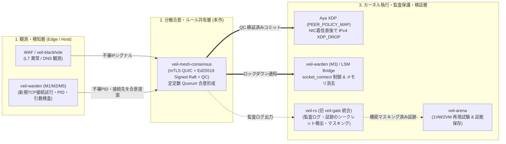

Archived local working document / ローカル最終文書の保全。

2026-10-28: Preserved from the local changes involved in the stash conflict. Historical statements, next steps, and relative links below retain their original context; they are not current recommendations or authorization to resume development. See the repository root README and docs/PROJECT_CLOSURE.md for closure status.

---

# 開発終了 — veil-mesh-consensus

> [!CAUTION]
> **2026年10月27日、開発を終了しました。実験・研究用の記録です。本番環境への導入を推奨しません。**
>
> **今後の保守・機能追加・セキュリティ修正は予定していません。GitHubは読み取り専用のアーカイブとして保管します。**

## [ARCHIVED] The Slumbering Destroyer (2026)

本リポジトリは、**eBPF × Rust × QUICによる合意形成**を用い、自律型メッシュ防衛システムを目指した実験的プロトタイプです。

[Cloud Runのようにカーネル操作を許可しないマネージド環境](https://docs.cloud.google.com/run/docs/container-contract#container_security_restrictions)では、この方式をそのまま稼働させることはできません。VMやベアメタルでも、本実装の稼働はカーネル・NIC・ドライバーの条件に依存し、本番運用の成立は未確認です。

しかし、いつかDePIN（分散型物理インフラネットワーク）やP2Pベアメタルクラウドが当たり前になるWeb3の時代が訪れ、インフラの奥底まで使い手が自ら選べるようになったなら——。

**その時、この実験を受け継ぐ者よ。この「駆逐艦」の封印を解いてください。**

**それまで、このリポジトリは深い眠りにつきます。**

## 開発終了の理由

- 当初の目的である「複数サーバーが連携し、1台が侵害されても健全な他サーバーへ不当な遮断を波及させない仕組み」は、実用としての成立を確認できませんでした。後続の単体ホスト向け手動一時BANは、この目的の達成を意味しません。
- 特権操作とカーネル・NIC・ドライバー・クラウド実行環境への依存が強く、広く安全に導入・保守する負担に見合う効果を、既存手段との比較で示せませんでした。
- 隔離環境や特定ホストでの成功と失敗は研究成果として残しますが、汎用クラウド適合・公開サイトへの安全な試験導入は未達です。追加開発・追加課金試験は終了します。

これは「sudoを使うソフトウェアはすべて不適切」「GCP・AWSでeBPFが一律に禁止されている」という結論ではありません。本プロジェクトの目的・実装・導入負担・確認済みの効果を合わせた終了判断です。

コードと履歴、既存の未コミット変更、ローカルの試験証拠は保全します。GitHubのコードとローカルの後続修正・試験記録は同一ではありません。**以下の導入手順・設計・ロードマップは過去の実験記録であり、現在の導入推奨や開発再開計画ではありません。**

**ローカルの最終終了記録：** [両ホストの確認結果・Piの保全対象・終了の区切り](../../PROJECT_CLOSURE.md)。この追記はローカル保存のみです。

---

## veil-mesh-consensus — ローカル一時BAN

現在の試験導入対象は **`veil-local-ban`** です。Linuxホストの一つの宛先IPv4・TCPポートに対し、管理者が指定した送信元IPを有限時間だけ遮断する、任意の追加防御です。

**同時BANは256件まで。満杯時は新規拒否。再起動で全BANが消えます。** 自動攻撃検知・自動BAN・分散合意・BANの永続化は、このモードに含みません。通常のブラウザに専用クライアントや独自tokenを要求しません。

[English](../../../README_EN.md) · [導入](../../local-ban/INSTALL.md) · [一覧・適用・解除](../../local-ban/OPERATIONS.md) · [停止・復旧](../../local-ban/RECOVERY.md) · [試験導入前チェックリスト](../../local-ban/PILOT_CHECKLIST.md) · [試験履歴・失敗と現在地](../../local-ban/TEST_HISTORY.md) · [セキュリティと報告](../../../SECURITY.md)

**課金前の成果物（2026-10-27）:** [新x86_64版・専用package・helper・hashと検証結果](../../review/2026-10-27-GENERIC-X86-PACKAGE-PREPARATION.md)を固定しました。非root実起動とhelper回帰は合格。QEMU上のRust kernel GET一件は未解決のまま保全し、同じRust回帰をGCPで最初に通す必須gateを同梱しています。**新loaderのGCP適合・公開pilotは未達。** VM作成・NIC設定変更・課金は行っていません。[具体的な試験案](../../local-ban/GCP_GENERIC_SINGLE_VM_PLAN_20261027.md)と[helper手順](../../../scripts/generic-trial/README.md)を参照してください。

**次の試験案（2026-10-27、未実行）:** [GCP専用一台・明示Genericの具体案](../../local-ban/GCP_GENERIC_SINGLE_VM_PLAN_20261027.md)を用意しました。offloadの事前off・保全・元のwantedへの復元、隔離機能、実NICの通常停止／SIGKILL、最大60分・US$0.20・期限付き削除を固定。先に非課金で新x86_64版と専用packageを準備・hash提示し、作成・NIC変更は実行承認後だけです。今回のGCP読取りではVM／disk／予約IP0を確認。公開18443・公開BANは含まず、公開pilotは引き続きHOLDです。

**最新の実装・非課金回帰（2026-10-27）:** [明示Genericとactive／wanted保全guard](../../review/2026-10-27-GENERIC-OFFLOAD-GUARD-IMPLEMENTATION.md)を追加。defaultも含めLRO／hardware GROが事前offでないNICを拒否し、所有link・mode・feature等をREADY前に検査します。Linux非rootのローカルBAN51件と既存回帰に合格。自動fallback・NIC設定の自動変更はありません。**新loaderの実XDP／実NIC／GCPは未検証、公開pilotはHOLD。** 次は専用環境の設定・復旧と新たな試験の具体案確認からで、追加課金・設定変更は行っていません。以下の旧binaryの実測記録は保全しています。

## どこまで確認できているか

**最新の装着方式の判断（2026-10-27）:** [一次資料と既存codeから採否を整理](../../review/2026-10-27-GCP-XDP-ATTACH-DESIGN-DECISION.md)しました。明示GenericでもkernelがLRO／hardware GROを無効化し、link解放だけでは元へ戻りません。保存したGCPのrx-gro-hw:onを維持する「一行変更だけ」の案は不採用。**事前にactive／wantedの両方がoffの専用環境に限る明示Generic＋保全guardを、未実装・未検証の条件付き候補**とします。今回のEINVALの実機根因は未確定で、queue不足等と断言しません。実装・再試験・cloud操作は行わず、次の課金試験は保留です。

**最新のGCP再試験（2026-10-27）:** [非root実起動と隔離実XDPの32確認は合格、実NIC装着はEINVAL、撤去完了](../../review/2026-10-27-GCP-ISOLATED-XDP-PASS-NIC-EINVAL.md)。修正版packageで実際のx86_64製品--help、BAN／解除・期限・256件・通常／SIGKILL restart・停止復帰を確認。一方、ens4／VirtIO-Net／MTU1460への現行FD所有link作成は拒否され、再装着・設定変更・再作成せず約7分38秒で撤去、既存九区分一致と別の不存在照会を確認しました。**当該実NIC構成への現行方式の導入は不可、公開pilotはHOLD。** 次は追加課金なしの装着方式の判断で、Generic等の成功は未検証です。

**前段の追加課金なしの修正（2026-10-27）:** [試験packageの権限と非root事前確認](../../review/2026-10-27-GCP-PACKAGE-PREFLIGHT-FIX.md)を修正しました。旧700／600を拒否し、新packageはroot所有0755／0644に固定。24件の回帰と、ローカルLinuxで非root読取り・実行権・書込み拒否を確認。**x86_64製品の実起動・systemd・GCP XDPは未検証**で、次回は実際の非root--helpを必須ゲートにします。[一台再試験案・費用・撤去](../../local-ban/GCP_PACKAGE_RETRY_PLAN_20261027.md)は未承認・未実行。最終ゴールは[公開サイトの六条件](../../local-ban/DELIVERY_GATE.md)による安全な限定導入で、GCPは候補環境の一つです。

**直前のGCP一台試験（2026-10-27）:** [VM作成・SSHは成功、配置権限で隔離daemon起動失敗、撤去完了](../../review/2026-10-27-GCP-VM-BOOT-AND-EXEC-PERMISSION-FAILURE.md)。今回は以前のVM作成503を越えましたが、root所有binaryの0700を転送時に引き継ぐ試験側の確認漏れにより、非root daemonが203/EXECで停止しました。再試験・実NIC装着・BANへ進まず、約6分6秒で新設物を撤去し、既存九区分の選択項目一致と別の不存在照会を確認。**GCPのXDP適合・公開pilotは未達です。** 最大60分・US$0.20・期限条件は維持し、今回枠は終了。次回は新たな承認が必要です。[四分類対応表](../../local-ban/SUPPORTED_ENVIRONMENTS.md)・[承認時の具体案](../../local-ban/GCP_XDP_SINGLE_VM_PLAN_20261027.md)から詳細を辿れます。

**2026-10-27の採否:** 現行BOOTTIME絶対期限を維持する**標準nftablesへの移植は不採用**としました。timeout／expiresは相対期間であり、送信後の待機でも元の期限を延ばさないという契約を同等に保証できません。meta time・定期削除・安全マージンの案も評価し、期限契約は変更していません。[一次資料・既存code・採否根拠と残タスク](../../review/2026-10-27-NFT-BOOTTIME-ADOPTION-DECISION.md)。この分岐の追加実装・試験は終了し、現行XDPと全ての実験記録を保全します。公開pilotは未達です。

前段ではhp-ubuntuで[owner限定の隔離試験を一回完了](../../review/2026-10-27-NFT-OWNER-ISOLATED-ACCEPTANCE.md)。実CAP_NET_ADMINだけ・loのみのnamespaceで、socket close／SIGKILLの空table回収、対照table存続、最終table0を確認。unit停止・非enabled、回収・保全・証拠退避まで完了しました。**この成功は、BANの期限保証とは別の結果として残します。**

前段では現行XDPを保全し、[nftables候補の権限分離・停止復旧](../../local-ban/NFT_BOUNDARY_DESIGN.md)を独立Rustモデルで検証しました。27件のオフライン検証と既存製品のhash保全を確認。[モデルの結果・証拠](../../review/2026-10-27-NFT-BOUNDARY-OFFLINE.md)を保全しています。製品brokerの権限分離や実通信は未実装・未検証のまま、この移植候補を終了します。

本人の選択で**現行の絶対期限を維持**し、BAN適用を保留しました。[owner機能だけの隔離確認案](../../local-ban/NFT_OWNER_PROBE_PLAN.md)と専用scriptを準備し、当初15件のoffline検証を確認。[準備段階の結果](../../review/2026-10-27-NFT-OWNER-PROBE-PREPARATION.md)も保持し、後続のowner成功をBAN移植の承認へ読み替えません。

後続の[hp-ubuntu読取り確認](../../review/2026-10-27-NFT-OWNER-READONLY-PREFLIGHT.md)で、PID 1 namespaceの直接参照と最小権限の組合せに問題を見つけました。本人承認後、固定のroot所有参照ファイルへ置き換え、24件のoffline検証を確認。[修正と回帰](../../review/2026-10-27-NFT-OWNER-HOST-REFERENCE.md)を経て、冒頭の実機確認を行いました。既存の防火壁・経路・物理NIC・他serviceへの変更は行っていません。

2026-10-26時点の、この作業ツリーに対応する検証記録です。公開Releaseや現在のmain CIの合格を示すものではありません。[試験履歴](../../local-ban/TEST_HISTORY.md)に、BFT調査からローカル一時BAN、隔離XDP、LAN、WAN中止、GCP準備までの目的・結果・未検証事項と個別報告へのリンクをまとめています。[公開試験の合格条件と終了上限](../../local-ban/DELIVERY_GATE.md)も参照してください。

過去のクラウド試験案は[GCP二台の構成案](../../local-ban/GCP_TWO_VM_EXECUTION_PLAN.md)に保全しています。承認Aの実施後、[別zoneへの承認済み一回比較もVM作成APIの503で停止し、新設network等の撤去・保全照合まで完了](../../review/2026-10-26-GCP-A-ZONE-B-COMPARISON.md)。二台準備・実XDP・公開の成功ではなく、公開Bは保留です。

続く[要求・監査ログの読取り分析](../../review/2026-10-26-GCP-503-REQUEST-ANALYSIS.md)では、明白な要求ミスは見つからず、根本原因は未確定です。当時の残り四工程と終了条件も同記録に保全し、後続のAWS結果・停止再照合と現在の判断は[試験履歴](../../local-ban/TEST_HISTORY.md)から辿れます。現在の追加クラウド試験は保留です。

| 範囲 | 状態 |
| --- | --- |
| 一覧・preview・明示適用／解除 | pi-nodeの隔離Linux・veth・実XDP・HTTPSで確認済み |
| 古いinstance／revisionの拒否、256／257件、期限失効、通常／SIGKILL restart | 同じ新binaryの実XDP試験で確認済み |
| 専用ユーザー・常設unit・所有記録破損時の固定先への復旧・host boot | 以前のbinary／fixtureで隔離確認済み。最新binaryで全て再実行した証拠とは区別 |
| hp-ubuntuの物理eno1／e1000e | 同じbinaryのGeneric XDPでLAN一件BAN・期限前解除・正常client／新規SSH／対照portの継続・停止復帰を確認済み |
| 自宅WAN／GCP | 自宅追加WANは保留。GCPは再試験で非root実起動・隔離実XDPの32確認合格。実NICはbpf_link_createのEINVALで装着失敗、設定変更・再試行せず撤去済み。実NIC上のBAN・公開受入れは未検証 |
| 公開サイト、他NIC／native mode、CDN越し、実運用者の操作負担 | 未検証。公開pilotの採否はHOLD |

[隔離実XDP受入れ](../../review/2026-10-25-LOCAL-BAN-OPERATOR-KERNEL-ACCEPTANCE.md)に加え、[物理eno1の一件LAN受入れ](../../review/2026-10-25-HP-UBUNTU-PHYSICAL-NIC-ACCEPTANCE.md)を確認しました。後者は23機能確認と独立終了監査に基づきます。監査driverの自己観測誤検出は原記録を残して切り分け済みです。成果物hash、停止・復帰・既存環境の保全を確認していますが、全NIC・native性能・公開運用の保証には読み替えません。

以前の[host boot記録](../../review/2026-10-25-LOCAL-BAN-BOOT-ACCEPTANCE.md)はnamespace復元とBAN0の確認です。同記録のmainnet同一container ID監査は未達、当時のCargo起動も失敗したまま保全しています。その後の[build復旧](../../review/2026-10-25-NIX-BUILD-RECOVERY.md)と区別し、host全体の無影響を保証しません。

## 現在の契約と限界

- 対象は実送信元が見える**一つの宛先IPv4・TCPポート**。共有IPの他利用者、同じサービスのURL・userは区別できません。
- TTLは1〜86,400秒。kernelのboot clockで失効し、daemonが止まっていても期限後はそのBANでDROPしません。再起動時は新instance・空のBAN表です。
- 掃除は最大16 slot／200ms。未知の送信元packetだけではBAN表を増やしません。件数上限はCPU時間・帯域・絶対の応答時間保証ではありません。
- 管理は専用UIDのローカルUnix socketのみ。`list`とpreviewは読取り専用。適用・解除はinstance／revisionを固定した別操作です。応答不明の変更命令は自動再送しません。
- IPv6、UDP／HTTP3、VLAN、断片化IPv4はこの追加遮断の対象外としてPASSします。基礎firewall・HTTPS／HTTP側制限を維持してください。
- CDN／別hostのL7 proxyでは中継元を利用者の代わりにBANしません。大容量DDoSでの回線飽和やWeb脆弱性も、この機能だけでは解決しません。
- 管理者が既に特定した少数IPへの臨時対処向けです。無人の自動防御としては不足し、既存防御より導入価値があるかも未証明です。
- root侵害は対象外。専用service UIDの侵害でも、そのhostのBAN操作を悪用され得ます。

## 使い始める順番

1. [チェックリスト](../../local-ban/PILOT_CHECKLIST.md)でhost・実入口・保護する管理source・復旧経路を確定する。
2. [導入手順](../../local-ban/INSTALL.md)の配置案と戻し方をレビューし、具体的な変更承認後に準備する。
3. 同じhost／選んだbinaryで隔離受入れ、LANの物理入口、承認した公開canary一件の順に確認する。
4. [操作手順](../../local-ban/OPERATIONS.md)で一覧→preview→明示適用→通信確認→解除を行う。
5. [復旧手順](../../local-ban/RECOVERY.md)で停止と復帰を確認し、初回試験は停止・非enabledで終える。継続採用は効果と運用負担で別に判断する。

導入コマンドを一括で流すinstallerではありません。文書用IP、pi-node専用fixture、古いBFT用デモを実サービスへ流用しないでください。
Windowsとのdual bootではWindows起動中にUbuntuのsiteは止まります。初回は時間を区切った有人試験として扱います。

## 開発・検証と旧BFT実験

Linux向けの対象binaryは明示的に選びます。ビルドの前提と、検証したC XDP objectの扱いは[導入手順](../../local-ban/INSTALL.md)を参照してください。

```sh
cargo build --locked --release -p veil-node --bin veil-local-ban
cargo test --locked -p veil-node --lib
```

ビルド・テストは新しい作業領域で行い、既存成果物を保全します。macOSのlibrary回帰はportableなロジックだけで、Linux/XDPの検証ではありません。
`cargo run -p veil-node`のdefaultは従来のBFT binaryです。一時BANの起動や公開pilotの代わりにはなりません。

**従来のBFT／QUIC／WAL、TUI、MicroVM等の本文は、以下に記載内容を保全しています。** 記載時点の実験記録であり、ローカル一時BANの導入手順・保証ではありません。旧WAL／鍵の自動移行・削除は行いません。[BFT設計記録](../../V1_ARCHITECTURE_AND_ROADMAP.md)や[当時の検証資料](../../CONSENSUS_AND_EBPF_PROOF.md)も保全しています。

<details>
<summary>従来のREADME・BFT実験記録を開く（記載時点の履歴）</summary>

## 🛡️ veil-mesh-consensus

> 公開サイトへの試験導入（2026-10-25）: 再ビルドしたlocal BANの隔離kernel受入れは確認済みです。実サイトの配備は、専用の試験host・公開入口・NIC・保護IPの確定待ちです。[最小構成・受入れ・復旧手順](../../review/2026-10-25-PUBLIC-SITE-PILOT-RUNBOOK.md)を参照してください。pi-nodeのmainnetへ自動配備したり、未確認の物理NICへ装着したりしません。

<!-- preserved-quote-boundary -->

> ローカル一時BAN（2026-10-24）: 別binary `veil-local-ban` を追加しました。単一ホストの指定IPv4/TCP入口、256件上限、分割掃除、満杯時拒否です。**再起動でBANは消えます。** 既存BFT/WALとは別の任意の追加防御で、まず隔離Linuxで検証しました。[契約・操作・検証と限界](../../review/2026-10-24-LOCAL-EPHEMERAL-BAN-IMPLEMENTATION.md)を参照してください。 [SIGKILL後の安全な再起動](../../review/2026-10-24-LOCAL-BAN-CRASH-RESTART.md)も隔離検証済みです。 初期化中断・記録破損時は[読取り専用診断と手動復旧](../../review/2026-10-24-LOCAL-BAN-MANUAL-RECOVERY.md)を使い、所有不明のものを削除しません。 [systemd運用と起動後の権限破棄](../../review/2026-10-24-LOCAL-BAN-SYSTEMD-OPERATIONS.md)には、通常操作と同じunitでの手動復旧をまとめています。

<!-- preserved-quote-boundary -->

> 承認・遮断範囲の更新（2026-10-24）: 通常daemonは独立した運用者署名と宛先IPv4・TCP/UDP・ポートの指定を必須とします。個別解除後も承認revisionを保持します。context 6 / WAL v9で旧WALは保全して拒否。IPv6・VLAN・断片化IPv4は対象外としてPASSします。[現在の契約・操作手順](../../review/2026-10-24-SCOPED-OPERATOR-APPROVAL.md)が旧直接BAN手順に優先します。
>
> WAL更新（2026-10-24）: 認証付きcheckpoint・状態転送・合意による失効記録整理を実装。通常daemonはcontext 6 / WAL v9です。旧WALを自動変換しません。[契約・上限・検証記録](../../review/2026-10-24-BOUNDED-WAL-CHECKPOINTS.md)が以前の保存方式の記述に優先します。
>
> 二段階合意の更新（2026-10-24）: 通常daemonはprepare/commit分離と署名付きnew-viewを使用します。旧QCを読み替えず、旧WALは保全して起動を拒否します。protocol context 6 / WAL v9、未確定1件、最大7 member・command 1024 bytesです。[安全条件・互換性・検証](../../review/2026-10-24-TWO-PHASE-VIEW-CHANGE.md)を参照してください。

[](https://github.com/mt4110/veil-mesh-consensus/actions/workflows/ci.yml)
[](../../../LICENSE)
[](https://github.com/mt4110/veil-mesh-consensus/releases)

[English](../../../README_EN.md) · [🧭 v0.9.1 実践設計書 & ロードマップ](../../V1_ARCHITECTURE_AND_ROADMAP.md) · [📋 第三者レビュー & 改訂設計](../../FEASIBILITY_REVIEW_AND_V1_DESIGN.md) · [☁️ クラウド・エッジの過去の構成案（導入・連携未検証）](../../CLOUD_DEPLOYMENT_GUIDE.md) · [🧪 証明・回帰テスト解説書](../../CONSENSUS_AND_EBPF_PROOF.md) · [🔒 Security](../../../SECURITY.md) · [🤝 Contributing](../../../CONTRIBUTING.md)

**QUIC (`Tokio` + `quinn` mTLS) 上の署名付き Raft 系合意形成（Ed25519 `SignedConsensusRpc` + マルチシグ `QuorumCertificate`）で決定した遮断ルールを、Linux カーネル空間の eBPF (`Aya` XDP パケットフィルタ) およびユーザー空間 LSM ブリッジへ反映する実験的プロトタイプです。**

> **投入状況（2026-10-24）:** 自動遮断の本番投入は保留です。競合QCの拒否処理、永続化前の応答、適用再試行、wireサイズ制限を修正していますが、実カーネルTTL・緊急バイパス・期限を維持するWAL復元も隔離Linux試験まで確認しました。署名付き共通期限による遅延catch-upの失効と、cluster ID・config epoch・構成digestへの署名bindingと固定membershipも確認しました。通常daemonの自動選挙・ローカルBAN受付・合意/適用・期限失効も、4プロセスの隔離Linux試験で確認しました。通常daemonはノード別TLS証明書・秘密鍵を読み、CA秘密鍵を保持しません。発行・更新・ローカル失効リストの反映も隔離試験で確認しました。BFTの進行性、複数ホストへの配布・導入先での運用受入れは未完了です。[修正範囲・検証・残課題](../../review/2026-10-23-CRITICAL-FIXES.md)、[TTL・復旧の修正記録](../../review/2026-10-23-TTL-BYPASS-RECOVERY.md)、[署名付き期限の契約と検証](../../review/2026-10-23-SIGNED-DEADLINE-CATCHUP.md)、[クラスタ・構成世代binding](../../review/2026-10-23-CLUSTER-CONTEXT-BINDING.md)、[固定membership・構成digestと起動互換性](../../review/2026-10-24-FIXED-MEMBERSHIP-DIGEST.md)、[通常daemonの操作・受付と合意の区別・実機結果](../../review/2026-10-24-DAEMON-OPERATION-FLOW.md)、[ノード別TLSの発行・更新・失効・移行条件](../../review/2026-10-24-NODE-TLS-OPERATIONS.md)を参照してください。

IP BANは合意ログでも有限TTLと署名付き共通期限を必須にしました。旧形式・TTL=0のBANは拒否し、それらを含むWALは変更せず起動を停止します。解除命令は期限なしで使用できます。[有限BAN方針と移行条件](../../review/2026-10-24-FINITE-BAN-POLICY.md)を参照してください。

通常起動では正常な既存WALが必須です。新しい試験クラスタは `--init-key` の後に一度だけ `--init-state` を実行します。使用済み署名鍵で欠損WALを作り直すことはできません。[初期構築・欠損時の停止・復旧の境界](../../review/2026-10-24-WAL-BOOTSTRAP-RECOVERY.md)を参照してください。


---

### 🎬 実機デモ画面（`iftop` 帯域監視 ＆ 実カーネル XDP + TUI 連動）

<!-- rgc:start -->

<!-- rgc:end -->

> **🎥 上記 GIF デモ（`[a]` $\to$ `[b]` $\to$ `[x]` 操作）で行われている処理**
>
> - **左画面 (`sudo iftop -i veth-victim`)**: 実機 Linux (`pi-node`: Kernel 7.0 x86_64) の NIC 着信トラフィックをリアルタイム監視。
> - **右画面 (`veil-node --tui`)**: カーネルの `veth-victim` に実 eBPF バイトコード (`veil_xdp_kern.o`) をアタッチした TUI アリーナ。
>
> 1. **`[a]` キー押下（モック攻撃プロセス起動）**: 隔離名前空間 (`ns-veil-rogue`, `10.99.0.66`) 上で秒間 1,000 発の UDP Flood を送出する実 OS プロセスを起動し、左画面 `iftop` のトラフィックバーが跳ね上がります。
> 2. **`[b]` キー押下（ビザンチン偽造 RPC 注入）**: リーダー `node-alpha` になりすました偽造コンセンサスパケット (`Term 999`) を注入。各ノードが **Ed25519 公開鍵検証** で検知・破棄します（紫色ログ）。
> 3. **`[x]` キー押下（合意コミット & カーネル eBPF 反映）**: 4ノードの定足数（Quorum $\ge 3/4$ の Ed25519 QC 署名）が成立した後、`sys_bpf(BPF_MAP_UPDATE_ELEM)` でカーネルの `PEER_POLICY_MAP` が `trusted=0` に更新され、NIC 層での **`XDP_DROP` 遮断**・**LSM ブリッジのロックダウン & メモリゼロ消去シミュレーション**・**`sys_kill(PID, SIGKILL=9)` によるモック攻撃プロセス停止**が実行されます。

---

### 🏗️ 実践連携アーキテクチャ（Veil エコシステムとの組み合わせ）

Veil シリーズの各コンポーネントと連携させる場合、以下の3層パイプラインとして構成します。

> ※ 注記: 旧 [`veil-gate`](https://github.com/mt4110/veil-gate)（Private archive）で試作していた秘密検出・診断ログのマスキング/最小化の知見は、現在ローカルシークレットスキャナー・マスキング CLI である **[`veil-rs`](https://github.com/mt4110/veil-rs)** に統合されています。



#### 各コンポーネントの役割分担

1. **[`veil-warden`](https://github.com/mt4110/veil-warden)（ローカル観測・プロセス接続制御）**:
   - 各 Linux ノード内でプロセスの新規 TCP 接続試行（PID/TID・宛先）や起動引数を監視し、不審な通信を検知します。
2. **`veil-mesh-consensus`（合意形成による遮断ルール同期）**:
   - 検知された攻撃元 IP・隔離対象ノード情報を mTLS QUIC + Ed25519 署名付き RPC でクラスタへ共有し、定足数（Quorum $\lfloor 2N/3 \rfloor + 1$）のマルチシグ `QuorumCertificate` が揃ったエントリのみをカーネル eBPF マップへ適用します。
3. **[`veil-rs`](https://github.com/mt4110/veil-rs)（シークレット検出・監査ログマスキング / 旧 `veil-gate` の知見を統合）**:
   - 遮断イベントや通信監査ログを保存・外部転送する際に、不要な秘密情報や個人情報がログに残らないようローカルでスキャン・マスキングします。
4. **[`veil-arena`](https://github.com/mt4110/veil-arena)（再現検証・証拠保存基盤）**:
   - 正常通信・意図した拒否 (`XDP_DROP` / `-EPERM`)・解除後の復帰を、隔離 VM や netns 環境で繰り返し検証し `summary.json` 等の監査証拠を保存します。

---

### 🛡️ セキュリティモデル：検証済みの防御範囲と既知の限界（Honest Security Boundaries）

本リポジトリは「Raft ベースの合意アルゴリズムに Ed25519 署名検証とマルチシグ `QuorumCertificate` (QC) を組み込み、eBPF マップと連動させる実験的プロトタイプ」です。コードで実際に検証されている範囲と、現時点での未検証・構造的な限界を正直に明記します。

#### 1. 実装・回帰テストで検証済みの項目 (`proof_1` 〜 `proof_14` + `regression_r1` 〜 `r10`)

| 脅威・検証項目 | 対策の実装状況 | 実装箇所と根拠テスト |
| :--- | :---: | :--- |
| **ネットワーク経路での未署名・改ざん・なりすまし RPC** | **実装・検証済み** | QUIC 受信ハンドラは `WireMessage::Consensus(SignedConsensusRpc)` のみを受け付け、必ず [`handle_signed_rpc`](../../../veil-node/src/usecase/consensus_engine.rs) を通して Ed25519 署名を検証します（`proof_5`, `proof_9`）。 |
| **TLS認証・PKI・WAL** | **隔離試験済み・運用条件あり** | ノード別TLS、投票応答前の永続化、通常起動の既存WAL必須化、一度限りの初期構築を検証。ディスク全体の巻き戻り・別ホストの鍵複製検出、本番配布の完成は未確認。[初期構築と復旧](../../review/2026-10-24-WAL-BOOTSTRAP-RECOVERY.md) |
| **クラスタ・構成世代への署名binding** | **実装・通信試験済み** | RPC・QC・TimeoutVoteをcluster ID / epoch / 構成digestへ束縛。固定memberのID・鍵・endpointを検証し、同epochの構成混在も拒否。通常daemonは全`--member`と既存の署名鍵が必要。世代移行は未実装。[起動契約と検証](../../review/2026-10-24-FIXED-MEMBERSHIP-DIGEST.md) |
| **末尾QC・別termの競合確定** | **既知反例の回帰あり** | 累積hashと投票履歴に加え、候補チェーン上でQCを検証してからログを変更。拒否したRPCが別ブランチへの投票を可能にする反例を修正。方式全体のBFT証明は未完了。 |
| **リーダー交代（View-Change）** | **二段階合意・実QUIC回帰あり** | prepare/commitと署名付きnew-viewで競合prefixを引き継ぐ。通常daemonの分岐復旧、hidden commitの回帰あり。任意障害下の一般証明・長時間運用は未完了。 |
| **TTL・バッチ・緊急バイパス** | **隔離Linux試験済み** | XDPが起動後時計で失効を判定。所有者限定ソケットでバイパスを変更し、WAL v9で期限・設定・構成digest付きcontext・phase証拠を復元（旧WALは保全して起動拒否）。`SIGSTOP`中の失効と再起動を実機検証。署名付き共通期限で遅延受信時の残時間だけを適用。時計の誤差・速度に前提あり。metrics HTTP公開は未実装。[制約と手順](../../review/2026-10-23-SIGNED-DEADLINE-CATCHUP.md) |
| **境界値攻撃 (`index = 0` / `term >= MAX_SAFE_TERM`)・鍵権限・チャンク分割** | **実装・検証済み** | `index == 0`、`term >= MAX_SAFE_TERM`、`0600` 以外の秘密鍵拒否、旧方式の1024件チャンク回帰に加え、新方式はcommit証明付き1件転送・command 1024 bytes上限を検証（`proof_11`, `regression_r8`, `regression_r9`, `regression_r10`）。 |

#### 2. 現時点での実装上の制約・構造的な限界（Known Limitations）

- **カーネル実機動作（XDP）とユーザー空間シミュレーション（LSM / Stealth GC）の区別**:
  - IPv4 パケットの `XDP_DROP` フィルタ（[`veil-ebpf/src/veil_xdp_kern.c`](../../../veil-ebpf/src/veil_xdp_kern.c) / `PEER_POLICY_MAP`）は実機 Linux カーネル (`pi-node`) の NIC 上でパケット遮断を実証済み（`proof_7`）です。
  - 一方、LSM (`socket_connect`) 遮断および Stealth GC によるダミー秘密鍵のゼロ消去は、現時点では [`MockEbpfBridge`](../../../veil-node/src/ebpf_bridge.rs) 上でのユーザー空間シミュレーションであり、実カーネルの `BPF_PROG_TYPE_LSM` アタッチおよび実運用秘密鍵との統合は今後のフェーズとなります（本番の LSM プロセス制御は [`veil-warden`](https://github.com/mt4110/veil-warden) 側で実装を進めています）。
- **XDP (L3/L4) の構造的限界（IPv6 未対応・送信元 IP 偽装リスク）**:
  - 現在の XDP プログラムは IPv4 ヘッダの送信元 IP (`src_ip`) のみを参照しているため、IPv6 トラフィックは素通りします。また、UDP 等で攻撃者が送信元 IP を正規ユーザーの IP に偽装（IP Spoofing）した場合、単純な流量検知と組み合わせると正規 IP を誤遮断する（反射型 DoS に悪用される）リスクがあります。実運用では TCP 3-way ハンドシェイク完了後の L7 WAF や `veil-warden` の観測結果を入力シグナルとする必要があります。
- **共通認証情報・ホスト `root` 侵害時の限界**:
  - 全ノードで同一の OS イメージや共通の管理者認証情報・秘密鍵シードを共有していた場合、1回の侵害で定足数（$2f+1$）が同時に突破されるリスクがあります。また、すでに `root` 権限を奪取されたノード内部で行われる直接的なファイル読み出しや通信は、クラスタの合意形成だけでは止められません。

---

### 🖥️ インタラクティブ TUI アリーナ & 実機 `pi-node` 連携コマンド

#### 1. Mac ローカルでの TUI 起動

```bash
# 対話モードで TUI アリーナを起動 (4ノードクラスタ・シミュレーション)
cargo run -p veil-node -- --tui

# 自動デモ再生モード
cargo run -p veil-node -- --tui-demo
```

#### 2. 実機 Linux (`pi-node`: Kernel 7.0) での実カーネル XDP + `iftop` + トレース連動

```bash
# ターミナル1: pi-node の仮想攻撃NIC (veth-victim) を iftop で監視
ssh -t pi-node "sudo iftop -i veth-victim -n -N -P"

# ターミナル2: Linux カーネル内部の SIGKILL (sig=9) & XDP_DROP トレースを監視
bash scripts/deploy-pi-node.sh trace

# ターミナル3: 実カーネル eBPF (veil_xdp_kern.o) をアタッチして TUI アリーナを起動
bash scripts/deploy-pi-node.sh tui
```

#### TUI 操作キー一覧

| キー | アクション | 内部で行われる処理 |
| :---: | :--- | :--- |
| **`[a]`** | **モック攻撃プロセス起動** | OS 上に実プロセス（Linux `ns-veil-rogue` では秒間1,000発の UDP Flood、Mac では `sleep 300`）を spawn し、本物の PID で模擬攻撃を開始します。 |
| **`[b]`** | **ビザンチン偽造 RPC 注入** | リーダー `node-alpha` を詐称した不正な Ed25519 署名パケットを全ノードへ注入し、`handle_signed_rpc` で棄却されることを確認します。 |
| **`[x]`** | **コンセンサス合意 & eBPF 反映** | 4ノード間でマルチシグ QC ($\ge 3/4$) 合意を実行し、カーネル `XDP_DROP` 遮断 ＋ LSM/Stealth GC シミュレーション ＋ `sys_kill(PID, SIGKILL=9)` を発動します。 |
| **`[r]`** | **クラスターリセット** | 全ノードと統計・ログを初期状態にリセットします。 |
| **`[q]`** | **終了** | 残存するモックプロセスをすべてクリーンアップして TUI を終了します。 |

---

### 🧪 11個の検証・回帰テストスイート（`veil-arena` 連携対応）

詳細は [docs/CONSENSUS_AND_EBPF_PROOF.md](../../CONSENSUS_AND_EBPF_PROOF.md) を参照してください。

```bash
# Mac / Linux 共通の全品質チェック (Markdown Lint + ShellCheck + Clippy + Proof Tests)
bash scripts/check.sh

# pi-node 実機 Linux カーネル上での証明テスト（実 XDP_DROP 検証含む）
bash scripts/deploy-pi-node.sh test

# veil-arena 準拠の証拠保存付きスモーク実行 (artifacts/ にログと summary.json を出力)
bash scripts/arena-smoke.sh
```

| # | テスト名 | 検証される性質・回帰テスト内容 |
| :-: | :--- | :--- |
| **1** | `proof_1_election_safety_and_log_up_to_date_check` | **Election Safety**: 4ノードクラスタで同一 Term 内に最大1台のリーダーしか選出されず、二重投票が拒否されること。 |
| **2** | `proof_2_three_node_quic_consensus_and_ebpf_xdp_enforcement` | **mTLS QUIC + QC + XDP 同期**: 4ノード実 QUIC (mTLS 1.3) 通信上で署名付き合意と $3/4$ QC 検証が行われ、全ノードの XDP 判定が `XDP_DROP` に切り替わること。 |
| **3** | `proof_3_network_partition_split_brain_prevention_and_recovery` | **Split-Brain 耐性**: 分断された少数派リーダーはコミットできず、再合流時に多数派（$3/4$ QC）のポリシーへ収束すること。 |
| **4** | `proof_4_ebpf_kernel_bridge_and_lsm_stealth_gc_zeroization` | **eBPF ブリッジ連動**: ロックダウン合意時に `EbpfBridge` 経由でポリシー更新とダミー鍵メモリのゼロ消去 (`Zeroize`) が呼ばれること。 |
| **5** | `proof_5_byzantine_fault_tolerance_ed25519_signature_verification` | **Ed25519 署名検証**: なりすまし・秘密鍵偽造・ペイロード1ビット改ざんの3攻撃を `handle_signed_rpc` で阻止すること。 |
| **6** | `proof_6_tui_arena_mock_attack_process_spawn_and_extermination` | **TUI & OS プロセス停止**: モック攻撃プロセスの生成から 4ノード QC 合意・`SIGKILL` 回収までが一貫動作すること。 |
| **7** | `proof_7_live_linux_kernel_xdp_drop_on_veth` | **実機 Linux カーネル XDP 遮断**: 実カーネル NIC (`veth-victim`) で攻撃 IP からの `ping` を 100% `XDP_DROP` し、信頼回復で即復帰すること。 |
| **8** | `proof_8_leader_equivocation_and_multisig_quorum_certificate_defense` | **リーダー二枚舌・単独コミット阻止**: 本番の `handle_signed_rpc` 経路上で、二枚舌エントリ・`commit_qc: None` のコミット強要・署名不足 QC がすべて拒否されること。 |
| **9** | `proof_9_network_quic_mtls_and_signed_rpc_rejects_untrusted_tls_and_forged_wire_packets` | **ネットワーク層 mTLS & 署名強制 (監査回帰 #1/#2)**: 未承認 CA の QUIC 接続を mTLS で遮断し、ネットワーク越しの偽造高 Term `AppendEntries` を拒否すること。 |
| **10** | `proof_10_lying_follower_match_index_cannot_trigger_two_node_commit` | **嘘の `match_index` 拒否 & 4ノード定足数 (監査回帰 #3/#4)**: フォロワーが嘘の `match_index` を返してもハッシュ・QC 署名検証で弾かれ、2ノードだけでは絶対にコミットされないこと。 |
| **11** | `proof_11_boundary_validation_index_zero_and_term_max_no_panic_or_saturation` | **境界値安全性 (監査回帰 #5)**: `index = 0` のエントリによるアンダーフロー Panic や `term = u64::MAX` による Term 飽和が発生せず安全に拒否されること。 |

---

### 🚀 Nix Flakes + MicroVM (`node-alpha` / `node-beta`) の起動

```bash
direnv allow
cargo run -p xtask -- doctor

# ターミナル1: node-alpha (10.0.0.1/24) の起動
nix run .#node-alpha

# ターミナル2: node-beta (10.0.0.2/24) の起動
nix run .#node-beta
```

---

### ☁️ クラウド・エッジ環境への導入構成（AWS / GCP / Azure / Cloudflare / Vercel）

以下は本実装の確認状況です。クラウド側のXDP機能の有無だけでは、本実装の導入成功を保証しません。[AWS・GCP試験の公開用要約](../../review/2026-10-27-CLOUD-VALIDATION-SUMMARY.md)を参照してください。**[旧導入ガイド](../../CLOUD_DEPLOYMENT_GUIDE.md)は過去の構成案であり、導入成功を確認した手順ではありません。**

| プラットフォーム | 本実装の直接導入・連携の確認状況 | 試験結果・過去の構成案 | 旧ガイド |
| :--- | :---: | :--- | :--- |
| **AWS** (EC2 / EKS) | **手元のEC2試験では実NICに装着できず** | 隔離XDPは合格。ENA／MTU 9001で装着拒否。EKS・別構成は未検証 | [AWS 過去の構成案](../../CLOUD_DEPLOYMENT_GUIDE.md#3-aws-amazon-ec2--vpc-への実践導入手順) |
| **GCP** (Compute Engine / GKE) | **手元のCompute Engine試験では実NICに装着できず** | 隔離XDPは合格。VirtIO-Net／MTU 1460でEINVAL。gVNIC・GKE・別構成は未検証 | [GCP 過去の構成案](../../CLOUD_DEPLOYMENT_GUIDE.md#4-gcp-google-compute-engine--vpc-への実践導入手順) |
| **Microsoft Azure** (Azure VM / AKS) | **未検証** | MANA／Accelerated Networkingを含め本実装の導入成功は未確認 | [Azure 過去の構成案](../../CLOUD_DEPLOYMENT_GUIDE.md#5-microsoft-azure-azure-virtual-machines--vnet-への実践導入手順) |
| **Cloudflare** (WAF / Workers) | **連携未検証** | 過去の構成案。API遮断同期・オリジン保護の連携実装と受入れ記録は未確認 | [Cloudflare 過去の構成案](../../CLOUD_DEPLOYMENT_GUIDE.md#6-cloudflare--vercel-を使う場合のハイブリッド実践構成) |
| **Vercel** (Next.js / Edge) | **連携未検証** | 過去の別Linuxバックエンド構成案。連携実装と受入れ記録は未確認 | [Vercel 過去の構成案](../../CLOUD_DEPLOYMENT_GUIDE.md#6-cloudflare--vercel-を使う場合のハイブリッド実践構成) |

受付済みBANの検閲対策には、任意memberの所有者限定ソケットへ `--submit-approval FILE` で要求を預け、`--status-local --request-id ID` で確認する。3/4台の要求timeoutで交代し、元の署名期限を引き継ぐ。受付はcommit保証ではない。現在の通常daemonはWAL v9を使用し、旧WALは保全して起動を拒否する。[契約・検証範囲](../../review/2026-10-24-WITNESSED-BAN-PROGRESS.md)。

</details>
