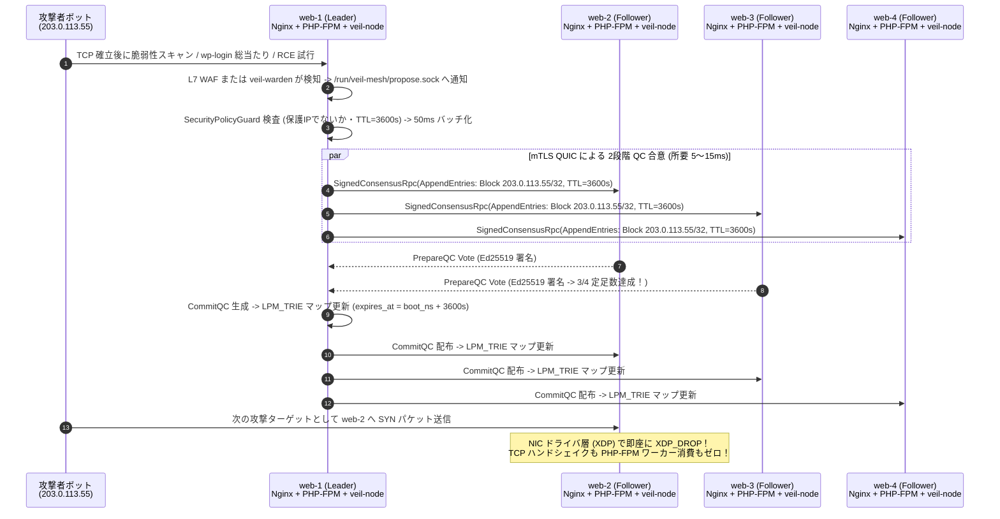

Archived local working document / ローカル最終文書の保全。

2026-10-28: Preserved from the local changes involved in the stash conflict. Historical statements, next steps, and relative links below retain their original context; they are not current recommendations or authorization to resume development. See the repository root README and docs/PROJECT_CLOSURE.md for closure status.

---

# 🧭 `veil-mesh-consensus` v0.9.1 実践アーキテクチャ設計書 & 運用ロードマップ

> 承認・遮断範囲の更新（2026-10-24）: 通常daemonは独立した運用者署名と宛先IPv4・TCP/UDP・ポートの指定を必須とします。個別解除後も承認revisionを保持します。context 6 / WAL v9で旧WALは保全して拒否。IPv6・VLAN・断片化IPv4は対象外としてPASSします。[現在の契約・操作手順](../../../review/2026-10-24-SCOPED-OPERATOR-APPROVAL.md)が旧直接BAN手順に優先します。
>
> WAL更新（2026-10-24）: 認証付きcheckpoint・状態転送・合意による失効記録整理を実装。通常daemonはcontext 5 / WAL v8です。旧WALを自動変換しません。[契約・上限・検証記録](../../../review/2026-10-24-BOUNDED-WAL-CHECKPOINTS.md)が以前の保存方式の記述に優先します。
>
> 2026-10-24 更新: prepare/commit分離と署名付きnew-viewを通常daemonへ実装。consensus context 4 / WAL v7を使用し、旧WALは自動移行せず保全して拒否する。後述の旧方式・旧WAL互換性より[新方式の契約](../../../review/2026-10-24-TWO-PHASE-VIEW-CHANGE.md)を優先する。
>
> 競合prefix復旧の更新（2026-10-24）: 有効なcommit QCが覆う分岐だけを修復し、過去の個別投票を保持する受領応答・親hash照合を追加。RPC署名domain v4のため新旧バイナリ混在不可。QCとWALの意味は維持する。QC未取得の一般的な競合復旧は未完了。[実装範囲・互換性・合意方式の判断](../../../review/2026-10-24-CONFLICTING-PREFIX-RECOVERY.md)を優先する。
>
> 2026-10-24 追加: [受付済みBANの進捗監視・検閲リーダー交代](../../../review/2026-10-24-WITNESSED-BAN-PROGRESS.md)を実装。任意memberへの有限要求受付、要求単位の定足数timeout、元の期限での引継ぎ、WAL v6を使う。WAL v4/v5を履歴保持で読込可能。後述の旧設計・旧WAL記述よりこの契約を優先し、完全なBFT進行性の保証とは区別する。

[README（日本語）](../../../../README.md) · [English README](../../../../README_EN.md) · [検証テスト解説書](../../../CONSENSUS_AND_EBPF_PROOF.md) · [クラウド導入ガイド](../../../CLOUD_DEPLOYMENT_GUIDE.md)

> **実装状態の注意（2026-10-23）:** 以下の保証とロードマップは目標仕様を含みます。版番号や既存テストの成功は、その全項目の実装・検証完了を意味しません。現在の修正と未解決事項は[重大欠陥の修正記録](../../../review/2026-10-23-CRITICAL-FIXES.md)と[TTL・バイパス・復旧の実装契約](../../../review/2026-10-23-TTL-BYPASS-RECOVERY.md)と[署名付き共通期限の実装契約](../../../review/2026-10-23-SIGNED-DEADLINE-CATCHUP.md)と[クラスタ・構成世代への署名binding](../../../review/2026-10-23-CLUSTER-CONTEXT-BINDING.md)と[固定membership・構成digestの実装契約](../../../review/2026-10-24-FIXED-MEMBERSHIP-DIGEST.md)と[通常daemonの自動駆動・操作・検証](../../../review/2026-10-24-DAEMON-OPERATION-FLOW.md)と[ノード別TLSとoffline CA運用](../../../review/2026-10-24-NODE-TLS-OPERATIONS.md)を優先してください。

本書は、`veil-mesh-consensus` を実験的プロトタイプ（`v0.3.0`）から、現場の Web / API / PHP アプリケーション基盤の水際防衛で確実な運用実績を出せる実戦パイロット品質（`v0.9.1`）へ引き上げるための技術仕様書です。

抽象的なスローガンや「100%・完全」といった誇張表現を排し、**① 前提条件と保証の境界、② 合意プロトコルの安全性と View-Change 仕様、③ カーネル eBPF (`LPM_TRIE` + 単調増加クロック TTL) のデータ構造、④ 障害復旧（WAL `fsync`）と輻輳制御、⑤ 実運用での SLI/SLO と Runbook** を定義します。

---

> 起動・復旧の更新（2026-10-24）: 通常daemonは全`--member`から固定構成とdigestを作る。`--cluster-id`・`--config-epoch`・既存署名鍵が必須。署名protocol v3とWAL v4を使い、同epochの異構成や旧WAL v1/v2/v3を拒否する。membership移行・旧WAL自動変換は未実装。[起動契約・互換性](../../../review/2026-10-24-FIXED-MEMBERSHIP-DIGEST.md)を確認する。
>
> 選挙・復旧の追加更新（2026-10-24）: 高いtermの採用に定足数の事前支持を要求し、タイマー延長にFollower発行の一回限りのchallenge応答を使う。成立したterm証拠はWAL v5へ保存し、有効なv4は投票履歴を維持して読み込む。下記の旧WAL v4記述より[term移行・freshnessの契約](../../../review/2026-10-24-TERM-ADMISSION-AND-FRESHNESS.md)を優先する。完全なBFT進行性の保証ではない。
>
> 通常daemon更新（2026-10-24）: 自動選挙・NoOp・複製と所有者限定BAN/status CLIを接続した。受付とコミット・適用は別々に観測する。4プロセスの隔離Linux試験を完了したが、BFT全体の進行性・site受入れは未完了。
>
> TLS更新（2026-10-24）: 通常daemonは `--tls-dir` のノード別証明書・鍵・CA公開証明書・失効一覧を読み、共有CA秘密鍵を保持しない。発行はCSR経由の別管理環境で行い、TLS更新・失効は新bundleと再起動で反映する。複数ホストへの本番配布・自動更新は別途必要。

## 1. 設計の核心：なぜ「ブロックチェーン型 BFT」ではなく「実用防衛メッシュ」なのか

分散合意をインフラ防衛に適用する際、パブリック・ブロックチェーン（見知らぬ敵対組織間で資産台帳を合意する Tendermint 等）の設計をそのまま持ち込むと、導入・運用コストが破綻します。本設計では、現場の運用実態に合わせて以下の選択を行います。

| 設計軸 | ✕ ブロックチェーン偏重の非現実的な設計（不採用） | ◎ 本設計（実戦・運用ファーストの Clean Architecture） |
| :--- | :--- | :--- |
| **運用主体と構成管理** | 複数の別組織・別担当者が `k-of-m` オフライン署名でノード追加を承認する | **同一のインフラチーム（または1人の管理者）** が管理する $N=4$（または $N=7$）台のサーバー群。Ansible / NixOS / Terraform で配布できる静的な `cluster.toml` 1ファイルで完結させる |
| **合意エンジンの依存** | 外部の巨大なブロックチェーン用エンジン（`Malachite` / Tendermint 等）を組み込み、空ブロックや Mempool を常時回す | 外部ブロックチェーンライブラリには依存せず、UseCase 層の [`ConsensusState`](../../../../veil-node/src/usecase/consensus_engine.rs) に **2段階 QC（Prepare / Commit）と `TimeoutCertificate`（約200行）** を実装し、サプライチェーン攻撃面を最小化する |
| **ハードウェア要件** | TPM Quote / Confidential VM Attestation / 異種クラウド・異種 CPU 混在を要求する | 標準的な Linux VM（Kernel 6.1+、AWS EC2 / GCP / Azure / VPS / ベアメタル）と **`0600` パーミッションの CSPRNG 鍵ファイルのみ** で動作する |
| **時刻と遅延catch-up** | 受信時刻から相対TTLを再開始し、古いBANを復活させる | 発行者が固定した `issued_at_unix_ns` と各ルールの `not_after_unix_ns` をログhash・署名・QCに含める。時計を参照しない構造検証で履歴を合意し、各ノードは誤差上限を差し引いた残時間だけをboot clock期限へ変換する。時刻不明・期限切れは新規執行しない |
| **責務の分離（Unix 哲学）** | 1つのバイナリに XDP、BPF LSM、シークレット検査をすべて密結合させる | - **合意形成 & XDP 水際遮断**: `veil-mesh-consensus`<br>- **ホスト内プロセス & BPF LSM 制御**: [`veil-warden`](https://github.com/mt4110/veil-warden)<br>- **監査ログの秘密情報マスキング**: [`veil-rs`](https://github.com/mt4110/veil-rs)<br>- **分断・障害再現テスト**: [`veil-arena`](https://github.com/mt4110/veil-arena) |

---

## 2. 保証（Guarantees）・前提条件（Assumptions）・対象外リスク（Out-of-Scope）

すべての主張を **【保証 ＋ 前提条件 ＋ 検証手段 ＋ 対象外】** の4点セットで定義します。前提条件が崩れた場合、該当する保証は成立しません。

### 2.1 システムが提供する保証（S1〜S4, L1）

| ID | 保証の定義（何が起きないか / 何が起きるか） | 成り立つための前提条件 | 検証手段 |
| :---: | :--- | :--- | :--- |
| **S1: 合意の一貫性**<br>*(Agreement)* | 誠実な2台のノードが、同一の `(term, index)` において異なる遮断ルールバッチを確定（Commit）することはない。 | 故障・侵害されたノード数が $f < N/3$（$N=4$ なら $f \le 1$）であり、誠実なノードの Ed25519 秘密鍵が漏洩しておらず、再起動時に WAL (`fsync`) が保持されていること。 | `proof_1`, `proof_3`, `proof_8` および `proptest` / モデル検査 |
| **S2: 定足数の強制**<br>*(Quorum Auth)* | $\lfloor 2N/3 \rfloor + 1$ 台（$N=4$ で3台）の異なるメンバーによる検証済み Ed25519 署名（`CommitQC`）なしに、誠実なノードが遮断ルールを eBPF マップへ適用することはない。 | `cluster.toml` に記載されたメンバー公開鍵リストが改ざんされていないこと。 | `proof_8`, `proof_10`（単独コミット・嘘の `match_index` 拒否） |
| **S3: 自己窒息の防止**<br>*(Guardrail Policy)* | 保護対象 CIDR（ループバック、クラスタ内ピア IP、管理用 SSH サブネット、デフォルトゲートウェイ）、広すぎるプレフィックス（IPv4 `/0`〜`/23`、IPv6 `/0`〜`/47`）、上限を超える TTL を含む提案に対し、誠実なノードは投票・署名・適用を行わない。 | ドメイン層の [`SecurityPolicyGuard`](../../../../veil-node/src/domain/policy.rs) に保護対象 CIDR が正しく設定されていること。 | `proof_11`（保護 IP ガード検証）およびファジング |
| **S4: カーネル内期限切れと整合**<br>*(Bounded Enforcement)* | 適用された遮断ルールは TTL 経過後にユーザー空間デーモンが停止していてもカーネル XDP 内で自動的に無効化（`XDP_PASS`）され、デーモン稼働中は `Reconciler` により確定状態と BPF マップの差分が解消される。 | 該当ノードのローカル `root` / `CAP_BPF` が攻撃者に奪われていないこと。 | `proof_7`（実カーネル XDP テスト）および TTL 境界テスト |
| **L1: リーダー沈黙からの回復**<br>*(View-Change Liveness)* | リーダーが停止、または特定の提案を意図的に無視（検閲）しても、提案タイムアウト後に $2f+1$ 台の `TimeoutVote` から `TimeoutCertificate` (TC) が形成されて `term + 1` の次期リーダーへ交代し、通信遅延が安定した後に合意が進行する。 | ネットワークが部分同期（GST 以降、メッセージ遅延がタイムアウト上限内に収まる）であること。 | `v0.4.0` リーダー `SIGSTOP` / 検閲シミュレート試験 |

### 2.2 明確に対象外とするリスク（Out-of-Scope）

- **ローカル `root` を奪取されたノード単体の保護**: あるノードで `root` 権限を奪われた場合、攻撃者はそのノード上の XDP プログラムをデタッチしたりデータを持ち出したりできます。本ツールの目的は「侵害された1台のノードから偽の合意メッセージや全解除命令が送られても、**残りの誠実な $N-1$ 台のファイアウォール設定とサービス継続性を守ること**」です。
- **上流回線を飽和させる Volumetric DDoS**: サーバーの NIC に到達する前の ISP / クラウドゲートウェイの帯域幅を超える攻撃は、ホスト内 XDP では防げません（Cloudflare Magic Transit や AWS Shield 等との併用が必要です）。
- **未検証の L3 送信元 IP に対する反射型遮断**: 生の UDP パケットの送信元 IP は容易に偽装（Spoofing）できるため、生 UDP 流量のみを根拠に自動提案を行うと、攻撃者が正規ユーザーの IP や DNS サーバーを詐称して遮断させることができます。したがって、遮断提案の入力源は **「TCP ハンドシェイク確立後の L7 WAF / Web サーバーの異常検知」** または **「[`veil-warden`](https://github.com/mt4110/veil-warden) によるホスト内プロセス通信検知」** に限定します。

---

## 3. 実運用ユースケース：どうやって現場（PHP / Web / API サーバー群）で実績を出すか

例として、ロードバランサ（または DNS ラウンドロビン / Cloudflare）の背後に **4台の Web / PHP アプリケーションサーバー（`web-1` 〜 `web-4`）** がある本番環境を考えます。



### なぜこれが現場（特に PHP / 動的 Web 環境）で絶大な効果を出すのか

1. **PHP-FPM / DB コネクション枯渇の根本防止（集団免疫）**:
   - PHP-FPM や一般的な Web ワーカーは「プロセス/ワーカー数」に上限があり、1台のサーバーに来た攻撃者が順番に `web-1` $\to$ `web-2` $\to$ `web-3` を叩くと、L7（アプリケーション層）で403を返すだけでもワーカーと CPU が食いつぶされます。
   - `veil-mesh-consensus` が入っていれば、`web-1` が最初の数リクエストで異常を検知して合意した瞬間（約 5〜15ms 後）、`web-2`〜`web-4` では **Linux カーネルの TCP ソケットすら作らせず、NIC 着信直後の XDP 層でパケットを破棄** します。
2. **Fail2ban 単体運用との決定的な違い**:
   - 各サーバーで個別に Fail2ban (`iptables`) を動かすと、「他ノードへの水平展開を防げない」「1台が誤検知したときに自分の監視サーバーやゲートウェイを BAN して孤立する」「侵害されたサーバーで `iptables -F` されたり偽の解除命令を出されたりする」という弱点があります。
   - 本ツールは **「保護 IP ガードレール (`S3`)」＋「3/4 マルチシグ合意 (`S2`)」＋「XDP 高速破棄 (`S4`)」** によってこれらを解決します。

---

## 4. 合意プロトコル詳細設計（Raft-BFT Hybrid with 2-Step QC & TimeoutCertificate）

`v0.2.0` の「単一 QC 付き Raft」を拡張し、外部のブロックチェーンライブラリを使わずに **「リーダー交代時の安全性（Locking Safety）」と「悪意あるリーダーの沈黙・検閲からの自動回復（View-Change Liveness）」** を約 200 行の純粋 Rust コード（[`veil-node/src/usecase/consensus_engine.rs`](../../../../veil-node/src/usecase/consensus_engine.rs)）で実現します。

### 4.1 なぜ「2段階 QC（`PrepareQC` $\to$ `CommitQC`）」が必要なのか

1段階の QC だけでは、あるエントリ $E$ の QC が「フォロワー1台にだけ届いた直後にリーダーがクラッシュ（または裏切りで隠蔽）」した場合、次の Term のリーダー選出時にその1台が選ばれなかった際、確定したはずの $E$ が失われる（Safety 違反の）可能性があります。

これを防ぐため、HotStuff-2 / PBFT の知見を取り入れた **最小限の 2段階 QC（Locked QC ルール）** を採用します：

1. **Phase 1 (`PrepareQC`)**:
   - リーダーがログエントリ `(term, index, command)` を提案し、$\lfloor 2N/3 \rfloor + 1$ 台（4台中3台）のフォロワーが `SecurityPolicyGuard` を検証して `PrepareVote` 署名を返す。
   - リーダーは3台分の署名を束ねて **`PrepareQC`** を生成する。
2. **Phase 2 (`CommitQC`)**:
   - リーダーは次の `AppendEntries` で `PrepareQC` を配布する。
   - フォロワーは有効な `PrepareQC` を受け取った時点で、そのエントリを自身の **`locked_qc`（ロック済み QC）** として記録（WAL に `fsync`）し、**`CommitVote`** 署名を返す。
   - リーダーは3台分の `CommitVote` を束ねて **`CommitQC`** を生成・配布し、各ノードは `CommitQC` を検証した時点で初めて eBPF マップへ適用（Commit & Apply）する。

> **💡 定足数交差（Quorum Intersection）による安全性の証明**:
> あるエントリ $E$ に `CommitQC` が形成されたならば、少なくとも $\lfloor 2N/3 \rfloor + 1$ 台（4台中3台）が `PrepareQC` を受け取って `locked_qc` を更新しています。そのうち悪意あるノードは高々 $f=1$ 台なので、**最低でも $f+1=2$ 台の誠実なノードが `locked_qc = PrepareQC(E)` を保持**しています。
> したがって、次のリーダー選出や `TimeoutCertificate` で任意の $\lfloor 2N/3 \rfloor + 1 = 3$ 台の票を集めると、鳩の巣原理により **必ず最低1台の「`locked_qc` を持つ誠実なノード」がそこに含まれ**、確定済みエントリ $E$ が消えることはあり得ません。

### 4.2 リーダーの沈黙・検閲を打ち破る `TimeoutCertificate` (TC)

フォロワーがローカルセンサーから提案を受け取ってリーダーへ転送したにもかかわらず、`proposal_timeout`（デフォルト `1500ms`、ラウンドごとに指数バックオフ）以内に `CommitQC` が返らない場合：

1. 各フォロワーは現在の `term` の投票を打ち切り、`TimeoutVote { term, voter_id, high_qc: self.locked_qc, signature }` を全ピアへブロードキャストします。
2. $\lfloor 2N/3 \rfloor + 1$ 台分の有効な `TimeoutVote` が集まると **`TimeoutCertificate` (TC)** が完成します。
3. TC が完成すると全ノードは `term + 1` へ遷移し、次期リーダーは乱数選挙ではなく **決定論的ラウンドロビン (`leader_id = sorted_nodes[(term + 1) % N]`)** で即座に決まります。
4. 新リーダーは最初の `AppendEntries` に **TC を添付** しなければならず、かつ **TC 内の全 `TimeoutVote` が報告した `high_qc` のうち最も Term が高いエントリを引き継いで再提案** しなければなりません（フォロワー側で TC と `high_qc` 継承を検証します）。

### 4.3 クラッシュリカバリ時の二重投票を防ぐ最小 WAL (`consensus.wal`)

誠実なノードが電源断やプロセス再起動を起こした際、同じ `term` で異なる候補者・異なるエントリに二重署名してしまう事故を防ぐため、以下の 4 フィールドのみをバイナリレコード（固定 256 バイト + CRC32C）として `/var/lib/veil-mesh/consensus.wal` に書き込み、`fdatasync()` 完了後にのみ署名付き応答を送信します：

- `current_term: u64`
- `voted_for_in_term: Option<NodeId>`
- `last_voted_prepare_hash: Option<(u64, u64, [u8; 32])>`
- `locked_qc: Option<QuorumCertificate>`

---

## 5. カーネル eBPF 執行層 (`veil-ebpf`) と Reconciler の詳細設計

### 5.1 `BPF_MAP_TYPE_LPM_TRIE` による IPv4 / IPv6 サブネット遮断と単調増加クロック TTL

`v0.3.0`〜`v0.5.0` で、カーネル空間の [`veil-ebpf/src/veil_xdp_kern.c`](../../../../veil-ebpf/src/veil_xdp_kern.c) を単一 IPv4 ハッシュマップから **IPv4-mapped IPv6 統一キーを持つ `BPF_MAP_TYPE_LPM_TRIE`** に拡張します。

```c
// キー構造体: IPv4 (/32 -> prefixlen=128 in ::ffff:0:0/96) と IPv6 (/128) を単一の LPM Trie で高速検索
struct veil_lpm_key {
    __u32 prefixlen;       // 0..=128
    __u8  addr_v6[16];     // IPv4 a.b.c.d は ::ffff:a.b.c.d として格納
} __attribute__((packed));

// バリュー構造体: カーネル単調増加クロックによる自律期限切れ判定付き
struct veil_peer_policy {
    __u8  trusted;              // 0 = XDP_DROP, 1 = XDP_PASS
    __u8  reserved[3];
    __u32 epoch;                // 合意 log index
    __u64 expires_at_boot_ns;   // bpf_ktime_get_boot_ns() と比較する有効期限 (0 = 無期限許可のみ)
} __attribute__((packed));
```

現行実装はexact IPv4のhash mapであり、上記LPMは目標仕様。期限は署名された共通期限から保守的に変換し、WALに保存した同じログ位置の期限を延長しない。旧形式の `ttl_secs=0` による無期限ルールは互換性のため残っており、上記の「無期限許可のみ」はまだ強制していない。[実装済みの期限契約と時計条件](../../../review/2026-10-23-SIGNED-DEADLINE-CATCHUP.md)を参照。

#### カーネル内 TTL 自動失効のメリット

XDP プログラム内で `if (policy->trusted == 0 && bpf_ktime_get_boot_ns() < policy->expires_at_boot_ns) return XDP_DROP;` と判定します。

- 万が一ユーザー空間の `veil-node` デーモンがクラッシュしたり、ネットワーク分断で合意が停止したりしても、**TTL が切れた瞬間にカーネル XDP 自身が自動的に `XDP_PASS` に戻す** ため、「一時的な遮断のはずがデーモン障害で永久に通信不能になる」という運用事故が構造的に起きません。

### 5.2 輻輳制御（マイクロバッチング）とマップ容量保護

攻撃発生時に WAF や `veil-warden` から秒間数千件の IP シグナルが殺到してもコンセンサスが詰まらないよう、以下の3段階のバックプレッシャーを設けます：

1. **ローカル重複排除（Deduplication）**: すでに `ebpf_policy_map` で遮断中であり、残り TTL が 50% 以上ある IP/CIDR の提案はローカルソケット受信時に即座にスキップします。
2. **50ms マイクロバッチング**: リーダーは個々の IP ごとに合意を回すのではなく、`50ms` 窓（または最大 `128` 件）の遮断ルールを1つの `MeshCommand::SetPeerTrustBatch(Vec<CidrRule>)` にまとめて提案します。これにより、秒間20回の合意ラウンドで最大 **秒間 2,560 サブネット** の遮断ルールを全ノードへ同期できます。
3. **Shortest-Remaining-TTL Eviction（容量上限保護）**: `PEER_POLICY_MAP`（上限 `65,536` エントリ）の使用率が `90%` を超えた場合、`Reconciler` は「有効期限切れまでの残り時間が最も短いルール」から順に回収し、新規の攻撃遮断ルールが書き込めなくなる事態を防ぎます。

---

## 6. 運用メトリクス（SLI / SLO）と緊急時 Runbook

現場で運用実績を証明できるよう、`veil-node` はローカル管理ポート（`127.0.0.1:9100/metrics`）から Prometheus 形式で以下の SLI を出力します。

| メトリクス名 | 種別 | 運用上の意味と目標 SLO |
| :--- | :---: | :--- |
| `veil_consensus_commit_duration_seconds` | Histogram | 提案から `CommitQC` 確定までの所要時間（同一リージョン内 **p99 < 25ms**） |
| `veil_xdp_packets_total{verdict="drop\|pass"}` | Counter | カーネル XDP で処理・破棄した総パケット数（攻撃吸収量の定量証明） |
| `veil_active_blocked_cidrs` | Gauge | 現在有効な遮断 CIDR ルール数（上限 65,536 に対する水位監視） |
| `veil_consensus_view_changes_total` | Counter | `TimeoutCertificate` によるリーダー強制交代の発生回数 |
| `veil_security_rejected_packets_total{reason}` | Counter | 署名不正・二枚舌・保護 IP 違反で弾いた異常パケット数 |
| `veil_reconciler_drift_repairs_total` | Counter | ユーザー空間とカーネル BPF マップの不整合を検知・自動修復した回数 |

### 緊急時バイパス手順（Circuit Breaker Runbook）

現実装では、起動ログに表示された所有者限定Unixソケットへ次の操作を送る。デーモンと同じUIDで実行する（root起動なら `sudo`）。XDPをattachしたまま、そのローカルmapの執行をバイパスする。

```bash
veil-node --bypass-local on --control-socket /path/from/startup-log/node.sock
# 原因を確認し、残存ルールを再び有効にすると判断した場合のみ:
veil-node --bypass-local off --control-socket /path/from/startup-log/node.sock
```

成功応答はカーネル更新とWAL保存の双方が成功したことを表す。保存失敗では、有効化によって通信を通せてもエラーを返す。バイパス設定は再起動後も復元される。ソケットは初期設定では起動ごとの専用パスとなり、古いソケットを自動削除しない。カーネル内TTLはデーモン停止中も進むが、このソケットへの操作にはデーモンの応答が必要である。LSM隔離やホストの他のファイアウォールはこの操作の対象外。

クラスタ一括 `unban` CLI、専用 `emergency-detach` CLI、3秒以内の復旧SLOは未実装・未検証。[実機試験と適用条件](../../../review/2026-10-23-TTL-BYPASS-RECOVERY.md)を参照。

---

## 7. v0.9.1 までの実装ロードマップと完了条件（Definition of Done）

| 版 | マイルストーン | 実装対象の Clean Architecture モジュール | 完了条件（自動テストによる検証基準） |
| :---: | :--- | :--- | :--- |
| **`v0.2.0`**<br>*(完了済)* | **Clean Architecture 4層分離 & CSPRNG 鍵・保護 IP ガード** | `domain/`, `usecase/`, `adapter/`, `infra/`, `proof_tests.rs` | 全 11 証明・回帰テスト (`proof_1`〜`proof_11`)、Markdown Lint、ShellCheck、Clippy が CI でグリーン。 |
| **`v0.3.0`**<br>*(完了済)* | **R1〜R10 監査修正：Prefix ハッシュ鎖・Voted-Entry Lock・共有 CA・WAL・XDP ポートバイパス除去** | `domain/entities.rs`, `usecase/consensus_engine.rs`, `adapter/crypto_ring.rs`, `infra/quic_mtls.rs`, `veil-ebpf/` | R1〜R10 回帰テストおよび WAL 復元テストを含む全 20 件（Linux 実機含め 22 件）の自動検証スイートが CI でグリーン。 |
| **`v0.4.0`** | **2段階 QC (`Prepare`/`Commit`) & 軽量 View-Change (`TC`) + Fuzzing** | `domain/entities.rs` (`TimeoutCertificate`)<br>`usecase/consensus_engine.rs`<br>`fuzz/` (`cargo-fuzz`) | ① リーダープロセスに `SIGSTOP` を送って沈黙させても、残り3台が `TimeoutCertificate` を形成して `term + 1` の新リーダーへ自動交代し、遮断提案が通ること。<br>② `proptest`（10,000 ケース）と `cargo-fuzz` で Panic ゼロ。 |
| **`v0.5.0`** | **`LPM_TRIE` (IPv4/IPv6 CIDR) & 50ms バッチ + Unix ソケット連携** | `veil-ebpf/src/veil_xdp_kern.c`<br>`infra/sensor_socket.rs`<br>`infra/metrics_prometheus.rs` | ① `/run/veil-mesh/propose.sock` へ 500 件の IPv4/IPv6 CIDR を流し込み、50ms バッチ合意で全ノードの `LPM_TRIE` に反映されること。<br>② [`veil-warden`](https://github.com/mt4110/veil-warden) および Nginx ログ監視からの自動遮断デモが動作すること。 |
| **`v0.9.1`** | **`veil-arena` カオス試験（遅延・ロス・分断） & 鍵ローテーション** | `scripts/arena-chaos.sh`<br>`docs/OPERATIONS_RUNBOOK.md` | `tc netem` によるパケットロス 20%・遅延 100ms・ネットワーク分断と復旧・リーダー強制停止・偽造パケット注入の複合カオス試験をクリアし、全 SLI メトリクスと `summary.json` 証跡が出力されること。 |
