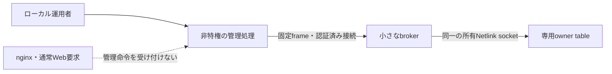
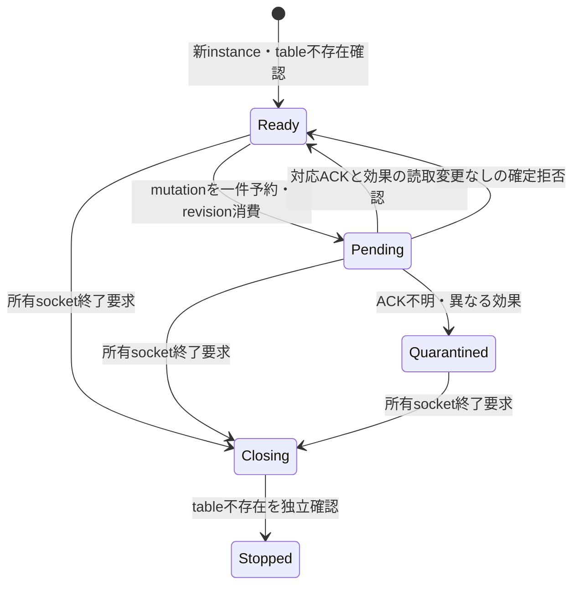

# nftables候補の権限分離・停止復旧・期限契約

2026-10-27。当初の対象は設計と独立したオフライン試作。その後、別承認でownerだけの隔離確認を一回実施した。最新の採否判断は一次資料と既存codeの照合だけで、追加の実装・host変更・試験は行わない。現行XDPのコード・binary・BFT・WAL・鍵・データを保全する。

最終ゴールは小規模公開サイトで安全に使える一時BAN。判断対象は、既存の256件・有限期限・再起動で消失・古い操作拒否を、nftablesへ移せるかである。**現行のBOOTTIME絶対期限を維持する標準nftablesへの移植は不採用とした。** owner限定の成功は保全するが、製品のnft移植へ進まない。[最新の採否根拠・回避案・残タスク](../review/2026-10-27-NFT-BOOTTIME-ADOPTION-DECISION.md)。以下には候補時の設計も保全しており、未実装部分を現在の必須タスクへ読み替えない。

## 1. 権限境界

nginxや外部HTTP入力からBANを作らない。自動BAN・遠隔API・BFT再開を追加しない。

| 部分 | 責務と制約 |
| --- | --- |
| 管理処理 | 一覧とpreview、人による明示適用。CAP_NET_ADMINを持たない |
| broker | 認証・scope・保護IP・TTL・instance／revisionを再検査。最大一件のmutation、待ちqueueなし、5変更/秒。外部TCP listenerを持たない |
| 特権 | 将来のbrokerだけにCAP_NET_ADMIN。他のcapability、setns／unshareによる移動、任意command実行を与えない。実際のuid／capability／seccompは③で確認する |
| OSの隔離 | 最初の③は新しい専用network namespaceだけ。host namespaceへ入るadapterを今回作らない。CAP_NET_ADMINはtable単位に閉じないので、この隔離は重要 |
| 入力 | 40 byte固定frame。magic、version、操作、instance、revision、送信元IPv4、TTL、ゼロ予約領域。table／family／chain／宛先／port／namespace／path／nft文字列を入力に含めない |
| 認証 | filesystem権限に加え、実SO_PEERCREDのUIDを検査。namespaceとowner socketはbroker自身が観測し、clientの申告を証拠にしない。SO_PEERCRED取得とFD受渡しは今回未実装 |
| 通常接続 | 既存の読取り期限・同時数上限を保持する方針。今回のモデルはstream受付を実装せず、固定frameと一件の状態遷移だけを検証する |

`CAP_NET_ADMIN`にはfirewall以外のネットワーク管理も含まれる。broker侵害を「専用tableだから他へ影響しない」とは評価しない。③では専用namespace内の別tableも対照として置くが、その成功も侵害されたbrokerの無害性を証明しない。[Linux権限の仕様](https://man7.org/linux/man-pages/man7/capabilities.7.html)・[network namespaceの隔離範囲](https://man7.org/linux/man-pages/man7/network_namespaces.7.html)。

固定scopeは最初の隔離試験では宛先`10.99.0.66`／TCP18443、一つのservice入口、保護する管理sourceを別設定とする。実運用の値は未決定。input hookを使う候補で、forward／DNAT／flow offload／CDNを含む公開経路の適合は別判定。現行のIPv4限定をIPv6対応済みへ広げない。

## 2. 所有socketによる停止を第一候補にする

Netfilterの公式manは`owner` tableと`persist`を区別し、ownerだけなら所有processの終了でtableを除去すると説明する。Linux v6.8の実装では`NETLINK_URELEASE`を受け、network namespaceと所有port IDが一致するtableのhookを解除・回収する。[nftのtable flags](https://www.netfilter.org/projects/nftables/manpage.html)・[v6.8のrelease処理](https://github.com/torvalds/linux/blob/v6.8/net/netfilter/nf_tables_api.c#L10681)。後続のhp-ubuntu／7.0.0-38では、空tableのsocket close／SIGKILL回収を一回確認した。全kernel対応、ruleを持つtable、最悪時の回収時間の保証はしていない。

設計では**owner付き、persistなし、長寿命の専用NETLINK_NETFILTER socketを一つ**に固定する。

- 一回限りの`nft -f`子processを更新ごとに起動する方式は採らない。作成socketが終了するとowner tableも失われ、別socketは所有tableを更新できないため。
- socketをCLOEXECとし、子process・管理側・socket activation・FD passingへ所有FDを漏らさない。FD番号の記録だけを所有根拠にしない。
- 同名tableが一つでもあれば初期化を拒否。owner記録の書換え、persistを用いた引継ぎ、未知tableの削除で起動しない。
- `owner`は他tableを保護する権限境界ではない。brokerの保持capabilityは別に隔離する。
- kernel回収は遅れ得る。close要求、unit停止、SIGKILLの送信だけで「通信復帰・停止完了」と表示しない。

## 3. 状態遷移と結果不明

確定拒否でもrevisionを戻さない。結果不明のBAN／解除は「成功」「未適用」のどちらにも変換せず、再送・後続mutationを拒否する。短いBANへの置換が不明なら、旧BANの長い期限も忘れない。確認応答にはkernel送信元、sequence、socket、namespace、transaction効果との一致が必要。単にnft／syscallの終了コードをAPPLIEDにしない。

transactionと完了照合にはinstanceも結び付ける。socket番号やrevisionが再利用されても旧世代の応答を受け入れない。実装時のinstanceは信頼できるOS乱数から新規生成し、clientに選ばせない。今回の固定値はモデルfixtureで、実nonce生成器ではない。

管理daemon終了に伴うbrokerの所有socket終了と、普通のCLI一接続の切断は区別する。CLIを閉じるたびに全BANを消す設計にしない。実process間の監督・EOF／終了連動、管理側停止とbroker停止の同時障害は③で検証する。

| 障害点 | 必要な挙動 |
| --- | --- |
| 初期化途中で終了 | owner socketを閉じる。消失未確認なら起動・復旧成功にしない |
| 更新前・更新後ACK前で終了 | kernel反映が不明でも所有socket終了側へ進む。自動再送しない |
| 通常停止・broker SIGKILL | owner socketの最終参照が解放されたか、tableとhookの消失、実通信復帰を確認 |
| 管理側だけ終了／freeze | brokerの終了連動を別途確認。brokerもfreezeした場合の期限は独立したkernel保証が必要 |
| tableが残る／読取り不能 | 再起動をReadyにしない。EPERMやtimeoutを「不存在」に変換しない |
| 正常な再起動 | 前のtable不存在→新socket・新instance→BAN0。旧BAN・旧操作を復元しない |

通常のpersistent tableを後からflushする常駐watchdogは第一案に含めない。owner機能が使えない環境では、保護を弱めた代替へ自動移行しない。

## 4. 状態量と掃除

管理状態は固定256 slot、userspaceの掃除は最大16 slot/回、既存の200ms周期・timer Skip方針を維持する。満杯なら拒否し、既存BANを追い出さない。未確認slotも件数に含める。

nft set自体にも256の上限を設ける候補。ただしkernelの期限切れ物理entry回収とuserspace slot回収は別で、slotが空いたことからkernelの挿入成功を推測しない。kernel挿入拒否を記録し、無限retryしない。**userspaceの16件制限を、kernel GCの時間保証として説明しない。** 接続追跡やWeb logの資源量も別である。

## 5. 絶対期限の採否：標準nftablesへの移植は不採用

後続の判定ではLinux v7.0も確認し、timeout／expiresの相対期間とmeta timeのREALTIMEでは、現行Dを同じ契約で扱えないと結論した。[採否記録](../review/2026-10-27-NFT-BOOTTIME-ADOPTION-DECISION.md)。この分岐の追加実装・期限実験は終了する。以下は先行調査で整理した反例と契約を保持する。

現行XDPは`CLOCK_BOOTTIME`基準の絶対期限をMapに渡し、kernelで同じboot clockと比較する。今回この安全条件は変更しない。

確認したLinux v6.8のnf_tables実装では、elementの期限を`get_jiffies_64()`と相対期間から作り、同じtick系の値と比較する。`NFTA_SET_ELEM_EXPIRATION`も相対値を変換する処理で、任意のBOOTTIME絶対値をそのまま受け取るAPIとは確認できない。[element初期化](https://github.com/torvalds/linux/blob/v6.8/net/netfilter/nf_tables_api.c#L5956)・[期限検査](https://github.com/torvalds/linux/blob/v6.8/include/net/netfilter/nf_tables.h#L769)。この調査を対象hostのkernel実測として扱わない。

### 反例A: 送信待ちで期限が延びる

- userspaceで時刻0に30秒のBANを決める。元の絶対期限は30秒。
- 相対30秒を渡し、kernelでelementを初期化する時刻が1秒になる。
- 素朴な置換では期限が31秒になる。送信直前に残り秒を計算しても、その後の待ちを無条件に0とはできない。

これは1秒の実測遅延ではなく、入力を明示した反例計算。kernelの丸め・実際の初期化／commit時刻は別に検証する。既存のTTLや時間制限を延ばして通さない。

### 反例B: サスペンドと時計差

BOOTTIMEはsleepも含む。timeoutの時計がsleep中に進まないというモデルでは、boot時刻では満了済みでもkernel側の相対期限が残る。止まったuserspaceの掃除では、復帰後の最初のpacketに対する保証を補えない。kernelのtimekeeping実装も参照したが、今回実機suspend試験は行っていない。[BOOTTIMEの仕様](https://man7.org/linux/man-pages/man2/clock_gettime.2.html)・[v6.8 timekeeping](https://github.com/torvalds/linux/blob/v6.8/kernel/time/timekeeping.c)。

**現行期限契約を維持する標準nftへの差替えはNO-GO／不採用。** 「suspendしないserverだけ」「期限の起点をkernel適用時へ変える」等は別の契約案であり、今回採用しない。rootで常時掃除すれば解決するとも扱わない。BPF併用等の別方式まで不可能とした判断ではなく、その追加研究・実装も自動では始めない。

## 6. 実装済みと未実装

| 実装したもの | 今回の証拠 |
| --- | --- |
| 独立Rust crate・依存なし・unsafe禁止 | [試作](../../experiments/nft-boundary/) |
| 固定frame、拒否条件、単一mutation、結果不明、停止・再起動のモデル | Rust unit／integration test |
| 期限の反例、実適用BLOCKED、applyコマンド拒否 | offline demoとrunner |
| 現行コード／objectの保全確認 | runnerの七ファイルhash比較 |

製品向けに未実装なのは、実Netlink adapter、長寿命socket、実SO_PEERCRED、capability／seccomp付与・監督process、BAN transaction、systemd unit、実通信・SIGKILL・namespace復旧である。モデルのcontextは模擬入力、ReferenceKernelはメモリ上の参考実装。後続の[独立probe](../../scripts/nft-owner-probe.py)では、空のowner tableだけについてhp-ubuntuで実機確認した。root0400の参照、CAP_NET_ADMINのみ、socket close／子SIGKILLの回収と既存保全が[一回の隔離試験で成功](../review/2026-10-27-NFT-OWNER-ISOLATED-ACCEPTANCE.md)。製品adapter・peer認証・BANのOS検証とは区別する。

## 7. 次の限定ゲートと終了条件

①の設計と②のオフラインモデル・検証は実施済み。後続の本人選択（2026-10-27）で「現行期限を維持・BAN実適用は保留・ownerだけの隔離確認」に限定し、最小修正・offline検証後、別の実行承認でowner限定の実機ゲートを達成した。①②全体・製品移植・公開pilotの完了とは扱わない。

[owner限定の隔離確認](NFT_OWNER_PROBE_PLAN.md)は一回で終了し、unit停止・非enabled、回収・保全・証拠退避まで確認した。その後の一次資料照合で、標準nftへの移植は期限条件に合わず不採用と確定した。この分岐の追加試験・broker実装を残タスクにしない。現行XDPを限定した導入先で使う価値と適合条件が揃う場合だけ、既存の公開受入れ手順へ戻る。

実機ではnamespace・peer credential・最小capability・owner機能、強制終了と再起動、実packet、期限・満杯・未知所有物保全の全条件が必要。owner非対応、hostへ広い権限を持ち出す必要が生じる、期限を黙って緩める必要がある場合は停止。試験合格数を導入可の代わりにしない。

[今回の検証結果](../review/2026-10-27-NFT-BOUNDARY-OFFLINE.md)・[試験履歴](TEST_HISTORY.md)。
