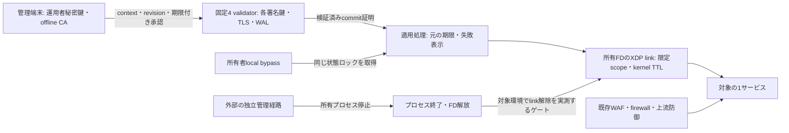

# 小規模試験導入の採否と最小構成

2026-10-24。現在の未コミット実装と既存の検証記録を対象とする独立設計レビュー。
独立レビュー自体はread-onlyで実施。その後、別担当の環境比較結果を本書へ反映した。製品コードは変更していない。

## ゴールと現在の判定

- 最終ゴール: 安全に限定試験導入でき、利用者が運用・復旧できる無償OSSにする。
- 現在のマイルストーン: 安全条件と既存期限を維持し、導入可能な構成が成立するかを見極める。
- 今回の完了条件: 現方式の採否、最小構成、残る導入ゲート、継続・保留条件を明文化する。

**判定は現方式を維持、小規模試験導入HOLD。追記試作の本体採用は見送る。**
追加2段階・実作業1〜2日相当を上限とする比較を実施した。独立ホストで保存・合意回帰が成立し、その後の明示依頼でビルドを復旧して通常daemon比較も完了した。
通常daemonは両ホスト全10段階成功。実サービスの実通信と独立復旧は別ゲートとして残し、小規模試験導入HOLDを維持する。
文書の完成、テスト件数、版番号は、小規模導入や最終ゴールの達成を意味しない。

## 現方式を支持する根拠と未達

1. **保存と投票の順序は維持する。** 現行FileWalは完全snapshotを一時ファイルへ書き、fileの`sync_all`、rename、親directoryの`sync_all`を行う。
   保存失敗は停止をラッチし、phase投票はslot/hashの保存成功後に署名する。通常RPC応答もdurable署名経路を通る。
   根拠: [wal.rs L221-L234](../../veil-node/src/infra/wal.rs#L221)、[consensus_engine.rs L421-L475](../../veil-node/src/usecase/consensus_engine.rs#L421)、[two_phase.rs L358-L385](../../veil-node/src/usecase/two_phase.rs#L358)、[quic_mtls.rs L424-L445](../../veil-node/src/infra/quic_mtls.rs#L424)。
2. **追記試作の中央値改善は採用条件を満たさない。** 同期回数は減ったが圧縮で約1.5秒停止し、既存NoOp期限を破った具体例がある。
   単独検閲試験は現方式3/3成功、追記2/3成功。少数試行による信頼性や統計的な優劣は主張しない。
   現方式の成功回にも長い保存停止があり、追記不採用を現方式の安定認定へ読み替えない。
   根拠: [追記試作 L71-L103](2026-10-24-SNAPSHOT-APPEND-PROTOTYPE.md#L71)。
3. **必須保存後の待機削減は局所的に合理的。** durableなprepare/commit進行後の即時送信はround当たり最大2回で、保存前の票は送らない。
   これはfsync内部の待ちを短縮しない。修正後の失敗を後続成功で取り消さない。
   根拠: [daemon.rs L159-L199](../../veil-node/src/infra/daemon.rs#L159)、[待機削減の結果 L41-L58](2026-10-24-PREPARE-COMMIT-WAIT.md#L41)。
4. **保存遅延の環境差は観測したが、寄与は未分離。** 同一TIDのjournal待ちは観測済み。今回、別ホスト・microSDの保存標本は短かったが、CPU・kernel・負荷も異なる。
   媒体だけの因果関係や、全負荷での期限保証は証明していない。共有環境の失敗だけから方式全体の不成立とも断定しない。
   根拠: [journal待ちの境界 L34-L48](2026-10-24-JOURNAL-WAIT-BOUNDARY.md#L34)、[独立ホスト比較](2026-10-24-INDEPENDENT-HOST-COMPARISON.md)。

## 最小導入構成と信頼境界

初回は自己管理Linuxの隔離された1サービス、固定4validator・定足数3、独立運用者の手動承認、1執行backendに限定する。
下図は責務を示す。別daemonや汎用基盤を今すぐ追加する提案ではない。

| 境界 | 実装・証拠で確認した範囲 | 残る前提・提案 |
| --- | --- | --- |
| 操作の承認 | member鍵と異なる運用者署名を必須とし、raw BAN・解除・LSM操作を拒否 | 運用者秘密鍵とCA秘密鍵をvalidatorへ配らない。正規運用者の誤判断は防げない |
| 合意と復旧 | phase別投票、new-view報告、確定親prefix、commit証明、認証付きcheckpoint、WAL欠損拒否 | 固定鍵・構成、誠実な定足数、保存の持続性。一般的なBFT安全性の形式証明は未実施 |
| 故障の独立性 | pi-node・pi-masterそれぞれの同一ホスト内で論理ノード試験と通常4プロセス試験 | 4物理ホストのクラスタは未検証。同じホスト、媒体、管理鍵、配布権限の共通故障を独立故障と数えない |
| 執行 | exact送信元IPv4と、宣言した宛先IPv4・TCP/UDP・port。有限期限と失効側復元 | plain Ethernet・非断片化IPv4に限定。IPv6・VLAN・fragment等はPASS |
| 基礎防御 | 本機構が所有する追加制御 | 既存WAF・firewall・上流防御と実サービスの正常通信を別に確認 |

根拠: [承認・scope契約 L7-L33](2026-10-24-SCOPED-OPERATOR-APPROVAL.md#L7)、[二段階方式と証明の限界 L24-L55](2026-10-24-TWO-PHASE-VIEW-CHANGE.md#L24)、[checkpoint契約 L22-L43](2026-10-24-BOUNDED-WAL-CHECKPOINTS.md#L22)。

合意は対象IPの悪性を証明しない。BFTの追加価値は、承認済み操作の順序・確定・復旧を1台の故障や侵害から守ることにある。
同じ宛先・portを共有するHTTPホスト名や利用者は区別できない。CDN/L7 proxyの送信元を利用者の代わりにBANしない。
本構成は全通信への強制アクセス制御や、上流回線を飽和させるDDoSへの単独防御ではない。

## 緊急復旧の独立性

**local bypassとstatusは、WAL処理と同じ状態ロックを待つ。独立した復旧経路とは呼ばない。**
`state_worker`は呼出し側の取消後も、進行中のWAL処理と排他を保持する。
bypass関数内のkernel先行更新はロック獲得後の動作であり、既に遅いfsync中ならそこへ到達できない。
根拠: [state_worker.rs L15-L29](../../veil-node/src/infra/state_worker.rs#L15)、[local_control.rs L88-L110](../../veil-node/src/infra/local_control.rs#L88)、[consensus_engine.rs L1800-L1819](../../veil-node/src/usecase/consensus_engine.rs#L1800)。

既存観測でもlocal statusに約1.462秒を要した。これは新たな解除不能の再現ではなく、確認済みの待機境界である。
根拠: [時計・TLS診断 L64](2026-10-24-CLOCK-QUALITY-AND-TLS-LATENCY.md#L64)。

最小の独立復旧ゲートは、運用担当者が外部管理経路から所有daemonを停止し、所有FDのXDP link解放と正常通信の回復を実測すること。
対象のkernel・driver・起動方法・サービス管理設定で行い、無関係なXDPや既存firewallを解除しない。
FD所有linkを使う実装上の前提は[ebpf_bridge.rs L114-L158](../../veil-node/src/ebpf_bridge.rs#L114)。対象環境での操作時間は未測定であり、復旧SLOを約束しない。
ここでいう独立性はアプリの状態ロックを経由しないこと。kernelの割込み不能なI/O待ちから即時に抜けられる保証ではない。
プロセス停止を要求したことと、終了・FD解放・link解除が完了したことを区別する。保存停止中の確認なしに「killすれば即座に解除」とはしない。
Linuxの待機APIにも割込み不能な待機とkillableな待機の区別がある。[kernel公式資料](https://docs.kernel.org/scheduler/completion.html)
このゲートのために投票前永続化や状態排他を弱めない。

## 限定canaryと大規模化の条件差

| 項目 | 小規模の観測・承認付きcanaryへ進む条件 | 大規模化で別途必要になる条件 |
| --- | --- | --- |
| 用途と効果 | 1サービスの実送信元、対象scope、許容影響、既存手段で不足する点が明確 | proxy/CDN・tenant・複数サービスの権限と障害範囲の分離 |
| 合意 | 固定4台・1故障の限定契約、反例回帰、通常runtimeと同一ソースの証拠 | 参照方式との差分、状態遷移・永続化・checkpoint・復旧全体の強い検証 |
| 保存 | 独立保存環境で同じ期限を満たす結果と失敗記録 | 電源断・媒体故障、バックアップ、fencing、鍵・構成移行 |
| 執行 | 実サービスの正常通信、BAN、期限、解除、scope外への非影響 | 容量・流量・driver/kernel組合せ、他制御との競合、必要な通信形式 |
| 運用 | 担当者が独立管理経路で復旧可能。受付・確定・適用・不明を区別 | 配布・失効・災害復旧・担当分担・継続監視と運用費 |

現実装の上限は1未確定height、最大7member、1KiB command、256件snapshot。
根拠: [domain/two_phase.rs L6-L7](../../veil-node/src/domain/two_phase.rs#L6)、[checkpoint.rs L6-L9](../../veil-node/src/domain/checkpoint.rs#L6)、[two_phase.rs L395-L397](../../veil-node/src/usecase/two_phase.rs#L395)。
大企業でもこの小さい単位を限定サービスへ適用する可能性はあるが、大きな単一クラスタへ広げる根拠はない。
IPv6/CIDR、高頻度batch、権限委譲、無停止移行を今回同時に追加しない。

## 追加2段階・1〜2日の見極め

固定条件は現行FileWal、file/parentの`sync_all`、TTL、NoOp 2秒等の既存期限、定足数、保存前の署名送出禁止。
既存の安全検証、承認・scope・時計条件も変更しない。

### 第1段階: 独立環境を準備できるか

- 物理媒体、filesystem/journal、flush、ホスト、管理経路の共有関係と対象architectureを記録する。
- 同じSSDの別directory・partition・VMを独立媒体の比較と呼ばない。
- 比較対象に現在と同じソース・Rust版・依存・試験条件を用意し、hashと差分を保持する。
- 準備不能ならHOLD。toolchain整備や環境調査を上限なく続けない。

第1段階は完了。pi-nodeはx86_64/SATA SSD/ext4共有環境、pi-masterはARM64/microSD/ext4の別物理ホスト。
同一Rust版・ソースを使うA76対象のcrossbuildと試験起動が成立した。
architectureと媒体等が同時に変わるため、純粋な媒体A/B比較と同一視しない。

### 第2段階: 現方式が固定条件で導入候補になるか

- 同一ソースと既存期限で、単独・並行合意、通常CLI、TLS更新後、leader停止、checkpoint復旧、期限・解除を確認する。
- 計測あり/なし、論理ノード/別プロセス/別ホスト、試験成否と実パケット・サービス通信を分ける。
- 成功回だけを残さず、失敗、保存停止、負荷条件、除外、cleanupと復旧後状態を記録する。
- 少数成功を長期安定保証にしない。新しい保存形式への分岐や、制限時間の延長で合格にしない。

**第2段階の保存・合意回帰・通常daemon比較は完了。実サービス導入はHOLD。** 両ホストで単独検閲試験3/3、訂正後の並行回帰2巡が各183成功。
当初のbuild失敗で一度停止した後、明示依頼により専用TMPDIR/target・増分無効で通常daemonのbuildを復旧した。製品コードや安全条件は変更していない。
通常4プロセスは両ホスト全10段階成功。TLS更新後の適用待ちは0.615秒/0.832秒で既存3秒以内。checkpoint 32/64、状態転送、圧縮WAL復旧、その後の合意/失効も確認した。
この3秒はBANログ登録確認後の適用待ちであり、署名やTLS作業の開始からではない。XDPなしのpolicy mirrorを実パケットの証拠に数えない。
実パケット・独立復旧・4物理ホストの故障独立性の不足を、回帰件数で代替しない。
初期測定・訂正・除外は[独立ホスト比較](2026-10-24-INDEPENDENT-HOST-COMPARISON.md)、後続のbuild復旧と通常経路の結果は[通常daemon比較](2026-10-24-DAEMON-HOST-ACCEPTANCE.md)に記録した。

## GO / HOLD / NO-GO

- **GO:** 上記ゲートを満たした限定環境で、観測または承認付きcanaryへ進める。一般公開環境の自動防御完成という判定ではない。
- **HOLD:** 独立環境の準備不能、既存期限の再失敗、独立復旧経路の未確認、結果不明、または1〜2日の上限到達。未完の根拠を残して停止する。
- **NO-GO:** 対象サービスで実送信元をXDPから識別できない、必要な通信形式・容量・保証がprofile外、または既存WAF等で十分で追加運用費に見合わない。その用途での採用をやめる。

## 代替設計と今は実装しないもの

| 選択肢 | 今回の判断 |
| --- | --- |
| 現行snapshot置換＋独立保存環境 | 候補を維持。保存・回帰・通常daemon比較は成立。実通信・独立復旧・配置の運用ゲートが残る。保存形式・復元器を増やさない |
| snapshot追記＋原子的圧縮 | 不採用保留。圧縮の期限失敗、電源断、正式移行・製品読出しが残る |
| 永続DB・差分ログ・リング | 今は実装しない。durabilityと復旧の契約が変わり上限を超える |
| 既存BFT実装への置換 | 一般的BFT保証が製品要件なら別途比較。1〜2日の救済策にしない |
| 単一署名controller＋agent | BFTの追加価値が運用負担を上回らない場合の縮小案。信頼モデル変更の合意が必要 |
| 既存WAF・期限付きfirewall | 実用途に十分なら本作を本番経路へ追加しない |
| 同期省略・非同期投票・TTLや期限の延長 | 固定条件に反するため採用しない |

導入前には現在の単一契約を短く定め、旧ロードマップの200行BFT、256byte WAL、5〜15ms、LPM、未失効eviction等を現行保証と混在させない。
既存資料の優先順位注記だけに導入判断を委ねない。根拠: [旧ロードマップ L38](../V1_ARCHITECTURE_AND_ROADMAP.md#L38)、[L142](../V1_ARCHITECTURE_AND_ROADMAP.md#L142)、[L181-L187](../V1_ARCHITECTURE_AND_ROADMAP.md#L181)。

形式的BFT安全証明、実電源断、多ホスト障害、実サイトのHTTP完了、長期運転は本レビューの確認範囲外。
独立レビューと後続の通常daemon比較の完了は、未合意の実装・配布・公開・本番変更を開始するものではない。
