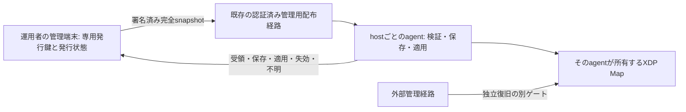

# ポリシー決定権の比較、副作用、最小構成と移行案

2026-10-24。実装前の判断用設計。製品コード・試験・設定を変更せず、現行コードと既存検証記録を読んだ。新規試験・リモート操作は行っていない。

最終ゴールは、安全に運用・復旧できる無償OSS。今回の完了条件は、方式変更で失う保証と残る責任を説明し、BFT継続／署名ポリシー試作／不採用を判断できること。

## 判定

**単一の運用主体が遮断を承認する限定サービスでは、署名付き期限ポリシーを比較対象の第一候補にする。既存BFTを置換する決定・実装開始はまだ行わない。**
複数の独立主体が決定権を持ち、そのうち一部の侵害下でも矛盾しない確定履歴を共有することが必須なら、BFTを残す。
単に観測ノードの署名を信頼して他ホストも自動BANする方式は、「観測ノード1台の侵害で他サイトを勝手に遮断できない」という既存要件を満たさず、採用しない。

新方式の性能・可用性は未測定。合意往復と投票保存を外せる一方、署名発行・再送防止・適用・時計・ローカル永続化・管理責任は残る。
現在のXDPはパケットごとに合意せず、ローカルMapを参照する。方式変更の対象はポリシー更新経路であり、パケット処理速度の改善を約束しない。
将来の方式比較では現行TTL、2秒backdate、時計誤差予算、試験の待機時間、scope等を固定する。設計変更と評価条件の緩和を同時に行わない。

## 一歩引いた要件

先に選ぶのはcodecではなく、決定権と故障時の振る舞いである。

| 判断 | 署名方式の最小案で置く前提 | 前提を受け入れない場合 |
| --- | --- | --- |
| 遮断を決める主体 | 1つの運用主体。専用の承認鍵を検知・執行ホストから分離 | 独立した複数承認やBFTを比較する |
| 1ノード侵害 | agent/observer/relayの1台を含む。承認者の侵害とは区別 | 承認鍵1つの侵害も防ぐなら単一署名案は不適合 |
| 通信分断 | node間で適用状態が一時的に異なり得る | 全台の同時適用・同時解除が必要なら両案とも単独では不適合 |
| 制御元不在 | 新規BAN・遠隔解除は発行/配布できない。既存の追加BANは元の期限で失効 | 防御継続と誤BANの自動解消のどちらを優先するか別契約が必要 |
| 復旧時 | 最新の信頼状態を復元できなければ新規執行を開始しない | 古いbackupから無条件で再開する保証は付けられない |

BFTも正しい観測や悪性IPの真実を証明しない。現行は運用者署名を別に要求する。承認者が正規の範囲内で不当なBANへ署名した場合、BFTだけでは防げない。
現行BFTも確定履歴と全台のkernel適用は別であり、全台同時適用を保証していない。
現行の運用者署名は1鍵であり、独立した複数人の承認を必須にする機能とは別。BFTの定足数と運用者の複数署名を同一視しない。

## 起こり得る副作用

### 決定権と攻撃範囲

- **発行元への集中。** 署名方式では発行元が新規更新の停止点になる。攻撃者が承認鍵を取得すると、許可範囲で不当なBANや解除を発行できる。現行にも独立運用者鍵への信頼があり、集中の一部は既存のもの。
- **有限TTLだけでは侵害鍵の被害を止めない。** 攻撃者は新しい有限BANを繰り返し発行できる。scope、保護IP、件数、更新頻度、鍵失効、外部復旧を組み合わせる必要がある。
- **局所侵害は残る。** root権限を取られた執行ホスト自身のMap・statusをBFTや署名だけで保護できない。他ホストへの伝播防止と、そのホスト自身の安全を混同しない。
- **一貫性の損失。** 発行者が同じrevisionで異なる内容へ署名すると、別agentが異なる内容を受理し得る。同一agentでの競合検出はできても、未交換の競合の存在は分からない。単一署名方式はByzantineな発行者の非矛盾性を保証しない。

### 分断、失効、解除

- **届かない解除。** BAN revision 41を適用したnodeに解除42が届かなければ、そのnodeのBANは元の期限まで残る。版番号は届かない情報を補わない。
- **防御の途切れ。** 制御元が停止して更新できず、追加BANの期限が切れると、その追加遮断はなくなる。既存firewall等の基礎防御は別に維持する。
- **鍵失効の伝播も必要。** 遮断命令と同様、失効情報も届くまで効かない。分断中の即時失効・即時解除は約束しない。
- **時計依存は残る。** 署名付きUTC期限を安全なboot clock期限へ変換する必要がある。時計品質不明時に新BANを有効化せず、既に確定したboot期限を延長しない。

### 更新、復旧、運用

- **完全一覧の抜けは解除になる。** 新snapshotから消えたルールはそのprofileで解除する。誤った空一覧は広い解除になるため、発行前に追加・解除・期限差分を表示し、全解除は明示操作にする。
- **snapshot受理とMap全体の原子更新は別。** 現在のMap更新は1 IPずつ。途中失敗では一時的に新旧が混ざり得る。成功表示を出さず、desired/applied/degradedを分けて再調整する。全件原子適用が必要なら別設計となる。
- **古いbackupへの復元。** 署名が正しい古いstateも古い。失ったhigh-watermarkや発行revisionを、署名・CRCだけで復活させることはできない。ローカルdisk全体の巻戻しは、外部の信頼状態等なしには自動検出できない。
- **遅延要因の移動。** 合意待ちは減らせても、署名発行元、配布、ローカルfsync、Map操作の待ちが残る。新方式にも必要な同期保存がある。
- **保護IPの自動登録が消える。** 現行FixedConfigurationはmemberのIPv4を保護IPへ加える。membershipを外すとこの保護も失われるため、管理・復旧先IPを独立した固定profileへ明示する。
- **情報集中。** 中央の発行者や配布先はBAN対象等を知る。署名は秘匿化ではない。生パケットやログ全体の転送を初期要件にせず、必要な対象・理由参照・期限だけにする。
- **証拠の意味が変わる。** 全体のcommit証明を、nodeごとの受領・保存・適用・観測結果へ置き換える。agentの署名付き成功応答も、侵害hostでの実パケット執行を証明しない。
- **配布コストが一覧サイズに比例する。** 完全snapshotは復旧を単純化するが、ルール数と配布先が増えると毎回の送信・検証・保存量も増える。高頻度更新へそのまま適するとは判断しない。

## 同条件での比較

現行BFTは固定4 validator・quorum 3、独立運用者承認、永続化、現在の二段階方式を前提とする。一般的なBFT安全性の形式証明は未実施。
署名方式は下記の単一発行者・完全snapshot案であり、未実装。

| 論点 | 現行BFT | 署名付き期限snapshot |
| --- | --- | --- |
| validator/agent 1台侵害 | 独立した故障領域と誠実な定足数等の前提で、単独の確定操作を防ぐ設計 | agentに発行鍵がなければ他host向けの新しい正規policyを作れない。侵害host自身は守れない |
| relay 1台侵害 | 遅延・欠落は起こる。別経路と定足数が必要 | 改ざんは署名検証で拒否。遮断・選別・古い版の配布は期限/版検査と別経路で扱う |
| 運用者/発行鍵侵害 | 有効な承認への署名自体はBFTで防げない | 同じく許可scope内で不当操作が可能。単一署名はこの侵害への耐性を主張しない |
| 相反する発行 | 正しいvalidator間で矛盾しない確定履歴を維持する狙い | 発行者の非矛盾性を信頼する。見た競合は検出して停止、未見の競合は保証外 |
| BAN後の解除と旧BAN再送 | 確定順序・revisionと復旧状態で拒否 | profile内の単調revisionと永続high-watermarkで拒否。中間版を飛ばして完全snapshotを受理可能 |
| 通信分断 | 定足数を失う側は新規確定できない。執行済みBANは元の期限 | 新版を受けた側だけ更新し得る。未受信nodeは期限まで旧状態 |
| 発行元停止 | 既存の承認済み要求はvalidatorで処理可能。新しい独立承認は発行できない | 再配布可能な署名済みsnapshotは使えるが、新たな承認状態を作れない |
| node再起動 | 鍵とWALの同一性、投票/lock/証明/checkpointを復旧 | 最新accepted snapshot・revision・期限anchorを復旧し、Mapへ再調整。受理履歴喪失を正常起動扱いにしない |
| 発行元復旧 | 独立承認者のrevisionとvalidator確定状態を合わせる | 単一writerの最新状態を必須とし、古いbackupや状態喪失なら同じ鍵で発行再開しない |
| 運用負担 | validator鍵・TLS・membership・定足数・WAL・view変更・checkpoint | 発行鍵・単一writer・版管理・署名snapshot・各agent状態・配布/ACK。負担は減る部分と集中する部分がある |
| 性能 | 実環境で通常flow成功。ただし保存のtail latencyは残る | 更新往復と投票保存を除ける見込み。未測定であり、改善率・時間上限は未確定 |

## 既存コードを活かす最小構成

最初は**1運用主体・1固定profile・1発行writer・各host 1執行agent**に限定する。
profileは現在のexact IPv4/TCP/UDP/service範囲、保護IP、時計誤差予算、TTL/件数上限を明示する。
複数発行者、profileの重複、CIDR/IPv6、中央自動検知、P2P gossipは初期版へ入れない。

発行鍵はobserver/agent/relayに置かない。初期案は既存管理経路で署名ファイルを配布し、owner Unix socketから取り込む。常駐する新しい中央serviceやP2P網を必須にしない。
配布経路の認証は管理操作のために必要だが、policyの決定権はpayload署名と固定profileが持つ。
ファイルを配るだけなので配布時間は消えず、短TTLの自動対処に適するかは別の実測が必要。

| 現行部品 | 活用する範囲 | そのまま流用しない箇所 |
| --- | --- | --- |
| Ed25519検証、SecurityPolicyGuard | 鍵処理、保護IP、finite TTL、入力上限 | validator鍵を発行鍵へ昇格させない |
| ApprovedPolicy | 運用者の承認・署名domain分離の考え方 | 現行revisionはcommit済み値+1と結合。snapshot用schema/署名tagは別にする |
| LinuxBootClock/LeaseTime | 時計品質と保守的なboot期限への変換 | clock不良を許容するfallback、受信時刻からのTTL再発行は禁止 |
| PeerPolicy/ServiceScopeKey、eBPF bridge | 現在のMap ABIと限定scope、TTL、Map更新 | 複数profileを現在のIPだけのMapへ無条件に重ねない |
| FileWal | 新しい専用state fileの原子的保存実装 | 旧BFT WALを別schemaで上書き・自動移行しない |
| local_control/状態表示 | owner限定socket、bounded input、エラー表示のパターン | ConsensusStateへの依存は新しい小さなusecaseへ分ける |
| NodeTls/QUIC | 将来のネット配布で鍵分離・失効・認証の実装を参考にする | 現行NodeTlsはFixedConfiguration/membershipに結合。RPCのハンドラをそのまま流用しない |
| 二段階合意・checkpoint | BFT実装と試験を保全 | 署名agentへ選挙・投票・QCを持ち込まない |

新しいengineは「profile検証→snapshot検証→durableな受理→Mapの再調整」に絞る。
FileWalの保存前後を安全に直列化する必要は残る。statusや外部復旧を長い保存lockに巻き込まない設計は別途必要で、engineを分けるだけで解決したとはしない。
local bypassを即応可能と呼ぶ前に、現在と同じ保存停止中の復旧ゲートを実測する。

## snapshotの契約案

以下は新規protocolの提案で、既存形式の解釈変更ではない。

- 固定header: protocol/schema version、deployment ID、mode、管理設定で固定したauthority epoch、profile digest、発行者key ID、revision、issued_at、accept_before。
- payload: profile全体のBAN一覧。対象IPで整列し重複を拒否。各ruleに元のissued_at・元の絶対not_after・有限TTLを含める。
- 署名: headerとpayloadを新しいdomain tagの下で全て署名する。BFTの旧承認/RPC/QCとの相互受理を禁止する。
- 上限: 現行の64 KiB入力上限、256件のpolicy上限、TTL上限24時間、既定時計誤差予算を初期案でも維持する。既存の保護IPと宣言service範囲を独立profileへ固定する。
- 受理windowは有限で最大300秒を初期案とし、BANごとの満了と区別する。期限切れmanifestを新規受理しない。満了したruleは有効化せず、high-watermarkは保持する。
- 空一覧はそのprofileの全解除を意味する。複数profileのunionや、既存firewallの削除を意味しない。
- codecは既存署名/WALの互換変更と混ぜず、新しいprotocol単独で決める。Postcardを使う場合も正規な署名バイト列・版互換・長さ/件数上限を定義する。Bincodeの新規採用を無条件には推奨しない。

受理規則:

1. 固定profile・authority epoch・鍵権限・署名・形式・上限・時計windowを検証する。
2. `revision < accepted`は拒否。同revision・同hashは再送として扱い、期限を再準備しない。同revision・異hashは競合を記録し、そのprofileの新規受理を停止する。
3. 完全snapshotなので上位revisionへの飛び越しを許す。最高受理revision/hashを期限後も捨てない。authority epochをruntimeメッセージ単独で上げない。
4. signed snapshot、最高revision/hash、必要なboot IDと期限anchorを新しいstate fileへ保存し`sync_all`を完了してから、新BANを適用・`ACCEPTED_DURABLE`を返す。
5. 同じruleの再送・snapshot更新・再適用でboot期限を延長しない。ruleの元の期限を保持し、同一bootで既知の早い期限を維持する。boot変更やclock不良時の抑制は既存の安全条件に合わせる。
6. Mapをidempotentに再調整。途中失敗なら`DEGRADED`で再試行し、最後まで確認できるまで`APPLIED`としない。multi-rule原子更新は初期保証外。

これは投票前保存を省略する案ではなく、投票のない別protocolのdurability契約である。
発行者も単一writerの排他を取り、revision・正確な署名済みsnapshotを保存してから外へ公開する。同じrevisionの異内容を再発行しない。
発行stateが欠損・破損・古いと判明した場合、同じ鍵で無条件に再初期化しない。最新stateの保全復元か、管理者による新epoch/鍵への切替を必要とする。
agentでも欠損/破損を通常起動へ読み替えない。新規構築と復元を分離する。ホスト全体の古いbackupへの巻戻しをローカルfileだけで完全検出する保証は持たせない。

revisionは「これまで見た版より古くない」を示すだけで、世界で最新であることを証明しない。分断や更新の隠蔽を解決するにはfreshな確認・別経路・期限等が必要。
revisionは固定幅の単調整数とし、overflowやwrapを拒否する。正規発行鍵による極端な版の引上げも発行者侵害の一形態であり、管理された新epochへの復旧が必要になる。
この論点はソフトウェア配布のrollback/freeze攻撃にも現れる。TUFの版・期限・鍵role分離、RFC 9124の単調sequenceの考え方を参考にするが、上記案をTUF/SUIT準拠や同等保証とは呼ばない。

## 移行案と引き返す条件

| 段階 | 内容 | 完了条件/停止条件 |
| --- | --- | --- |
| 0 設計判断 | 単一承認主体、分断時の差異、期限後の追加遮断消失、失効伝播の限界を確認 | これを受け入れなければ単一署名案へ進まない |
| 1 独立試作 | 新usecaseとstate fileを分離。既存BFT・WAL・鍵・期限を保全 | 旧形式を拒否し、再送/競合/破損/clock不良/保存失敗/再起動で安全条件を確認 |
| 2 shadow | 同じ承認意図を別domainで署名し、適用せずBFTの確定stateと比較 | 比較時点と元の期限を固定。shadowはMapへ書かず、未確定prefixを移行元としない |
| 3 隔離実機 | 同一profile・TTL・期限で既存方式と比較 | 固定条件の単独/並行負荷、実パケット、解除、再送、Map失敗、状態復元、外部復旧を通す |
| 4 1サービスcanary | 1つのMap/対象interfaceにつき執行ownerを1つにする。mode/epochを管理設定とdurable stateに固定 | 旧/newの同時書込みを拒否。実送信元・正常通信・復旧操作と担当者が確定していること |

初回の切替は、旧発行を止め、既存BANが自然失効してから新方式を有効化する方法を最小案とする。
TTLを縮めたり延ばしたりせず待つので、長いTTLなら切替待ちも長い。更新停止中の防御継続は基礎防御へ依存するため、許容できる保守窓が前提。
稼働中BANを持ち越す必要がある場合は、QCで認証された確定stateを読み取り専用で取り出し、運用者が新domainで明示承認する別手順が必要。元の絶対期限・解除revisionを保持し、相対TTLから再発行しない。
旧WALを直接編集・削除・新schemaで上書きしない。安全な確定stateを取得できなければ切替を止める。

**ロールバックも新しい操作である。** 新方式で解除したBANを、旧BFT WALの再起動で復活させてはならない。
新発行を停止し、現在の新方式stateを基に旧BFT側へ新たな承認・確定を行い、元の期限と解除を反映してから執行ownerを戻す。
旧BFTの鍵/投票履歴を失っていれば、空WALで再参加しない。定足数や最新stateを確保できなければ自動rollbackせず、外部管理経路と基礎防御で安全に保留する。

## 実装前の反例チェック

- 通常agent/relayの鍵だけで偽BAN・範囲拡大・新epochを発行できない。
- BAN41→解除42→旧41、BAN41→解除42→新BAN43→遅延42、同revision同hash/異hash、途中版欠損を区別する。
- 解除したIPが次の完全snapshotへの誤混入や旧backupで復活しない。全解除も合法な明示操作として検証する。
- 発行者/agentの各保存前後、Map更新途中、ACK前後で停止しても、二重発行・期限延長・成功の誤報を起こさない。
- 同期停止、clock不良、長い分断、発行鍵失効、満杯、解除未達をそれぞれ別に報告する。
- shadowと本番、旧BFTと署名agentの二重執行、古いmode/設定への復元を拒否する。
- 欠損state、破損state、完全な古いbackupの違いと、最後のケースの検出限界を運用手順へ含める。

以上は未実施の受入条件であり、試験件数や性能結果ではない。設計採用後も、最初の反例試験で保証を満たせなければ機能を足す前に方式を再判定する。

## 根拠

- [運用者承認とcommit済みrevision](../../veil-node/src/usecase/authorization.rs#L3)、[承認schema](../../veil-node/src/domain/authorization.rs#L42)、[承認CLI](../../veil-node/src/infra/approval_cli.rs#L38)
- [保護IP/finite TTL/入力上限](../../veil-node/src/domain/policy.rs#L12)、[membership由来の保護IP](../../veil-node/src/domain/configuration.rs#L124)
- [期限の準備と適用](../../veil-node/src/usecase/consensus_engine.rs#L1563)、[snapshotへの承認revision反映](../../veil-node/src/usecase/stable_checkpoint.rs#L43)
- [Map更新](../../veil-node/src/ebpf_bridge.rs#L197)、[state lockとWAL処理](../../veil-node/src/infra/state_worker.rs#L15)、[TLSと固定構成の結合](../../veil-node/src/infra/node_tls.rs#L74)
- [通常daemonの既存検証と範囲](2026-10-24-DAEMON-HOST-ACCEPTANCE.md)、[現在の導入ゲート](2026-10-24-PILOT-DECISION-AND-TARGET-DESIGN.md)
- [TUF specification: rollback/freezeと鍵role](https://theupdateframework.github.io/specification/latest/)、[RFC 9124: manifest sequenceと復旧](https://www.rfc-editor.org/rfc/rfc9124.html#section-3.2)
