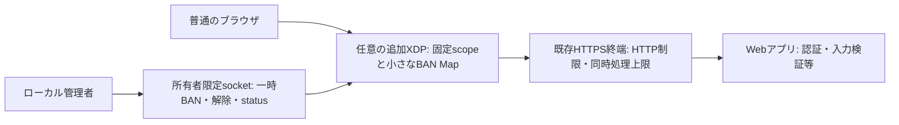

# 小規模公開サイト向け: 状態と掃除を制限する最小案

> 実装への更新（2026-10-24）: ユーザーが再起動時のBAN消去を採用したため、別binaryで実装し、隔離Linux受入れまで実施しました。[実装・操作・検証記録](2026-10-24-LOCAL-EPHEMERAL-BAN-IMPLEMENTATION.md)を参照してください。以下は実装前に合意した設計記録です。

2026-10-24。普通のブラウザから利用する公開サイトに用途を固定した、実装前の設計案。製品コード・設定・試験を変更していない。

## 結論

**基礎防御は既存のHTTPS終端・HTTP側制限・firewallに置く。既存コードは、必要な場合だけ追加する、単一ホストの有限TTL付きIPv4遮断へ絞る。**
BFT、P2P、独自パケット暗号、パケット再構築、全送信元IPの学習を初期構成に入れない。
既存防御で足りる場合は追加agentを導入しない。それも有効な採否とする。

最終ゴールは安全に運用・復旧できる無償OSS。今回の完了条件は、対象用途、状態量/処理量の上限、満杯/停止時の動作、保証変更と導入ゲートを示すこと。
本書は候補設計の採用を支持するが、実装・配備開始や現行BFTの廃止を決定しない。

## 対象を固定する

- 1運用主体、1 Linuxホスト、1つの専用サービス入口。IP/portを他の独立サイトと共有する場合、XDPはHTTP hostnameやpathごとの遮断を区別できない。
- ブラウザ・HTTP/TLSの通信形式は変えない。Web利用者へ専用クライアント・鍵・token付加を要求しない。
- 追加XDPの初期対象は、実送信元IPv4が直接見える、宣言した宛先IPv4/TCP portだけ。80/443等は実際の公開構成に合わせて明示する。
- UDP/HTTP3、IPv6、VLAN、fragment、L7のURL/ユーザー単位制御はこのXDP版の保護対象外。基礎防御で扱い、通過を「保護済み」と数えない。
- CDNや別hostのproxy経由では、originのXDPに見えるのは中継元。そのIPを利用者の代わりにBANしない。その構成では利用者への制限をCDN/HTTP終端側で行い、初期の利用者IP向けXDP BANは無効にする。
- 同一hostでHTTPSを終端する通常reverse proxyの場合は、その手前の物理入口に実送信元が見えるかを確認する。HTTP headerだけを根拠にXDPの送信元IPを決めない。

CDN構成では利用者の制御を前段で行うため、この図の利用者IP向けXDPは採用しない。
大容量DDoSでorigin回線が飽和する場合、host内XDPだけでは解決できず、上流での対処が必要。

## 最小案で明示的に変える保証

**推奨する最小profileは、一時BANを永続化せず、daemon再起動時に空で開始する。**
これにより、追加BANの更新/掃除にWAL・fsync・compactionを持ち込まない。
これは現行BFTの保存を省略する修正ではなく、「分散投票を行わない、再起動をまたがない追加防御」という別の契約である。

| 項目 | 最小profileの契約 |
| --- | --- |
| 再起動・host停止 | 追加BANは消える。自動再発行・旧fileからの復活はしない |
| 基礎防御 | HTTPS終端、既存firewall、HTTP側制限はagentとは別に維持 |
| 管理権限 | 管理者のローカル操作のみ。通常Web要求はpolicyを作れない |
| 永続監査 | durableな監査履歴を保証しない。必要なら別要件として扱う |
| 遠隔policy | 初期版は受け取らない。過去の署名policy/QC/RPCを互換入力として扱わない |
| node侵害 | rootに侵害されたそのhostは守れない。他hostへの更新経路は持たない |

再起動後もBANを維持することが必須なら、このprofileは不適合。その場合は[署名policy/永続復旧の案](2026-10-24-POLICY-AUTHORITY-AND-MIGRATION-DESIGN.md)を選び、保存待ちの責任も引き受ける。
旧BFTで必要な投票前永続化、旧WALの欠損拒否や復旧規則はそのまま保全する。

期限は単一hostのCLOCK_BOOTTIMEでchecked加算して固定する。kernelも同じboot clockで満了を判定し、daemon停止中も期限後はこの追加BANでDROPしない。
このprofileはUTC署名期限を他hostへ渡さず、再起動時の期限復元も行わないため、ローカルの期間管理にNTPを使う必要はない。boot clock取得不能・time namespace不整合なら新BANを拒否する。
UTC品質/署名backdateを変更した比較結果を現行方式の性能改善とは呼ばない。比較試験では同じ絶対の終了条件を与え、TTLや既存試験期限の延長で合格にしない。

## 状態と1回の仕事量の上限案

以下の新しい値は、処理能力の実測値や保証時間ではなく、実装に持たせる制約の提案。

| 対象 | 上限案 | 満杯・失敗時 |
| --- | --- | --- |
| ユーザー空間のBAN slot | 固定256 slot。activeと削除未確認のexpiredを合計して数える | 新規IPのBANはCAPACITYで拒否。既存の有効BANを追い出さない |
| kernel BAN Map | 既存物理上限4096 entryを流用。新agentが所有・追跡するentryは256以下 | load時の実上限と空Mapを確認。root等による別writerは契約外 |
| service scope | 初期profileの固定サービス入口だけ | 想定外scopeを受け付けない |
| 掃除 | 200 msごとに最大16 slot検査、最大16回のMap削除。cursorで巡回 | delete失敗slotは保持して後の巡回で再試行。無限retry loopをしない |
| missed timer | Skip。停止時間分をまとめて取り戻さない | 再開時に掃除が集中しない |
| 通常control同時処理 | 最大8。requestは固定長の小さい命令、読取り期限2秒。listen backlogも有限値に固定 | 過剰接続は拒否。無制限task/queueを作らない |
| 緊急制御 | 通常枠と別の専用1枠 | 通常のslow readerで全枠を占有されない。kernel操作の時間保証は別 |
| mutation | 同時1件、待ちqueue 0。初期案では最大5変更/秒・burst 1 | BUSY/RATE_LIMITで返す。自動再送しない |
| 手動BAN/解除の検索 | 最大256 slotのメモリ検査 | 同期的に期限切れ全件をkernelから消して場所を作る処理はしない |
| 直近イベント表示 | 固定64件のRAM ring | 古い診断イベントのみ上書き。BAN slotのLRU evictionはしない |
| packet統計 | 既存の固定per-CPU counter | 送信元IP別に無制限の統計Mapを作らない |

256 slotを16ずつ巡回するため、timerが予定どおり動けば1巡は3.2秒。これはslot回収の目安であり、BAN失効の遅延ではない。
**期限判定はkernel側で行うため、slotが残っていても満了後はそのBANでDROPしない。**
OS停止、scheduler遅延、BPF syscallの長い待ちまでは、この件数制約で時間保証できない。
delete失敗が続けば利用可能slotは減り、満杯時の新規BANは拒否される。既存の未失効BANを勝手に捨てて見かけ上回復させない。

各slotはIP、固定したboot期限、状態等だけを保持する。初期版では管理命令が少ないため、別の可変IP indexを設けず、管理時に最大256 slotを検索する案とする。
期限切れslotを空にするだけで、可変長の履歴やtombstoneを追記しない。policy file、期限ごとのfsync、VACUUMはこのprofileに存在しない。
control用のsocket名とruntime directoryもprofileごとの固定個数とし、起動ごとにhomeへ新しい証拠directory/socketを作る試験方式を製品運用へ流用しない。
終了時の回収は自分が作ったsocketの所有関係を確認して行う。staleな対象の所有関係が不明なら起動拒否し、別名を無制限に生成して迂回しない。
key/valueのサイズだけを総メモリ使用量と呼ばない。kernel hash管理領域、preallocation、per-CPU counter、runtime/socket等の分も含めた実メモリ上限は実装後に測る。

パケットはMapを参照して判定し、未知の送信元だからといってentryを作らない。
したがって、多数の異なる送信元IPからpacketを送るだけでは、このBAN表のslotは増えない。ただしCPU/帯域消費の攻撃は残る。

## 掃除と解除の安全規則

1. 1プロセスがMapの唯一のownerとして、insert/deleteとslot変更を直列化する。
2. BANは管理権限・scope・保護IP・正の有限TTL・容量を検証する。kernel書込み前にslotを予約し、不明な結果も追跡する。kernel更新に成功してからAPPLIEDを返す。TTL上限は現行24時間を上限とし、初期の運用TTLはサービス条件に合わせて別途決める。
3. 解除や掃除では、kernelからの削除成功または既に存在しないことを確認してからslotを空にする。失敗時は追跡を失わずDEGRADEDとする。
4. 再試行で満了をnow+TTLへ戻さない。変更を再要求するのは明示的な新操作として扱う。応答不明時はstatusを照会し、自動で再BANしない。
5. controlは起動ごとのinstance IDと管理操作の単調revisionを持つ。命令にexpected revisionを必須とし、不一致や古いinstanceを拒否する。解除後に古いBAN命令を再送しても通さない。結果不明の命令でrevisionを勝手に取り直して再送しない。固定長のinstance/revisionを使い、request IDを永遠に蓄積しない。counter overflowは拒否する。再起動した旧queueや旧署名commandは読み込まない。
6. 起動時は新しい空Map/所有linkから開始する。scope・保護IPを確認できない場合は装着しない。古いpin済みMapを無条件に再利用しない。
7. emergency bypassはBAN処理の待ちqueueに入れない。既存の長いConsensusState lockから分離する。独立復旧は保存停止/Map異常等で実測するまで保証しない。

一時BANの喪失を許すことによりdiskの再送履歴は不要にできるが、所有者認証、管理操作の競合、満杯、Map失敗は依然として扱う。
再起動して管理者が同じIPを明示的に再BANすることと、旧データが勝手に復活することを区別する。

## 基礎防御側の上限も必要

追加agentだけを制限しても、Webサイト全体の状態量を保証したことにはならない。
TLS接続、HTTP同時処理、upstream待ちqueue、body size、timeout、ログ保存量は既存serverで別に制限する。

- 最初はサービス全体や重いpath単位のHTTP制限を使い、外部から来た任意の値を新しい管理keyにしない。
- IP単位制限を使うなら固定容量zoneを使い、満杯時の処理を確認する。NGINXのlimit_reqは有限zoneで、容量枯渇時にLRU stateを除去し、それでも作成できなければ要求をerrorで終了する。BAN表の未失効entryのevictionとは目的が異なる。
- rate/同時接続数の具体値はアプリの処理能力と正常利用を測って決める。現在は未決定であり、任意のrpsを「小規模」の根拠にしない。
- IP単位制限は共有NATの利用者をまとめて扱う。誤遮断があり得るので、認証済み利用者やpath単位の扱いはHTTP側で判断する。
- packetごとのログは出さない。追加agentの履歴はRAM ringを基本とする。既存bridgeのper-update info出力はそのまま流用せず、必要な集計/エラーに制限する。外部journalやWeb access logの保持量も導入前に確認する。
- 署名されたWeb観測やheaderは攻撃性の証明ではない。初期版はログからの自動BAN投入を行わず、管理者が対象と期限を選ぶ。

## 既存コードから残すものと分けるもの

| 部品 | 活用 | 変更が必要な境界 |
| --- | --- | --- |
| PeerPolicyとC/RustのXDP判定 | 有限boot期限・固定Map・scope・counter | 既存4096物理capと新256管理capを混同しない |
| SecurityPolicyGuard | 無期限BAN拒否、保護IP、入力検証 | membership由来の管理IP保護を独立設定へ移す |
| CLOCK_BOOTTIME/namespace確認 | ローカルの固定期限 | UTC署名leaseの処理や復元をこのprofileへ持ち込まない |
| owner-only Unix socket | 所有者認証、接続数と入力読取りの制限 | ConsensusState依存を小さなLocalPolicyEngineへ分ける |
| EbpfBridge | Map挿入・解除・bypass・counter | 現行load経路はLSMも試すため、XDP専用経路を分ける。LSM/秘密消去機能は初期用途に入れない |
| BFT・署名承認・FileWal | 既存backendと証拠として保全 | 初期の一時ローカルprofileへ選挙・QUIC・投票・WALを持ち込まない |

既存コードの数値やtimerを一部再利用しても、本書のbounded掃除や非永続profileが既に実装されているわけではない。
現行expire_stale_policiesは全期限を調べexpiredをcollectして処理するため、新しい16 slot/step制約にはそのまま使えない。

## 導入限界と実装後の受入条件

**この構成は、少数の分かった送信元を短時間抑える追加手段。大規模DDoS、分散bot、Webの脆弱性対策を単独で担わない。**
XDPは同じIP/port上のURLやユーザーを区別できず、HTTPS payloadもこの判定では見ない。
public serviceがCDN越し、IPv6必須、hostname別に分離必須なら、利用者向けの制限は対応するHTTP/前段で行う。

実装後に必要な確認:

1. 256件満杯でも状態量が増えず、新規BANを拒否し、既存の有効BANを維持する。
2. 全slot同時満了でも、1 stepの検査/削除は16以下。daemonを停止してもkernel期限で追加DROPが終わる。
3. 未知IPの大量packetで新しいBAN stateやログが作られない。通常Web通信とscope外への影響を測る。
4. delete/insert失敗、control過多、slow reader、応答不明、古いinstance命令で成功の誤報や期限延長がない。
5. 再起動でBANは消え、旧WAL・署名file・pin済みMapから復活しない。基礎防御は別途残る。
6. 所有者がbypass/停止/通信回復を確認できる。XDP ownerの終了要求だけを復旧完了と数えない。
7. TLS/HTTP/connection/logの別上限と、正常なブラウザでの実サービス疎通を確認する。

まだ未実装・未測定なので、件数の上限をCPU時間や「タイムアウトなし」の保証へ読み替えない。
既存防御と比べて効果が確認できなければ、追加agentを本番経路へ入れない。

## 次の判断

候補としては本書の非永続・ローカル一時BANを推奨する。その際に受け入れる必要がある主要な保証変更は、**agent再起動で追加BANが消えること**。
この変更を受け入れない場合は永続profileへ戻る。現行BFTの保存条件を部分的に無効化して代用しない。
最初の導入先、CDN有無、実送信元、基礎防御、運用担当は未決定。これらが確定するまで実サービスへの配備可とは判定しない。

## 根拠

- [既存XDPの固定Mapとkernel期限](../../veil-ebpf/src/veil_xdp_kern.c#L65)、[既存の論理256件上限](../../veil-node/src/domain/checkpoint.rs#L7)
- [全件型の現行期限掃除](../../veil-node/src/usecase/consensus_engine.rs#L1771)、[owner限定controlと8接続](../../veil-node/src/infra/local_control.rs#L44)
- [既存Map操作](../../veil-node/src/ebpf_bridge.rs#L197)、[LSMも含む現行load経路](../../veil-node/src/ebpf_bridge.rs#L160)
- [Linux hash map上限・preallocation・LRU](https://docs.kernel.org/bpf/map_hash.html)
- [NGINX HTTP rate limitと有限zone](https://nginx.org/en/docs/http/ngx_http_limit_req_module.html)、[trusted proxyのreal IP処理](https://nginx.org/en/docs/http/ngx_http_realip_module.html)
- [Cloudflareの元利用者IP headerとorigin認証](https://developers.cloudflare.com/fundamentals/reference/http-headers/#cf-connecting-ip)
