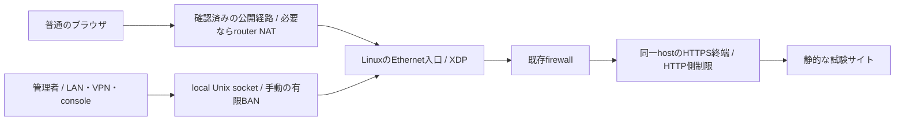

# 小規模公開サイトの最小構成・受入れ・復旧手順

2026-10-25 JST。**設計・読取り確認のみ。本番・新PC・DNS・router・firewallへの変更は行っていない。**
ユーザー回答: 新PCのOS・接続方法はこれから決める。公開URLも未決定。したがって具体的な本番tupleや保護IPは未確認で、配備判断はHOLD。

最終ゴールは小規模公開サイトで安全に試用できる無償OSS。現在の節目は、動作確認済みのlocal BANを実サイトへ載せるための条件を固めること。
今回は推奨構成、未確定項目、合否の決め方、戻し方をまとめる。サイトへ装着した、実IPを確定した、本番受入れが完了したとは報告しない。

## 結論と役割分担

**新PCを専用に使えるならUbuntu Server 26.04 LTS amd64を第一候補とし、mainnetから分離した静的HTTPS試験サイトを一つ用意する。pi-nodeは既知の回帰環境として保全する。**
公式に[26.04 LTSのamd64 Server install image](https://releases.ubuntu.com/26.04/)が提供されている。pi-nodeもUbuntu 26.04.1 LTS/x86_64なので、OS系列をそろえて検証差分を減らす判断。新NIC・driver・kernel条件の一致や性能を保証する選定ではない。
Windows等を普段使いする必要があれば既存OSを保全してLinux VMを第二候補とする。VMのvNICに本来の送信元が届くかの確認が増える。OS導入、disk初期化、VM作成、virtual switch変更は今回承認されていない。

| 対象 | 現状・役割 |
| --- | --- |
| pi-node | x86_64、4 logical CPU、約31GiB RAM。local BANの実kernel受入れは確認済み。性能不足で動いていない状態ではない |
| pi-nodeの実NIC | enp0s31f6、e1000e。現在のIPv4は192.168.1.100/24、default routeもこのNIC。XDP装着なし、tc ingress/egress filterなしを読取り確認。**この物理NICへの本番装着試験はしていない** |
| pi-nodeの公開用途 | mainnetの31401/31402/31403、SSH10023、WireGuard51820が稼働。80/443のhost待受は観測されず、nginx/caddy/apache2/cloudflaredのunitもnot-found。別namespaceやrouter側の全サービス不在を証明したものではない |
| 新PC | OS・disk状況・SSH・NIC・ネットワーク未確認。新たな隔離受入れ→LANのHTTPS確認→承認済み公開canaryの順で進める候補 |

新PCの価値はまず**mainnetと障害・設定変更の影響を切り離せること**。CPU性能を合格条件の代用にしない。新PCでも同じ256件・有限TTL・再起動消失の契約を検証する。

## 最小構成



- 1運用者、1host、1つの専用サービスtuple。初期の追加XDP対象はIPv4/TCP443だけ。ブラウザへ専用client/tokenを要求しない。
- 新しい専用subdomainを使用し、既存公開サイトやmainnetを流用しない。TLSはブラウザが信頼する証明書を用意する。lab用の自己署名証明書を本番用へ昇格させない。
- 同一hostでNGINX等がHTTPSを終端する単純な構成を優先。既存firewall・HTTP側の制限が基礎防御で、veilは追加防御。HTTP側のrequest rate制限には[NGINX標準module](https://nginx.org/en/docs/http/ngx_http_limit_req_module.html)等が使える。rate/burstは通常通信の観測から決め、未測定の性能値を保証しない。
- 初回の専用canaryはA recordとIPv4/TCPに範囲を限定する案。A-onlyだけでIPv6への直接到達を防げるとは限らないので、listen/firewallも照合する。UDP443/HTTP3、IPv6、fragment、VLAN等はこのbinaryの追加保護対象外。必要な経路があるなら基礎防御側で扱い、未対応経路を保護済みと数えない。
- TCP80のredirectやACMEは基礎防御側で扱う。現binaryは起動時に一つのscopeだけを登録するため、443と80を同時に守ったとはしない。同じNICに2 daemonを装着して代用もしない。
- 自動検知・自動BAN・P2P/BFT・独自暗号・BANの復元queueを初期構成に追加しない。公開試験は所有確認済みのcanary送信元一件への手動BANから開始する。
- 256は**同時BANの件数**。サイト利用者数の上限ではない。満杯時は新規BAN拒否、未失効entryの追出しなし。再起動では全BANが消える。

既存防御で十分、または回線帯域そのものが限界なら、この追加daemonを導入しない判断も採る。小規模を一律のPV/RPS値で定義せず、専用scope・運用可能性・基礎防御の実測で判断する。

## 入口・NIC・保護IPを確定する票

[未確定項目の票](../../artifacts/site-pilot-plan-a0to08k6/selection.json)は配備設定ではない。nullを仮の値で埋めたり、labの198.51.100.7を本番へコピーしたりしない。

| 項目 | 確認する内容・証拠 | 未確認時 |
| --- | --- | --- |
| 管理先 | 新PCのOS、対象diskの既存データ、SSH名、LAN/VPN経路、consoleへのアクセス | OS導入・配備しない |
| 公開入口 | 所有するFQDN、DNS A/AAAA、TLS終端位置、CDN/LB/router/転送経路、実到達先 | 配備HOLD |
| NIC | 実際に受信するEthernet/vNICの名前・driver・既存XDP/TC・MTU/encapsulation、現loaderでの装着/停止能力 | veth成功だけで合格にしない |
| service tuple | XDP位置で観測される宛先IPv4・TCP port。DNSのpublic IP、router変換後IP、Docker内部IPを区別する | daemon起動しない |
| 送信元 | 所有確認した外部canaryから低頻度に接続し、そのIPがL3の送信元として届くこと | headerのIPだけでBANしない |
| 保護IP | `--protected-ip`はBAN禁止の**送信元**IPv4。管理者の実egress、必要な監視等を確認する。`--destination`は守る宛先。宛先自身は自動的に除外される | 保護例外を推測しない |
| 例外形式 | 保護IPはexact IPv4で、CIDRを受け付けない。追加は最大255個。複数なら`--protected-ip`を繰返すunit案をレビューする。単一env変数へ空白区切りで詰め込まない | 必要な例外を表現できなければHOLD |
| 既存防御 | host firewallの有効rule、cloud/router ACL、HTTP制限、更新・TLS運用、monitor、ログ保存範囲 | 「active」の表示だけで合格にしない |

NIC名や宛先の構文が正しいだけでは、本来の入口に効くことを保証しない。現実装は指定宛先が本当にそのNICで受信されることまで起動時に証明しない。実際の通信tupleとcanaryで確認する。
管理用wg0をWebのXDP入口と取り違えない。programはEthernet frameを読むので、raw-IP tunnel等を同等と仮定しない。既存XDPがあれば置換・解除せず止める。

## 構成ごとの採否

| 構成 | 初回の扱い |
| --- | --- |
| 同一Linux hostでHTTPS終端、実client IPv4がNICで見える | 第一候補。tuple・NIC・復旧経路の確認後に限定試験 |
| RouterのDNAT、またはsourceを保持するL4 LB | 条件付き。外部clientでL3送信元と変換後tupleを実確認。CGNAT/port開放不可なら公開化を保留 |
| Docker publish | 初回は避ける。必要なら公開portとcontainer内部port、DNAT、forwarding、Docker用ruleを追加確認 |
| CDN・別hostのL7 proxy・outbound tunnel | originのXDPからclientの代わりにproxyをBANしない。利用者向け制限はCDN/HTTP側で行う |
| Windows等のLinux VM | guestのkernel/vNICで同じ隔離受入れを行い、public通信の実送信元が維持されることを確認。TCP proxy型の転送をsource保持と見なさない |
| 共有の443をhostname/pathごとに分離したい | このXDPでは分離できない。専用tupleかHTTP側の制御を選ぶ |

Dockerの[公式説明](https://docs.docker.com/engine/network/packet-filtering-firewalls/)では、公開container trafficとufwの処理経路に注意が必要とされる。pi-nodeはUFW activeだがDocker公開portがあり、DOCKER-USERは空だった。これはmainnetが脆弱だと断定する材料ではなく、「UFW activeだけでWeb入口の基礎防御を証明できない」という確認事項。
Cloudflareの[client IP header](https://developers.cloudflare.com/fundamentals/reference/http-headers/)やNGINXの[real IP処理](https://nginx.org/en/docs/http/ngx_http_realip_module.html)はHTTP側の情報であり、kernelが読むpacketのL3送信元を書き換えるものではない。既存CDNの無効化をこのagentのためだけに提案しない。

## 受入れの順序と中止条件

1. **新PCの準備:** 既存disk/OS保全を確認し、対象と戻し方への承認後にOS/SSHを準備。root filesystem・libc等の実行依存・kernel・systemd・NICを確認する。x86_64という一致だけでbinary互換と見なさない。
2. **同じ隔離受入れ:** 新PCで同じbinary/objectのhashと実行PIDを確認し、通信・256/257件・TTL・解除・normal/SIGKILL restart・権限破棄を同じ条件で検証する。pi-nodeでの成功を新PCの成功へ転記しない。失敗時は公開化せず原因を分ける。
3. **基礎Webのみ:** LANで静的HTTPSサイト、証明書、管理経路、必要なHTTP制限・firewallを確認。公開前にsourceとtuple、対象外サービス、業務上の合否基準と観測時間を確定する。globalなoffload/LSM/IPv6設定等を試験のために無断変更しない。
4. **変更承認:** 下表の対象とrollbackを具体化して承認を受ける。DNS、router/FW、証明書、unitの変更も含む。値が未確定のまま「配備一式」を包括承認にしない。
5. **空BANで実入口:** agent装着はBAN0でもpacket経路を変えるため、本番変更として扱う。独立した正常clientのHTTPS、証明書、対象外port、管理経路がbaselineと一致することを確認。
6. **公開canary一件:** 管理者とは別の、共有NATの他利用者を巻き込まない所有確認済みegressを使う。有限TTL30秒を試験入力案とし、承認時に確定。canaryの対象TCP443だけ遮断、独立clientと対象外経路は通信継続、drop counterとclient結果を両方確認する。
7. **解除と復帰:** unban、自然失効、同じinstance内でのbypass、承認したnormal restartによる新instance/BAN0、旧instanceの拒否を確認。256件満杯やSIGKILL/daemon pauseの障害注入は公開siteでは行わず、隔離受入れの証拠を使う。host rebootは別途承認。
8. **終了解除:** agentを停止し、XDP非装着・normal HTTPS・管理経路を再確認。試験終了時は停止・非enabledを原則とし、継続/enableは別の明示判断。旧BANや未完了queueを自動再投入しない。

中止条件は、想定外のsource/tuple、保護IP未確認、未知の既存XDP、canary以外の通信劣化、管理経路喪失、容量/状態の不明、基礎防御の変化、解除・停止で復帰しない場合。
unban/bypassの直前にもcanaryのBANが未失効で遮断中だと確認する。すでに自然失効した通信復帰を、手動解除やbypassの成功に数えない。結果不明のBANを盲目的に再送せず、status確認か停止へ進む。
性能の許容幅やSLOはsite基準から承認前に定める。未測定の「数ms」「何万RPS」や、試験を通すために緩めた期限を合格基準にしない。
packet payload/cookie/認証headerは収集しない。低頻度の所有client確認と必要なtuple/statusだけを記録し、既存ログの保持量も確認する。外部telemetryは追加しない。

## 復旧手順

以下のpathはproduction templateの予定値。実配備したhost/unit/UID/pathの所有・hashを確認してから使い、未確定値をそのまま実行しない。

1. **個別解除:** service UIDからstatusを読み、現在の`instance`と`revision`を使ってunbanする。

    ```sh
    sudo -u veil-local-ban /usr/libexec/veil-local-ban status \
      --control-dir /var/lib/veil-local-ban/primary --ip <CANARY_IPV4>
    sudo -u veil-local-ban /usr/libexec/veil-local-ban unban \
      --control-dir /var/lib/veil-local-ban/primary --ip <CANARY_IPV4> \
      --instance <INSTANCE> --expected-revision <REVISION>
    ```

2. **追加遮断全体のbypass:** normal経路が詰まっていても別のemergency socketを使う。statusの`control_revision`を指定する。BAN用の`revision`と取り違えない。

    ```sh
    sudo -u veil-local-ban /usr/libexec/veil-local-ban bypass \
      --control-dir /var/lib/veil-local-ban/primary --mode on \
      --instance <INSTANCE> --expected-revision <CONTROL_REVISION>
    ```

3. **daemonから独立した解除:** UDS応答が不明、またはbypassを確認できないときは、所有確認済みのunitを停止する。

    ```sh
    sudo systemctl stop veil-local-ban.service
    ```

    正常終了またはkillで所有FDが閉じてXDP linkが外れる契約を使う。`ip link ... xdp off`で未知のprogramまで強制解除しない。stop完了後に対象NICのXDP・HTTPS・管理経路を独立確認する。stop自体にも既存の待機時間があるので、即時復帰を無条件に約束しない。
4. **起動拒否/所有記録破損:** inspect-runtimeはread-only。未知fileを消さず、既存の[手動復旧手順](2026-10-24-LOCAL-BAN-MANUAL-RECOVERY.md)に従い、事前に用意した固定の空recoveryへ必要時だけ切り替える。古いprimaryと証拠は保全する。
5. **設定のrollback:** 承認対象として新設したunit/drop-in/有効化symlinkだけを照合して停止・disable/退避する。DNS/NAT/FW/Web設定も変更差分だけを戻す。ufw reset、rule全flush、共有Web server全停止、account DBの丸ごと復元はしない。削除は新規の所有確認済み対象を承認範囲に明記しておく。
6. **SSHが使えない:** consoleから同じunitを止める。host rebootやdisk再初期化を自動実行しない。必要なら別途、対象と影響を示して確認する。

## 本番変更の承認票に必要なもの

| 対象 | 具体化して承認する内容 |
| --- | --- |
| OS/disk | 対象device/既存データ/backup/既存OSへの戻し方。未確認のdiskを上書きしない |
| binary/object | source版とSHA、配置先/usr/libexec/veil-local-ban・/usr/lib/veil-local-ban/veil_xdp_kern.o、既存fileの有無と退避方法 |
| account/state | 新規専用user/groupの作成範囲、/var/lib/veil-local-ban/{primary,recovery}の新設と権限。既存物は流用・再帰chownしない |
| unit/config | /etc/veil-local-ban/service.conf、/etc/systemd/system/veil-local-ban.service等、確定NIC/tuple/保護IP。enable時は作成・除去するsymlinkも明記 |
| Web/TLS | 新規FQDN/vhost/証明書、秘密keyの保管方法、基礎制限、test/reloadとrollback。既存siteの証明書/設定を巻き戻さない |
| 公開経路 | DNS record、router/cloud FW/NATの正確な差分、管理経路、controlled canary、公開時間帯。NATや新virtual switchの影響も含める |
| 受入れ/復旧 | canary IP、実ingress tuple、許容影響、停止判定、console担当、rollback確認。終了後の停止・非enabled |

本書の推奨はOS導入・本番配備への承認を代行しない。現在は新PCのOS/接続が未準備なので、次の具体化は既存diskの保全確認とOS導入計画。その後、NIC・公開FQDN・実保護IPを埋めて配備票をレビューする。

## 証拠

- private: `artifacts/site-pilot-plan-a0to08k6/pi-node-readonly-inventory.json`、selection.json、source-reviewed-sha256.json。
- 既存の[新binary実kernel受入れ](2026-10-25-REBUILT-LOCAL-BAN-KERNEL-ACCEPTANCE.md)と[Nix/build復旧](2026-10-25-NIX-BUILD-RECOVERY.md)。
- 本番のDNS・router・新PCのNIC・Web設定は未確認であり、実測と記載しない。
